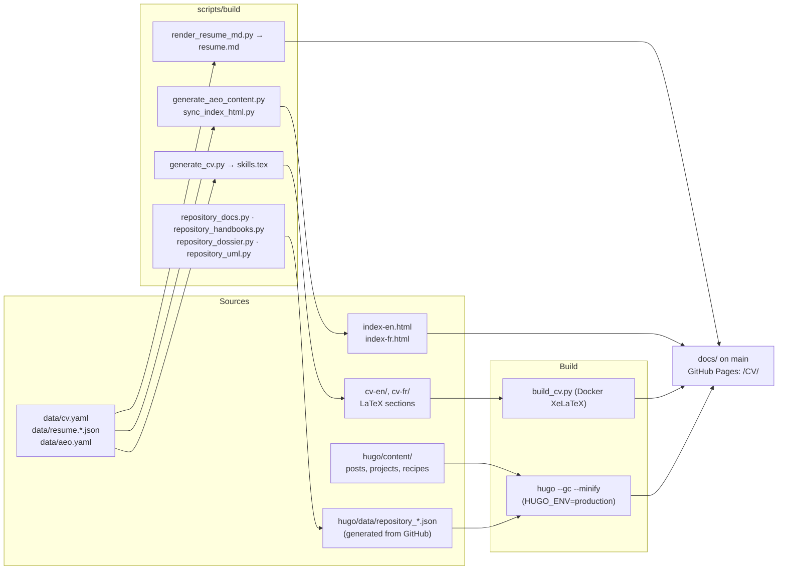

# Antoine Boucher — CV, blog and project documentation

Source for [antoineboucher.info/CV](https://antoineboucher.info/CV/): a bilingual (EN/FR) résumé as static HTML, LaTeX PDFs and machine-readable JSON, plus a Hugo blog with articles and a documentation page for every public repository.

[](https://github.com/antoinebou12/CV/actions/workflows/quality.yml)
[](https://github.com/antoinebou12/CV/actions/workflows/lighthouse.yml)
[](https://github.com/antoinebou12/CV/actions/workflows/compile-cv.yml)

## What is published

| Surface | URL | Source |
| --- | --- | --- |
| CV (HTML, EN default) | `/CV/index-en.html`, `/CV/index-fr.html` | `index-en.html`, `index-fr.html` (canonical), `index.html` synced from EN |
| CV (PDF) | `/CV/cv-en/resume.pdf`, `/CV/cv-fr/resume.pdf` | `cv-en/`, `cv-fr/` (LaTeX, Russell class) |
| Machine-readable résumé | `/CV/resume.json`, `/CV/resume.md` (+ `-fr`) | `data/resume.en.json`, `data/resume.fr.json` |
| Blog and project pages | `/CV/blog/`, `/CV/blog/fr/` | `hugo/` (Paper theme + custom layouts) |
| Markdown twin of every blog page | append `index.md` to any blog URL | `hugo/layouts/_default/*.context.md` |
| Agent discovery | `/CV/llms.txt`, `/CV/llms-full.txt`, `/CV/robots.txt`, `/CV/sitemap.xml` | `hugo/layouts/index.llms*.txt`, `hugo/layouts/_default/sitemap.xml`, `scripts/deploy/merge_root_sitemap.py` |
| GitHub stars by theme | `/CV/blog/stars/` (once generated) | `scripts/build/fetch_github_stars.py` → `hugo/data/github_stars.json` |

## How the pieces fit



The CV hero and the blog share one visual spine: tokens in `design/tokens.json` are synced into `css/design-tokens.css` and `hugo/assets/design-tokens.css` by `scripts/build/sync_design_tokens.py`. Fonts are self-hosted in `css/fonts/` (`scripts/build/fetch_fonts.py`).

## Quick start

Prerequisites: Python 3.13+, Node 22+, Hugo extended 0.160.1, Docker (LaTeX only), Git with submodules (`git submodule update --init --recursive` for the Paper theme).

```bash
pip install -r requirements-ci.txt
```

Build the blog and preview it with the CV:

```bash
cd hugo && hugo server -D
```

Build the CV PDFs (Docker image with XeLaTeX):

```bash
python build_cv.py build --all
```

Build the whole production site into a staging copy and validate it (writes `docs/`):

```bash
python scripts/deploy/publish_site.py
```

Publishing is a local step: `python scripts/deploy/publish_site.py --publish` commits `docs/` and pushes `main`. GitHub Pages serves `main` from `/docs`. See [docs/development/local-publishing.md](docs/development/local-publishing.md).

## Repository map

```text
CV/
├── index-en.html, index-fr.html   # Canonical CV pages (index.html is synced from EN)
├── css/, js/, images/             # CV styles, interactions, logos, self-hosted fonts (css/fonts)
├── cv-en/, cv-fr/                 # LaTeX CV (resume.tex + latex/*.tex, fonts/, russell.cls)
├── letters/                       # Cover letters (LaTeX, EN/FR)
├── data/                          # cv.yaml, resume.*.json, aeo.yaml, schemas
├── design/tokens.json             # Shared design tokens (CV + blog)
├── hugo/                          # Blog: content/, layouts/, assets/, data/, i18n/, static/
│   ├── content/posts/             # Articles (bilingual page bundles, translationKey)
│   ├── content/projects/notes/    # One documentation page per public repository
│   ├── data/repository_*.json     # Source-backed facts extracted from each repository
│   └── layouts/                   # Templates, partials, shortcodes, Markdown output formats
├── scripts/                       # build/, html/, verify/, deploy/, ci/, tests/ (see scripts/README.md)
├── tools/ux-audit/                # Playwright suites (e2e/, tests/, unit/) and helpers
├── docs/                          # Published site (GitHub Pages) + development documentation
├── .github/workflows/             # quality, lighthouse, compile-cv, link-check, repository-documentation
├── build_cv.py                    # LaTeX build driver (Docker)
└── lighthouserc.json              # Lighthouse CI thresholds and audited URLs
```

## Project documentation pages

Each public repository gets a bilingual page under `hugo/content/projects/notes/<slug>/` rendered by the `repository-note` shortcode from data in `hugo/data/`:

| File | Content |
| --- | --- |
| `repository_notes.json` | Introduction, components, architecture nodes and edges, limits, source files |
| `repository_analysis.json` | GitHub Linguist bytes, installation commands, types, manifests |
| `repository_handbooks.json` | README chapters and documents |
| `repository_profiles.json` | Technology badges, Compose services, Docker commands, workflow steps |
| `repository_api_guides.json` | Endpoints and access rules found in handlers |
| `repository_dossiers.json`, `repository_uml.json` | Dependency manifests, tests, coverage, C4-style diagrams |

The page order is fixed (title, badges, languages, overview, getting started, README excerpts, features, architecture, workflow, API, deployment, algorithm, structure, limits, sources). Rules for editing these pages live in `.cursor/skills/project-docs/SKILL.md` and `PRODUCT.md`; facts not present in the data files are not added by hand. Refresh the data with the *Repository documentation* workflow or `python scripts/build/repository_docs.py` and friends (see `docs/development/repository-articles.md`).

## Stars page

`python scripts/build/fetch_github_stars.py` reads the account's starred repositories through an authenticated `gh` session, groups them by theme (topics, language, description keywords) and writes `hugo/data/github_stars.json` plus the `hugo/content/stars/` section. The header pill and the llms.txt entry appear only when that data exists; rerun the script to refresh.

## Checks

| Check | Command | Where it runs |
| --- | --- | --- |
| CV data schema, EN/FR parity, generated LaTeX | `python scripts/verify/validate_cv_data.py`, `check_en_fr_parity.py`, `scripts/build/generate_cv.py --check` | `quality.yml` |
| Spelling (advisory), html-validate | `python scripts/ci/spellcheck.py`, `npx html-validate …` | `quality.yml` |
| Project note structure | `CV_NOTES_SITE=hugo/public node --test scripts/verify/repository-notes.test.mjs` | `quality.yml` |
| Frontend behaviour (Playwright) | `cd tools/ux-audit && node scripts/run-local-e2e.mjs e2e/enhancements.spec.ts` | `quality.yml` |
| Lighthouse (CV + blog pages) | `lighthouserc.json` | `lighthouse.yml` |
| Links | Lychee, advisory | `link-check.yml`, `compile-cv.yml` |
| Deploy artifact | `python scripts/verify/verify_deploy_build.py` | `publish_site.py` |

Windows helpers: `scripts/ci/run-tests.ps1`, `scripts/ci/test-pipeline-local.ps1`, `scripts/ci/run-act.ps1`.

## Documentation

- [docs/development/](docs/development/README.md) — CV compilation, GitHub Actions, Hugo navigation, local publishing, AEO tracker, project architecture views, repository articles, editorial design
- [docs/setup/](docs/setup/README.md), [docs/deployment/](docs/deployment/README.md), [docs/infrastructure/](docs/infrastructure/README.md)
- [DESIGN.md](DESIGN.md) — documentation shell tokens; [PRODUCT.md](PRODUCT.md) — purpose and rules of the project pages; [AGENTS.md](AGENTS.md) — conventions for automated edits
- [scripts/README.md](scripts/README.md) — script folders and common commands

## License

MIT — see [LICENSE](LICENSE). Fonts (Fraunces, Open Sans) are distributed under the SIL Open Font License.
