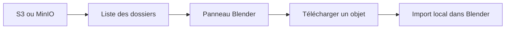

# Mon fork bloc : parcourir S3 et MinIO depuis Blender

> Lecture de mon fork de stockage cloud pour Blender : connexions multiples, dossiers, recherche approximative et import de maillages.

- Page HTML: https://antoineboucher.info/CV/blog/fr/posts/bloc-blender-cloud-storage/
- Langue: fr
- Traduction (en): https://antoineboucher.info/CV/blog/posts/bloc-blender-cloud-storage/index.md
- Publié: 2026-10-23
- Mis à jour: 2026-10-23
- Tags: Blender, Python, S3, MinIO, Open Source
- Auteur: Antoine Boucher (https://antoineboucher.info/CV/index-en.html)Mon dépôt [`bloc`](https://github.com/antoinebou12/bloc) est un fork de [MrKuros/Blender-Cloud-Storage](https://github.com/MrKuros/Blender-Cloud-Storage). Il conserve le crédit de l’auteur d’origine et explore un panneau Blender pour parcourir des ressources dans AWS S3 et MinIO.

## Parcourir et importer suivent deux chemins

La liste construit l’arborescence du panneau; le chargement récupère les octets et appelle un importateur local. L’actualisation peut donc réussir alors qu’un format non pris en charge bloque l’import. Le rafraîchissement en arrière-plan transmet les changements d’interface par les timers Blender.

[Lire la note d’architecture et ses frontières de connexion et d’import](https://antoineboucher.info/CV/blog/fr/projects/notes/bloc/).

## Choisir la connexion

[`addon.py`](https://github.com/antoinebou12/bloc/blob/main/addon.py) définit un groupe de propriétés `CloudConnection` avec fournisseur, point d’accès, bucket et région. Les préférences contiennent plusieurs connexions et l’index de celle qui est active. L’initialisation choisit ensuite le client S3 ou MinIO correspondant.

C’est ce qui m’intéresse à la rencontre de l’infographie et de la plateforme : l’artiste reste dans Blender, tandis que l’extension traduit ses actions en opérations sur le stockage objet.

## Représenter les objets dans des dossiers

Le stockage objet utilise des clés. L’opérateur de rafraîchissement découpe ces clés sur `/` et construit un dictionnaire imbriqué pour le panneau. L’état des dossiers ouverts est conservé séparément. L’interface permet ainsi une navigation hiérarchique sans confondre ce stockage avec un système de fichiers local.

`CloudSearchManager` ajoute une recherche approximative avec RapidFuzz. Il compare noms et segments de chemins, privilégie les correspondances directes et propose des filtres pour les scènes, maillages, images et matériaux.

## Distinguer téléchargement et import

La fonction de téléchargement enregistre l’objet dans un chemin temporaire. L’opérateur de chargement choisit ensuite un importeur Blender pour STL, OBJ, PLY ou les variantes USD. Les autres extensions produisent un message d’erreur. Un transfert réussi ne suffit donc pas à confirmer l’import d’un objet utilisable.

L’opérateur d’envoi du fichier courant transmet le `.blend` sauvegardé. Le README parle aussi des dépendances, mais je vérifierais l’inclusion des textures et les chemins relatifs avant de l’utiliser pour déplacer une scène complète.

## Préciser la portée du fork

La [comparaison avec le dépôt d’origine](https://github.com/antoinebou12/bloc/compare/MrKuros:main...main) indiquait 10 commits d’avance et 5 de retard le 23 octobre 2026. Les changements concernent l’extension, ses métadonnées et le README. Cet historique ne signifie pas que le projet d’origine a accepté ces modifications.

Le code utilise également un seul appel S3 `list_objects_v2`. Les buckets qui dépassent une réponse nécessitent donc un travail de pagination. Ce sont les détails de fonctionnement que je souhaite garder visibles en reprenant ce projet.
