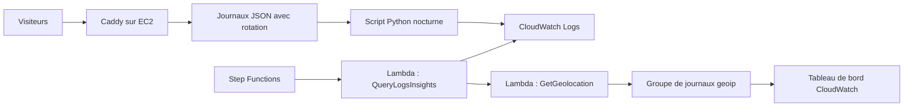

# Faire travailler ensemble Caddy, EC2, CloudWatch, Step Functions et Lambda

> Caddy sur une instance EC2 t4g.nano : journaux d’accès JSON, script Python nocturne vers CloudWatch, workflow Step Functions qui lance des Lambdas Logs Insights et de géolocalisation, et les corrections que je ferais aujourd’hui.

- Page HTML: https://antoineboucher.info/CV/blog/fr/posts/caddy-ec2-cloudwatch-lambda/
- Langue: fr
- Traduction (en): https://antoineboucher.info/CV/blog/posts/caddy-ec2-cloudwatch-lambda/index.md
- Publié: 2024-05-14
- Mis à jour: 2026-11-05
- Tags: AWS, Caddy, EC2, CloudWatch, Lambda, Step Functions
- Auteur: Antoine Boucher (https://antoineboucher.info/CV/index-en.html)J’utilisais déjà **Caddy** à la maison pour Home Assistant. Cet article en est la version **en bordure AWS** : une instance **EC2** `t4g.nano`, HTTPS automatique, des journaux d’accès JSON envoyés vers **CloudWatch** par un script Python nocturne, et un workflow **Step Functions** qui exécute deux fonctions **Lambda** sur ces journaux. Le but : une visibilité bon marché sur un reverse proxy personnel, pas une facture de tableau de bord SaaS.

## Avant EC2 : un tunnel entre un VPS et la maison

Mon premier reverse proxy public, vers 2021, était un petit VPS avec Caddy, relié à un serveur à la maison par un tunnel **WireGuard**. Caddy terminait le HTTPS sur le VPS, servait lui-même quelques sites et transmettait les autres à des services du serveur maison. Le montage suivait un [article public sur les tunnels de reverse proxy depuis un VPS](https://blog.fuzzymistborn.com/vps-reverse-proxy-tunnel/).

Les scripts étaient courts :

- installer WireGuard, générer la paire de clés de chaque côté sous `umask 077` et activer `wg-quick@wg0` ;
- sur le VPS, lancer des scripts d’aide NAT dans `PostUp` / `PostDown` ;
- sur le serveur maison, activer le routage IP et régler `PersistentKeepalive = 25` pour garder le tunnel ouvert à travers le NAT du routeur ;
- installer Caddy depuis son dépôt Debian officiel.

Deux leçons sont restées. D’abord, cela ne fonctionnait que pour des services HTTP : Caddy relaie du HTTP, donc un serveur de jeu en UDP comme Minecraft ne pouvait pas passer par lui. Ensuite, le bloc de journalisation écrit à l’époque (fichiers de 10 Mo, cinq conservés, sept jours) est celui que j’ai repris sur EC2 et que j’utilise encore. Les rôles Ansible commencés pour cette machine sont restés surtout des squelettes vides ; le playbook n’a jamais appliqué qu’un rôle `common` pour les paquets de base et sudo.

## Architecture



Le homelab m’a fait aimer l’ergonomie du **Caddyfile**. AWS m’a fait aimer payer quelques cents pour une instance nano quand le trafic reste à l’échelle personnelle.

## Étape 1 : EC2 et Caddy

- AMI : Amazon Linux 2023, Arm 64 bits, comme dans la capture ci-dessous.
- Instance : **`t4g.nano`** (2 vCPU, 0,5 Gio). La console l’affichait à 0,0042 $ l’heure à la demande, ce qui donne les « environ 0,10 $ par jour » de mes notes d’origine. Un `t2.micro` fonctionne aussi si vous êtes dans l’offre gratuite.
- Groupe de sécurité : **22, 80, 443**.


L’assistant de lancement ouvre SSH à `0.0.0.0/0` par défaut, et la console le signale dans la capture. Limitez le port 22 à votre propre adresse, ou supprimez-le et passez par Session Manager. Les ports 80 et 443 doivent rester ouverts : Caddy en a besoin pour les défis ACME HTTP et TLS-ALPN.

Installation, comme dans mes notes d’origine :

```bash
sudo yum update -y
sudo yum install -y yum-utils
sudo yum-config-manager --add-repo https://dl.cloudsmith.io/public/caddy/stable/rpm.repo
sudo yum install caddy -y
```

### Modèle de Caddyfile

Un snippet de journalisation par site, et un reverse proxy vers CloudFront ou un service local :

```caddyfile
{
  email you@example.com
  admin localhost:2019
  metrics
}
(log_site) {
  log {
    output file /home/ec2-user/caddy/logs/{args[0]}.log {
      roll_size 10mb
      roll_keep 5
      roll_keep_for 168h
    }
    format json {
      time_format iso8601
    }
    level INFO
  }
}
example.com www.example.com {
  import log_site example.com
  reverse_proxy https://your-origin.example {
    header_up Host {upstream_hostport}
  }
}
```

Trois changements par rapport à la version publiée au départ :

- **API d’administration sur localhost.** L’original utilisait `admin :2019`, qui écoute sur toutes les interfaces ; mon tableau plus bas devait alors conseiller de « verrouiller le groupe de sécurité ». La lier à `localhost` règle le problème. Les métriques Prometheus sont servies par l’API d’administration sur `/metrics` : collectez-les sur l’instance, ou exposez-les par un bloc de site distinct qui refuse tout `remote_ip` absent d’une liste autorisée. C’est ce que fait ma configuration actuelle.
- **`metrics` comme option globale.** L’original activait les métriques avec `servers { metrics }`. Ma configuration actuelle utilise plutôt l’option globale `metrics` ; vérifiez la forme attendue par votre version de Caddy.
- **`header_up Host` pour les origines HTTPS.** CloudFront et GitHub Pages choisissent le site d’après l’en-tête `Host`. Sans cette substitution, Caddy transmet le nom d’hôte du visiteur et l’origine ne le reconnaît pas.

`format json` avec des horodatages ISO 8601 fait de chaque ligne un objet JSON, ce qui compte pour les requêtes de l’étape 3.

Rechargez avec `sudo caddy reload`. La commande valide la nouvelle configuration et garde celle en cours si elle ne se charge pas.

## Étape 2 : CloudWatch sans se noyer dans les fichiers

Caddy écrit des journaux JSON avec rotation sous `/home/ec2-user/caddy/logs/`. Un petit script **boto3** lit chaque fichier et envoie ses lignes avec `put_log_events` vers un groupe de journaux nommé `reverse_proxy`, un flux par fichier, en créant le groupe et le flux la première fois qu’il les rencontre.

Planifiez-le avec **cron** la nuit pour que les sessions SSH de la journée restent tranquilles :

```cron
0 0 * * * /usr/bin/python3 /home/ec2-user/cloudwatch.py
```

Le script, tel que publié :

```python
import os
import boto3
from datetime import datetime

cloudwatch = boto3.client('logs', region_name='us-east-1')
log_group_name = 'reverse_proxy'
log_directory = "/home/ec2-user/caddy/logs"

def send_log_to_cloudwatch(log_stream_name, log_message):
    try:
        streams = cloudwatch.describe_log_streams(logGroupName=log_group_name, logStreamNamePrefix=log_stream_name)
        if not streams['logStreams']:
            cloudwatch.create_log_stream(logGroupName=log_group_name, logStreamName=log_stream_name)
        cloudwatch.put_log_events(
            logGroupName=log_group_name,
            logStreamName=log_stream_name,
            logEvents=[{
                'timestamp': int(datetime.now().timestamp() * 1000),
                'message': log_message
            }]
        )
    except Exception as e:
        print(f"Failed to send log to CloudWatch: {str(e)}")

for filename in os.listdir(log_directory):
    if filename.endswith(".log"):
        log_stream_name = filename[:-4]
        file_path = os.path.join(log_directory, filename)
        with open(file_path, 'r') as file:
            for line in file:
                send_log_to_cloudwatch(log_stream_name, line.strip())
```

Points à surveiller avec cette conception :

- **Regrouper les lignes.** Un appel `put_log_events` accepte jusqu’à 10 000 événements ; un appel par ligne, c’est surtout du temps réseau.
- **Garder la trace de ce qui est envoyé.** Si le script relit les fichiers entiers chaque nuit, les lignes encore présentes dans le fichier courant repartent une deuxième fois. Conservez une position par fichier, ou n’envoyez que les fichiers déjà passés par la rotation.
- **Attention à l’horloge.** L’entrée cron s’exécute à minuit dans le fuseau de l’instance, UTC sauf si vous l’avez changé.
- **Donner un rôle à l’instance**, plutôt que des clés d’accès sur le disque. Il lui faut `logs:CreateLogGroup`, `logs:CreateLogStream` et `logs:PutLogEvents` pour ce groupe.

## Étape 3 : Step Functions, Lambda et requêtes Insights

Le workflow enchaîne deux appels Lambda : **QueryLogsInsights** exécute une requête CloudWatch Logs Insights sur les journaux envoyés, puis **GetGeolocation** géolocalise les adresses obtenues.


**QueryLogsInsights** lance une requête Insights sur les dernières 24 heures, interroge `get_query_results` jusqu’à la fin (30 secondes au plus) et renvoie la liste des IP dans le corps de la réponse :

```python
import boto3
import json
import time
from datetime import datetime, timedelta

def lambda_handler(event, context):
    client = boto3.client('logs')
    query = """
    fields @timestamp, @message
    | parse @message /"remote_ip": "(?<remote_ip>[^"]+)"/
    | stats count() by remote_ip
    | sort remote_ip asc
    """
    start_query_response = client.start_query(
        logGroupName='reverse_proxy',
        startTime=int((datetime.now() - timedelta(days=1)).timestamp()),
        endTime=int(datetime.now().timestamp()),
        queryString=query
    )
    query_id = start_query_response['queryId']
    response = None
    max_wait_time = 30
    start_time = time.time()
    while response is None or response['status'] == 'Running':
        if time.time() - start_time > max_wait_time:
            raise TimeoutError("Query did not complete within the maximum wait time.")
        response = client.get_query_results(queryId=query_id)
        time.sleep(0.5)

    ip_addresses = []
    for result in response['results']:
        for field in result:
            if field['field'] == 'remote_ip':
                ip_addresses.append(field['value'])

    return {'statusCode': 200, 'body': json.dumps({'ip_addresses': ip_addresses})}
```

**GetGeolocation** reçoit ce corps, interroge [ipinfo.io](https://ipinfo.io/) pour chaque adresse et écrit un événement JSON par IP dans un groupe de journaux `geoip` :

```python
import json
import urllib3
import boto3
import time

def lambda_handler(event, context):
    ip_addresses = json.loads(event['body'])['ip_addresses']
    http = urllib3.PoolManager()
    results = []
    for ip in ip_addresses:
        response = http.request('GET', f"https://ipinfo.io/{ip}/json")
        data = json.loads(response.data.decode('utf-8'))
        results.append({
            'IP': ip,
            'Location': f"{data.get('city')}, {data.get('region')}, {data.get('country')}",
            'Coordinates': data.get('loc'),
            'Organization': data.get('org'),
            'Timezone': data.get('timezone')
        })

    log_client = boto3.client('logs')
    log_group_name = 'geoip'
    log_stream_name = 'geolocation_results'
    try:
        log_client.create_log_group(logGroupName=log_group_name)
    except log_client.exceptions.ResourceAlreadyExistsException:
        pass
    try:
        log_client.create_log_stream(logGroupName=log_group_name, logStreamName=log_stream_name)
    except log_client.exceptions.ResourceAlreadyExistsException:
        pass

    log_events = [{'timestamp': int(time.time() * 1000), 'message': json.dumps(r)} for r in results]
    batch_size = 10
    for i in range(0, len(log_events), batch_size):
        log_client.put_log_events(
            logGroupName=log_group_name,
            logStreamName=log_stream_name,
            logEvents=log_events[i:i + batch_size]
        )
    return {'statusCode': 200, 'body': json.dumps(results)}
```

Deux remarques sur ces fonctions. Le commentaire d’origine disait que `PutLogEvents` accepte dix événements à la fois ; la vraie limite est de 10 000 événements ou 1 Mo par appel, donc ce découpage ne fait qu’ajouter des requêtes. Et les appels à ipinfo.io partent l’un après l’autre, sans jeton : une longue liste d’IP peut atteindre la limite gratuite et le délai maximal de la Lambda.

La requête publiée au départ devait lister les adresses IP distinctes :

```sql
fields @message
| parse @message /"remote_ip": "(?<remote_ip>[^"]+)"/
| stats count_distinct(remote_ip) as unique_ip by remote_ip
| sort unique_ip desc
```

Elle contient un bogue visible dans la capture : regrouper par `remote_ip` puis compter les valeurs distinctes de `remote_ip` dans chaque groupe donne toujours 1.


Ce que je voulais vraiment, c’était le nombre de requêtes par adresse IP, et le nombre d’adresses distinctes :

```sql
fields @message
| parse @message /"remote_ip":\s*"(?<remote_ip>[^"]+)"/
| stats count(*) as requests by remote_ip
| sort requests desc
```

Pour le seul nombre d’adresses distinctes, utilisez `stats count_distinct(remote_ip) as unique_ips` sans `by`. Le `\s*` accepte à la fois `"remote_ip": "…"` et la forme compacte de Caddy, `"remote_ip":"…"`. Quand chaque événement est une ligne JSON brute de Caddy, Insights découvre aussi les champs JSON tout seul : `stats count(*) by request.remote_ip` fonctionne alors sans `parse`.

Les résultats de géolocalisation s’interrogent de la même façon :

```sql
fields @timestamp, @message
| parse @message /"IP": "(?<ip>[^"]+)", "Location": "(?<location>[^"]+)"/
| stats count() by ip, location
| sort count desc
```

Le tableau de bord les place à côté des métriques de requêtes et de taux d’erreurs 4xx/5xx, du CPU et du réseau de l’instance, et de la taille du bucket de stockage :


## Coûts et exploitation

| Choix | Compromis |
|-------|-----------|
| EC2 `t4g.nano` | Environ 0,10 $ par jour à la demande ; 0,5 Gio de RAM laisse peu de marge pour traiter les journaux sur la machine |
| Journaux en fichiers + script cron | Simple ; pas en temps réel, et il faut des positions pour éviter les doublons |
| Lambda + Step Functions | Paiement à l’exécution ; surveillez l’offre gratuite et le volume analysé par Insights |
| Administration et métriques Caddy | Lier l’administration à `localhost` ; n’exposer les métriques que par un site avec liste d’adresses autorisées |

## Quand ne pas utiliser cette pile

- Une bordure de production multi-locataire à fort trafic : utilisez un CDN ou un WAF géré.
- Un SIEM strictement temps réel : un envoi nocturne par lots est trop lent.
- Une équipe qui ne veut pas entretenir un serveur en SSH : envisagez Fargate avec un conteneur annexe pour les journaux.

## La suite

Mon reverse proxy actuel fait tourner Caddy dans Docker sur un VPS, provisionné avec Terraform et configuré avec Ansible. Je l’ai décrit dans [Mon reverse proxy : séparer provisionnement, configuration et vérifications](https://antoineboucher.info/CV/blog/fr/posts/reverse-proxy-infrastructure/). Il garde le même snippet de journalisation JSON par site, mais abandonne l’envoi vers CloudWatch : un playbook Ansible télécharge les journaux à la demande et un script Python en tire un rapport PDF.

Une leçon va dans l’autre sens. Sur EC2, les visiteurs se connectaient directement à Caddy, donc `remote_ip` était bien leur adresse. Dès que le proxy Cloudflare est placé devant, `remote_ip` désigne un serveur de bordure Cloudflare, tant que Caddy n’est pas configuré pour faire confiance aux plages de Cloudflare et lire `CF-Connecting-IP`. Toutes les requêtes par adresse IP de cet article en dépendent.

## Bilan

On peut obtenir une visibilité structurée sur un reverse proxy sans payer le prix de Datadog, si l’on accepte le délai du cron et un peu de code Python. Vérifiez que vos requêtes comptent bien ce que vous croyez.

## Articles liés

- [Lab réseau maison](https://antoineboucher.info/CV/blog/fr/posts/home-networking-evolution/) : là où Caddy a commencé pour moi
- [Mon reverse proxy : séparer provisionnement, configuration et vérifications](https://antoineboucher.info/CV/blog/fr/posts/reverse-proxy-infrastructure/)
- [Certification AWS Cloud Practitioner](https://antoineboucher.info/CV/blog/fr/posts/aws-certified-cloud-practitioner/)

---

*Publié à l’origine sur [Medium](https://medium.com/@antoine.boucher012/making-caddy-aws-ec2-cloudwatch-step-functions-and-lambda-work-together-creating-a-cheap-and-990fd0d9427d).*
