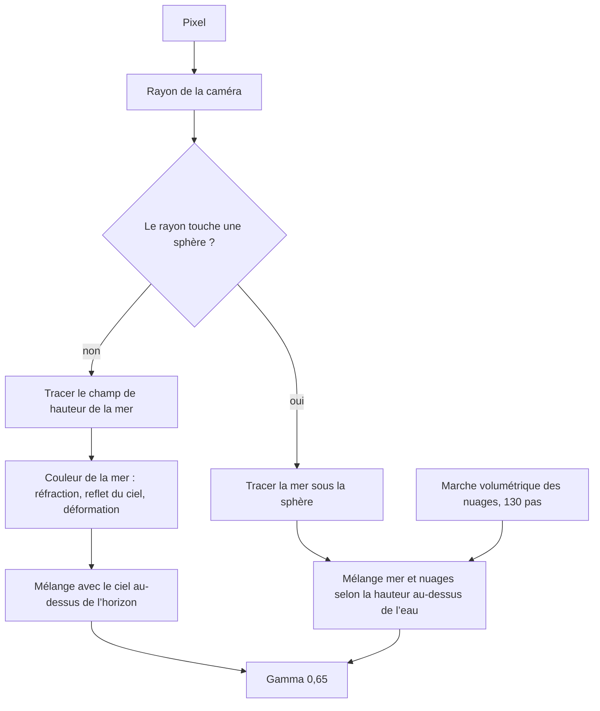

# Six shaders Shadertoy, lus ligne par ligne

> Lecture du code de six shaders GLSL publiés sur Shadertoy en 2024 : déformation de domaine, spirale, grille anticrénelée, mer, rayons de soleil et déformation à la souris.

- Page HTML: https://antoineboucher.info/CV/blog/fr/posts/shadertoy-six-shaders/
- Langue: fr
- Traduction (en): https://antoineboucher.info/CV/blog/posts/shadertoy-six-shaders/index.md
- Publié: 2026-11-06
- Mis à jour: 2026-11-06
- Tags: GLSL, Shadertoy, Shaders, Graphics, Procedural
- Auteur: Antoine Boucher (https://antoineboucher.info/CV/index-en.html)Entre janvier et février 2024, j’ai publié six shaders sur [Shadertoy](https://www.shadertoy.com/). Certains sont mes propres expériences, d’autres partent de shaders connus que j’ai modifiés pour comprendre leur fonctionnement. Cet article lit chacun ligne par ligne : ce que le code calcule, d’où viennent les idées, et où le code fait autre chose que ce que disent ses commentaires.

Chaque intégration démarre en pause, pour que la page n’exécute pas six shaders à la fois. Appuyez sur lecture pour en lancer un.

## Comment un shader Shadertoy s’exécute

Un shader d’image Shadertoy est une seule fonction, `mainImage`, que le GPU appelle une fois par pixel, à chaque image. Elle reçoit la position du pixel `fragCoord` et écrit une couleur dans `fragColor`. Quelques variables uniformes viennent de la page :

- `iResolution` : la taille du canevas en pixels.
- `iTime` : les secondes écoulées depuis le démarrage.
- `iMouse` : la position de la souris en pixels pendant qu’un bouton est enfoncé.

Dans un shader à une seule passe, aucun état n’est conservé entre les pixels ni entre les images. Tout ce qu’on voit est une fonction pure de la position du pixel, du temps et de la souris. La plus grande partie du code ci-dessous sert à transformer `fragCoord` en coordonnée utile, puis cette coordonnée en couleur.

## 1. Domain Wrapping

La technique s’appelle en général *domain warping*, ou déformation de domaine. Inigo Quilez la décrit dans son [article sur le warping](https://iquilezles.org/articles/warp/), et ce shader reprend l’exemple de mouvement brownien fractal du chapitre 13 de [The Book of Shaders](https://thebookofshaders.com/13/) de Patricio Gonzalez Vivo, avec ses couleurs.

### Bruit de valeur

```glsl
float random(vec2 co){
    return fract(sin(dot(co.xy, vec2(12.9898, 78.233))) * 43758.5453);
}

float noise(in vec2 _st) {
    vec2 i = floor(_st);
    vec2 f = fract(_st);

    float a = random(i);
    float b = random(i + vec2(1.0, 0.0));
    float c = random(i + vec2(0.0, 1.0));
    float d = random(i + vec2(1.0, 1.0));

    vec2 u = f * f * (3.0 - 2.0 * f);

    return mix(a, b, u.x) +
        (c - a) * u.y * (1.0 - u.x) +
        (d - b) * u.x * u.y;
}
```

`random` est le hachage classique en une ligne. Il multiplie un sinus par un grand nombre et garde la partie fractionnaire, ce qui donne une valeur entre 0 et 1 qui a l’air aléatoire mais reste la même pour une même entrée.

`noise` découpe le plan en cellules unitaires. `floor` donne la cellule et `fract` la position à l’intérieur. Chaque coin de la cellule reçoit une valeur aléatoire, et les quatre valeurs sont mélangées. Le poids du mélange est `u = f*f*(3 - 2f)`, la courbe cubique de smoothstep : la pente est nulle aux bords des cellules, qui se raccordent donc sans pli visible. La dernière expression est l’interpolation bilinéaire des quatre coins, écrite à la main.

### Mouvement brownien fractal

```glsl
float fbm(in vec2 _st) {
    float v = 0.0;
    float a = 0.5;
    vec2 shift = vec2(100.0);
    mat2 rot = mat2(cos(0.5), sin(0.5),
                    -sin(0.5), cos(0.50));
    for (int i = 0; i < 5; ++i) {
        v += a * noise(_st);
        _st = rot * _st * 2.0 + shift;
        a *= 0.5;
    }
    return v;
}
```

`fbm` additionne cinq couches de bruit, ou octaves. Chaque octave a deux fois la fréquence et la moitié de l’amplitude de la précédente, si bien que les grandes formes portent un détail fin. Avant chaque octave, la coordonnée tourne de 0,5 radian et se décale. Le bruit de valeur repose sur une grille carrée, et sans la rotation les lignes de la grille de chaque octave s’aligneraient en traînées horizontales et verticales.

### Déformer le domaine

```glsl
vec2 st = gl_FragCoord.xy / iResolution.xy * 3.0;

vec2 q = vec2(0.);
q.x = fbm( st + 0.00*iTime);
q.y = fbm( st + vec2(1.0));

vec2 r = vec2(0.);
r.x = fbm( st + 1.0*q + vec2(1.7,9.2)+ 0.15*iTime );
r.y = fbm( st + 1.0*q + vec2(8.3,2.8)+ 0.126*iTime);

float f = fbm(st+r);
```

C’est l’idée centrale. Au lieu de dessiner `fbm(st)`, le shader déforme la coordonnée d’entrée avec encore du bruit avant de l’échantillonner :

- `q` est un vecteur 2D de bruit, un `fbm` par composante, décalé pour que les deux composantes diffèrent.
- `r` est du bruit échantillonné en `st + q`, donc déjà déformé une fois. Le temps le fait bouger, à une vitesse légèrement différente sur chaque axe.
- `f = fbm(st + r)` est la valeur finale, donc au total `f = fbm(st + fbm(st + fbm(st)))`.

Chaque niveau d’imbrication plie davantage le motif, d’où les formes repliées et marbrées. Deux détails sont bons à savoir. `q` est multiplié par `0.00*iTime`, il ne bouge donc jamais et seul `r` est animé. Et la coordonnée est divisée par `iResolution.xy` sur les deux axes, si bien que le motif s’étire selon les proportions du canevas.

### Couleur

```glsl
color = mix(vec3(0.101961,0.619608,0.666667),
            vec3(0.666667,0.666667,0.498039),
            clamp((f*f)*4.0,0.0,1.0));
color = mix(color, vec3(0,0,0.164706), clamp(length(q),0.0,1.0));
color = mix(color, vec3(0.666667,1,1), clamp(length(r.x),0.0,1.0));

fragColor = vec4((f*f*f+.6*f*f+.5*f)*color,1.);
```

La couleur se construit en trois mélanges. La valeur finale `f` choisit entre sarcelle et kaki. Puis les valeurs intermédiaires la teintent : la longueur de `q` la tire vers un bleu marine foncé, et `r.x` vers un cyan pâle. Comme `q` et `r` ne varient pas comme `f`, les couleurs suivent les plis de la déformation et pas seulement sa luminosité. La dernière ligne multiplie par la courbe `f³ + 0.6f² + 0.5f`, qui assombrit les faibles valeurs plus vite que les fortes et ajoute du contraste.

## 2. Golden number spiral

Celui-ci montre bien un shader dont les commentaires promettent plus que le code. Voici la fonction de couleur :

```glsl
vec3 calculateColor(vec2 uv, float time) {
    float angle = time * 0.2;
    uv = mat2(cos(angle), -sin(angle), sin(angle), cos(angle)) * uv;

    float goldenAngle = radians(137.508);
    float r = length(uv) * 8.0;
    float theta = atan(uv.y, uv.x);

    float z = mod(r, 10.0);
    float phi = mod(theta, 2.0 * 3.14);

    float primeEffect = step(0.5, fract(sin(dot(uv, vec2(12.9898, 78.233))) * 43758.5453));
    primeEffect = smoothstep(0.45, 0.55, primeEffect);

    float oddEvenEffect = mod(r, 2.0);

    vec3 primeColor = mix(vec3(0.9, 1.0, 0.7), vec3(0.1, 0.0, 0.6), abs(sin(z) + cos(phi)));
    vec3 oddColor = vec3(0.7, 0.3, 0.5);
    vec3 evenColor = vec3(0.3, 0.5, 0.7);

    vec3 col;
    if (primeEffect == 1.0) {
        col = primeColor;
    } else if (oddEvenEffect == 0.0) {
        col = oddColor;
    } else {
        col = evenColor;
    }
    col *= primeEffect * 0.5 + 0.5;
    return col;
}
```

Ce qu’elle calcule réellement :

- **Coordonnées polaires.** `r` est la distance au centre et `theta` l’angle. Toute l’image tourne d’abord, mais d’un angle qui vient de la souris et non du temps : `mainImage` passe `iMouse.x / iResolution.x * 10` comme `time`.
- **L’angle d’or n’est jamais utilisé.** `goldenAngle` vaut 137,508°, mais aucune ligne ne le lit. La spirale du titre ne vient pas du nombre d’or.
- **Les points « premiers » sont du bruit aléatoire.** `primeEffect` hache la coordonnée et garde les valeurs au-dessus de 0,5, donc environ la moitié des points d’échantillonnage sont actifs, au hasard. Le `smoothstep` qui suit ne change rien, puisque son entrée vaut déjà 0 ou 1. Rien ici ne teste les nombres premiers.
- **La branche impaire ne s’exécute jamais.** `mod(r, 2.0)` est une valeur continue, presque jamais exactement `0.0`. En pratique, tout point qui n’est pas « premier » reçoit `evenColor`.
- **La structure visible vient de `primeColor`.** Elle mélange deux couleurs selon `abs(sin(z) + cos(phi))`. `sin(z)` dessine des anneaux autour du centre, et `cos(phi)` un dégradé autour du cercle. Leur somme atteint 2, donc `mix` dépasse sa deuxième couleur et pousse certains canaux hors de l’intervalle. Le mappage de tons plus bas les ramène.

L’image est donc un mélange aléatoire moitié-moitié de deux sortes de points : la moitié montre les anneaux et le dégradé angulaire à pleine intensité, l’autre moitié est un bleu uni à demi-intensité. C’est une texture intéressante, mais pas une spirale d’or. Une vraie spirale est un motif de [phyllotaxie](https://fr.wikipedia.org/wiki/Phyllotaxie) : le point numéro `n` se trouve à l’angle `n × 137,508°` et au rayon `c × sqrt(n)`. Pour la dessiner, un shader peut parcourir les `n` proches et garder la distance au point le plus proche. Ce serait la correction naturelle si je reviens à ce shader.

### Mappage de tons et suréchantillonnage

```glsl
vec3 aces_tonemap(vec3 color) {
    mat3 m1 = mat3(0.59719, 0.07600, 0.02840,
                   0.35458, 0.90834, 0.13383,
                   0.04823, 0.01566, 0.83777);
    mat3 m2 = mat3(1.60475, -0.10208, -0.00327,
                   -0.53108,  1.10813, -0.07276,
                   -0.07367, -0.00605,  1.07602);
    vec3 v = m1 * color;
    vec3 a = v * (v + 0.0245786) - 0.000090537;
    vec3 b = v * (0.983729 * v + 0.4329510) + 0.238081;
    return pow(clamp(m2 * (a / b), 0.0, 1.0), vec3(1.0 / 2.2));
}
```

C’est l’approximation très répandue du mappage de tons filmique ACES, par Stephen Hill, surtout connue par le projet [BakingLab](https://github.com/TheRealMJP/BakingLab) de Matt Pettineo. `m1` convertit la couleur dans l’espace de travail ACES, la fonction rationnelle `a / b` approche la courbe de réponse du film, et `m2` reconvertit. Le `pow(…, 1/2.2)` final est un encodage gamma pour l’écran.

```glsl
for (int i = 0; i < 9; i++) {
    vec2 ssCoord = fragCoord + offsets[i];
    vec2 uv = (ssCoord - 0.5 * iResolution.xy) / iResolution.y;
    uv *= 50.0 * iTime * 0.01;
    vec3 col = calculateColor(uv,(iMouse.x / iResolution.x) * 10.0);
    col = aces_tonemap(col);
    accumColor += vec4(col, 1.0);
}
fragColor = accumColor / 9.0;
```

`mainImage` échantillonne chaque pixel neuf fois sur une grille 3 × 3 de décalages sous-pixel et fait la moyenne. C’est du suréchantillonnage, utile ici à cause du zoom : `uv` est multiplié par `0.5 × iTime`, donc la vue recule en continu. Avec le temps, les anneaux deviennent plus fins qu’un pixel, et la moyenne de neuf échantillons évite le moiré. Les points aléatoires sont moyennés eux aussi, ce qui les transforme en un grain plus fin.

## 3. Grid Line

```glsl
void mainImage( out vec4 fragColor, in vec2 fragCoord )
{
    vec2 uv = fragCoord / iResolution.xy;
    float gridSize = 30.0 + 10.0 * (iMouse.x / iResolution.x);

    vec2 grid = abs(fract(uv * gridSize - 0.5) - 0.5) / fwidth(uv * gridSize);
    float line = 1.0 - min(grid.x, grid.y);

    vec3 bgCol = 0.5 + 0.5 * cos(iTime + uv.xyx + vec3(0, 2, 4));
    vec3 col = mix(bgCol, vec3(1.0, 0.8, 0.1), line);

    fragColor = vec4(col, 1.0);
}
```

Le plus court des six, et celui qui contient l’astuce la plus utile : une grille dont les lignes restent larges d’un pixel à toute échelle.

- `uv * gridSize` compte les cellules. La souris choisit entre 30 et 40 cellules sur la largeur.
- `abs(fract(x - 0.5) - 0.5)` est la distance de `x` à l’entier le plus proche : 0 sur une ligne, 0,5 au milieu d’une cellule.
- `fwidth(x)` mesure de combien `x` change d’un pixel au suivant. Le GPU le calcule en comparant les pixels voisins. Diviser par cette valeur convertit la distance de « cellules » en « pixels ».
- `line = 1 - min(grid.x, grid.y)` vaut 1 sur une ligne et tombe à 0 à un pixel de distance. Le bord est une rampe d’un pixel, une forme d’anticrénelage peu coûteuse.

Le fond est la palette de cosinus que Shadertoy place dans tout nouveau shader : trois cosinus déphasés de 0, 2 et 4 donnent une teinte qui change avec la position et le temps.

Il y a une particularité. Loin des lignes, `line` continue de descendre sous 0, jusqu’à environ −10 au milieu d’une cellule sur un canevas courant. `mix` avec un poids négatif ne s’arrête pas à la couleur de fond. Il s’éloigne du jaune, donc la plupart des canaux à l’intérieur des cellules dépassent 0 ou 1, et l’affichage les écrête en couleurs unies et saturées. Seuls les pixels voisins de chaque ligne montrent le dégradé. Écrire `line = 1.0 - min(min(grid.x, grid.y), 1.0)` garde le poids dans l’intervalle et montre tout le fond. Comme `uv` est divisé par la taille du canevas sur les deux axes, les cellules sont aussi un peu plus larges que hautes sur un canevas en paysage.

## 4. Sea and Stars

Ce shader est un collage. J’ai combiné trois shaders Shadertoy connus avec la déformation de domaine du premier shader, et ajouté des sphères posées dans l’eau. Le mérite de chaque morceau revient à :

- La mer est [Seascape](https://www.shadertoy.com/view/Ms2SD1) d’Alexander Alekseev (TDM).
- Le champ d’étoiles du ciel est [Star Nest](https://www.shadertoy.com/view/XlfGRj) de Pablo Román Andrioli (Kali).
- Les nuages dans les sphères sont [Protean clouds](https://www.shadertoy.com/view/3l23Rh) de nimitz.

Chaque original a sa propre licence, indiquée sur sa page, et ces conditions s’appliquent au code repris. Le code complet est sur la page Shadertoy ; les extraits ci-dessous montrent les parties importantes.



### La mer

La mer est un champ de hauteur : pour chaque position `x, z`, `map` renvoie la hauteur d’un point au-dessus de l’eau.

```glsl
float sea_octave(vec2 uv, float choppy) {
    uv += noise(uv);
    vec2 wv = 1.0-abs(sin(uv));
    vec2 swv = abs(cos(uv));
    wv = mix(wv,swv,wv);
    return pow(1.0-pow(wv.x * wv.y,0.65),choppy);
}

float map(vec3 p) {
    float freq = SEA_FREQ, amp = SEA_HEIGHT, choppy = SEA_CHOPPY;
    vec2 uv = p.xz; uv.x *= 0.75;
    float d, h = 0.0;
    for(int i = 0; i < ITER_GEOMETRY; i++) {
        d = sea_octave((uv+SEA_TIME)*freq,choppy);
        d += sea_octave((uv-SEA_TIME)*freq,choppy);
        h += d * amp;
        uv *= octave_m; freq *= 1.9; amp *= 0.22;
        choppy = mix(choppy,1.0,0.2);
    }
    return p.y - h;
}
```

Une `sea_octave` est une grille de bosses sinusoïdales, perturbée par du bruit et aiguisée par `pow(…, choppy)` pour que les crêtes soient pointues et les creux larges, comme de vraies vagues. Chaque octave est ajoutée deux fois, une fois en avançant dans le temps et une fois en reculant, pour que les vagues se croisent au lieu de glisser dans une seule direction. Entre les octaves, `octave_m` tourne et met à l’échelle la coordonnée, la fréquence monte de 1,9 et l’amplitude descend à 22 %. La fonction existe en deux versions : `map` avec 12 octaves pour trouver où le rayon touche l’eau, et `map_detailed` avec 20 octaves pour la normale de surface, là où le détail fin se voit.

`heightMapTracing` trouve le point d’impact. Il n’avance pas le long du rayon par petits pas. Il part de deux points, un au-dessus et un sous l’eau, et affine huit fois entre eux en interpolant l’endroit où la hauteur passe par zéro, à la manière de la méthode de la sécante. `getNormal` prend ensuite la hauteur en deux points voisins et construit la normale à partir des différences.

### Changements par rapport à Seascape

L’éclairage est l’endroit où ma version s’écarte de l’original, et deux des changements désactivent des effets :

```glsl
float fresnel = clamp(1.0 - dot(n,-eye), 0.0, 1.0);
fresnel = pow(fresnel, 20.);
fresnel = min(pow(fresnel,3.0), 0.5);
...
color = mix(color, vec3(specular(n,l,eye,60.0)), pow(smoothstep(0.0, -0.02, l.y), 0.2));
```

- **Reflet.** Le terme de Fresnel décide quelle part du ciel l’eau reflète. L’original l’élève à la puissance 3. Cette version l’élève d’abord à la puissance 20, ce qui donne au total la puissance 60, proche de zéro sauf en incidence rasante. La mer ne reflète presque pas le ciel et paraît plus sombre et plus plate que Seascape.
- **Reflet spéculaire.** Le reflet est mélangé avec un poids qui dépend de la hauteur de la lumière, `l.y`. La lumière pointe vers le haut (`l.y` vaut environ 0,78), et `smoothstep(0.0, -0.02, l.y)` vaut 0 pour toute valeur positive. Le reflet spéculaire n’apparaît donc jamais.
- **Déformation de domaine.** À la fin de `getSeaColor`, le shader calcule la déformation du premier shader en espace écran et en mélange 25 % dans la couleur de l’eau. C’est ce qui donne à l’eau ses taches cyan et marine qui dérivent lentement.

### Le ciel et les étoiles

```glsl
vec3 getSkyColor(vec3 e) {
    e.y = (max(e.y,0.0)*0.8+0.2)*0.8;
    vec3 color = vec3(pow(1.0-e.y,2.0), 1.0-e.y, 0.6+(1.0-e.y)*0.4) * 1.1;
    vec2 uv=gl_FragCoord.xy/iResolution.xy-.5;
    ...
    for (int r=0; r<volsteps; r++) {
        vec3 p=s*dir*.5;
        p = abs(vec3(tile)-mod(p,vec3(tile*2.)));
        for (int i=0; i<iterations; i++) {
            p=abs(p)/dot(p,p)-formuparam;
            a+=abs(length(p)-pa);
            pa=length(p);
        }
        ...
    }
    return color * v * 0.01;
}
```

Les deux premières lignes sont le dégradé de ciel de Seascape, calculé à partir de la direction du rayon `e`. Le reste est Star Nest. Il avance de 20 pas le long d’un rayon, replie l’espace en tuiles répétées, puis itère `p = abs(p)/dot(p,p) - 0.53`. Cette formule fractale concentre l’énergie en petits points brillants, et la somme des variations de `p` donne les étoiles et la brume colorée.

Dans cette version, le champ d’étoiles utilise la position à l’écran (`gl_FragCoord`) et non la direction du rayon. Cela a deux conséquences. Les étoiles restent fixes à l’écran quand la caméra bouge, et le reflet dans la mer montre les étoiles du même pixel d’écran plutôt que la partie du ciel que l’eau refléterait. La variable `time` est calculée mais pas utilisée, donc le champ d’étoiles ne dérive pas comme dans Star Nest. La ligne `uv.y *= iResolution.y/iResolution.y` multiplie par 1, là où Star Nest corrige les proportions avec `iResolution.y/iResolution.x`.

### Des sphères dans l’eau

C’est mon ajout. Trois sphères sont posées dans la mer, et chacune montre un tunnel de nuages au lieu d’une surface.

```glsl
for (int i = 0; i < 3; i++) {
    float waterLevelAtSphere = map(vec3(sphereCenters[i].x, 0.0, sphereCenters[i].z));
    vec3 adjustedSphereCenter = sphereCenters[i];
    adjustedSphereCenter.y = max(waterLevelAtSphere, sphereCenters[i].y);
    float tSphere = raySphereIntersect(ori, dir, adjustedSphereCenter, sphereRadii[i]);
    if (tSphere > 0.0) {
        hitSomething = true;
        vec3 spherePos = ori + dir * tSphere;
        ...
        float blendFactor = smoothstep(waterLevelAtSphere - 0.6, waterLevelAtSphere + 0.3, spherePos.y);
        vec3 sphereColor = calculateSphereColor(spherePos, sphereNormal, light, time + spherePos.x);
        vec3 seaColor = getSeaColor(p, n, light, dir, dist);
        color = mix(seaColor, sphereColor, blendFactor);
    }
}
```

Pour chaque sphère, le code mesure la hauteur de l’eau sous son centre et remonte la sphère à ce niveau, pour qu’elle flotte à la surface. Là où le rayon touche une sphère, `blendFactor` compare le point d’impact au niveau de l’eau. Sous l’eau, on voit la couleur de la mer, au-dessus les nuages, et une bande de 0,9 unité mélange les deux. C’est ce qui donne l’impression de sphères à moitié immergées.

`calculateSphereColor` rend les Protean clouds de nimitz : une marche volumétrique d’au plus 130 pas dans un tunnel de bruit tordu, avec brouillard et vignettage. Elle utilise la position à l’écran et sa propre caméra, pas la position ni la normale de la sphère. Chaque sphère est donc une fenêtre sur la même animation de nuages, et non une boule texturée.

Quelques points de cette partie sont utiles à connaître pour lire le code :

- **Pas de test de profondeur.** La boucle garde la couleur de la dernière sphère touchée, pas de la plus proche. Là où deux sphères se chevauchent à l’écran, celle qui vient après dans le tableau l’emporte.
- **Centres incohérents.** `sphereNormal` utilise le centre d’origine à `y = -10`, pas le centre remonté.
- **Code inutilisé.** `island_octave`, `getSandColor`, `SAND_COLOR` et `zoom` sont définis mais jamais appelés. Ce sont les restes d’une idée d’îles de sable.
- **Coût.** Un pixel qui touche une sphère trace la mer, calcule une normale à 20 octaves, exécute la marche de 130 pas dans les nuages et évalue le champ d’étoiles. C’est de loin le plus lourd des six shaders.

L’extrait collé utilise aussi des fonctions qu’il ne définit pas : `noise`, `fbm`, `fromEuler`, `raySphereIntersect`, `disp`, `rot`, `mag2`, `m3`, `linstep` et `iLerp`. Elles viennent des trois shaders sources et font partie du code complet sur Shadertoy.

## 5. Sun Ray Clockwise

```glsl
void mainImage( out vec4 fragColor, in vec2 fragCoord )
{
    vec2 uv = (fragCoord.xy - 0.5 * iResolution.xy) / iResolution.y;

    float angle = 360.0;
    float scale = 0.9;
    float offset = iTime * 0.2;

    float r = length(uv) * scale;
    float theta = atan(uv.y, uv.x) * degrees(1.0);

    theta += angle * offset;

    float pattern = mod(floor(theta / angle), 2.0);
    pattern *= step(0.5, abs(sin(r - offset) * cos(theta - offset)));

    vec3 col = mix(vec3(0.2, 0.3, 0.6), vec3(0.8, 0.7, 0.4), pattern);
    fragColor = vec4(col,1.0);
}
```

Les rayons de ce shader viennent d’un mélange entre degrés et radians, et le résultat est meilleur que l’intention.

- **Coordonnées centrées.** Diviser par la hauteur seule garde les cercles ronds sur tout canevas.
- **Angle en degrés.** `atan` renvoie des radians, et `degrees(1.0)` vaut environ 57,3, donc `theta` va de −180 à 180.
- **Rotation.** `theta += 360 × 0.2 × iTime` fait tourner le motif de 72° par seconde. Une forme qui reste à `theta + 72t` constant se déplace vers les petits angles avec le temps, et à l’écran les petits angles sont dans le sens horaire. D’où le titre.
- **Les rayons.** `cos(theta - offset)` passe un angle en degrés à `cos`, qui attend des radians. Sur un tour complet, `theta` couvre 360 unités, donc le cosinus fait 360 / 2π, environ 57 cycles. La valeur absolue double ce nombre, et `step(0.5, …)` transforme chaque pic en bande à bords nets : plus d’une centaine de rayons fins autour du centre.
- **Les anneaux.** `sin(r - offset)` est proche de zéro près du centre, le produit reste donc sous 0,5 et aucun rayon n’y apparaît. Quand `offset` grandit, la bande où `sin` est grand traverse l’image, et les rayons pulsent.
- **Les deux secteurs.** `mod(floor(theta / 360), 2)` ne change de valeur qu’une fois par tour, il vaut donc 0 ou 1 sur de grandes parties de l’écran. Il bascule à deux endroits : le long de l’axe horizontal gauche, où `atan` saute de 180° à −180°, et le long d’une ligne qui tourne dans le sens horaire avec le motif. Les rayons apparaissent dans l’un des deux secteurs délimités par ces lignes, et l’autre est bleu uni. Les secteurs grandissent et rétrécissent pendant que la seconde ligne tourne.

Si l’intention avait été quelques larges rayons, `cos(radians(theta) * 12.0)` en donnerait 12. C’est la confusion entre degrés et radians qui donne à ce shader son allure de soleil rayonnant.

## 6. Warping Mouse

Ce shader part de « Warping - procedural 2 » d’Inigo Quilez, qui accompagne son [article sur le warping](https://iquilezles.org/articles/warp/), et ajoute le contrôle à la souris. Il reprend l’idée du premier shader avec plus de soin : fbm à valeur vectorielle, éclairage tiré de la hauteur déformée et palette inversée.

```glsl
float func(vec2 q, vec4 ron, vec2 mouse) {
    q += 0.03*sin( vec2(0.27,0.23)*iTime + length(q)*vec2(4.1,4.3));
    vec2 o = fbm4_2( 0.9*q );
    q += mouse * 0.03;
    o += 0.04*sin( vec2(0.12,0.14)*iTime + length(o));
    o += mouse * 0.03;
    vec2 n = fbm6_2( 3.0*o );
    ron = vec4( o, n );
    float f = 0.5 + 0.5*fbm4( 1.8*q + 6.0*n );
    return mix( f, f*f*f*3.5, f*abs(n.x) );
}
```

- **Deux niveaux de déformation.** `fbm4_2` renvoie deux valeurs de fbm à la fois, sur 4 octaves, ce qui donne le vecteur de déformation `o`. `fbm6_2` déforme à nouveau sur 6 octaves et donne `n`. La valeur finale échantillonne un fbm à 4 octaves en `1.8q + 6n`.
- **Mouvement lent.** De petits termes sinusoïdaux sur `q` et `o` font respirer le motif, à des fréquences choisies pour que les deux axes ne s’alignent jamais.
- **Contrôle à la souris.** La souris, en unités de hauteur du canevas, s’ajoute à `q` après le calcul de `o`, et à `o` avant celui de `n`. Un balayage complet de la souris ne déplace les coordonnées que d’environ 0,05. Le motif dérive doucement au lieu de sauter.
- **Contraste.** La dernière ligne tire `f` vers `3.5 f³` là où `n.x` est grand, ce qui creuse les veines sombres.

### Couleur, normale et lumière

```glsl
vec4 on = vec4(0.0);
float f = func(p, on, iMouse.xy/iResolution.y);

col = mix( vec3(0.2,0.1,0.4), vec3(0.3,0.05,0.05), f );
col = mix( col, vec3(0.9,0.9,0.9), dot(on.zw,on.zw) );
col = mix( col, vec3(0.4,0.3,0.3), 0.2 + 0.5*on.y*on.y );
col = mix( col, vec3(0.0,0.2,0.4), 0.5*smoothstep(1.2,1.3,abs(on.z)+abs(on.w)) );
col = clamp( col*f*2.0, 0.0, 1.0 );

vec3 nor = normalize( vec3( func(p+vec2(e,0.0),kk, …)-f, 2.0*e, func(p+vec2(0.0,e),kk, …)-f ) );
vec3 lig = normalize( vec3( 0.9, 0.2, -0.4 ) );
float dif = clamp( 0.3+0.7*dot( nor, lig ), 0.0, 1.0 );
vec3 lin = vec3(0.70,0.90,0.95)*(nor.y*0.5+0.5) + vec3(0.15,0.10,0.05)*dif;
col *= 1.2*lin;
col = 1.0 - col;
col = 1.1*col*col;
```

La couleur traite `f` comme une carte de hauteur. Le shader appelle `func` deux fois de plus, un pixel à droite et un pixel au-dessus, et construit une normale de surface à partir des différences, la même méthode de différences finies que pour la normale de la mer. La lumière combine un terme de ciel froid, qui dépend de l’orientation de la normale vers le haut, et un terme diffus chaud venant d’une direction. Puis la couleur est inversée et mise au carré, ce qui transforme la base violet foncé en un aspect pâle, proche du papier.

Un détail change le résultat. Dans l’original de Quilez, `ron` est déclaré `out vec4 ron`, si bien que `func` renvoie les vecteurs de déformation `o` et `n` à `mainImage`. Ici, c’est une simple entrée, donc `on` reste à zéro. Les quatre couches de teinte utilisent alors zéro au lieu des valeurs de déformation : pas de veines blanches, une teinte brune constante de 20 % et aucune zone bleue. La couleur ne dépend que de `f`. Ajouter `out` au paramètre rétablit toute la palette.

Comme pour Sea and Stars, l’extrait ne contient pas les fonctions `fbm4`, `fbm4_2` et `fbm6_2`. Elles sont dans le code complet sur Shadertoy.

## Ce que je retiens de ces six shaders

- **Lire le code, pas les commentaires.** Deux de ces shaders calculent autre chose que ce que promet leur nom, et l’un de ces accidents, la confusion entre degrés et radians, donne un meilleur résultat que le plan.
- **`mix` ne borne pas.** Un poids hors de l’intervalle 0 à 1 extrapole, ce qui explique les cellules unies de Grid Line et les couleurs hors limites de la spirale.
- **De petits changements dans du code repris désactivent des effets sans bruit.** Un `pow` en trop a supprimé les reflets de Seascape, et un `out` manquant a supprimé la moitié de la palette de déformation.
- **L’essentiel de la qualité visuelle vient de quelques idées :** bruit lisse, octaves, déformation de domaine, normales par différences finies et courbe de tons. Une fois ces idées claires, la plupart du code Shadertoy devient lisible.
