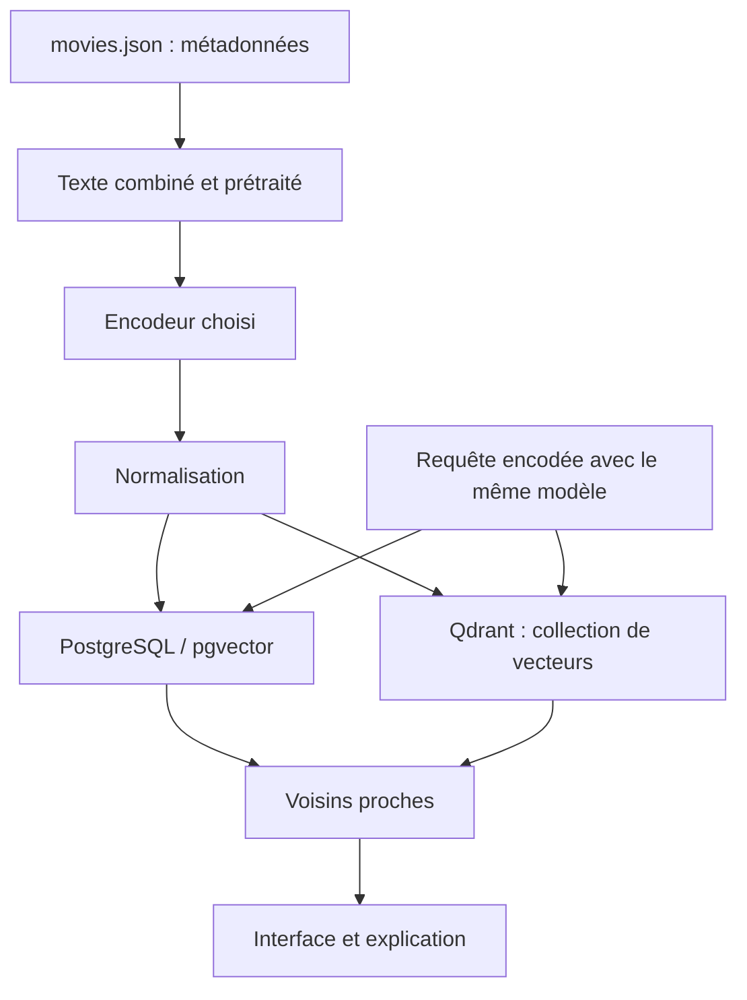

# Similarité entre films et recherche vectorielle

> Récit pédagogique : kNN pgvector en SQL, vecteurs denses et creux Qdrant sur MovieLens, puis RAG LangChain + Ollama.

- Page HTML: https://antoineboucher.info/CV/blog/fr/posts/vector-databases-similar-movies/
- Langue: fr
- Traduction (en): https://antoineboucher.info/CV/blog/posts/vector-databases-similar-movies/index.md
- Publié: 2026-04-13
- Mis à jour: 2026-10-20
- Tags: PostgreSQL, Pgvector, Qdrant, Python, Embeddings, RAG, Machine Learning
- Auteur: Antoine Boucher (https://antoineboucher.info/CV/index-en.html)Fil conducteur « films similaires » : **embeddings dans PostgreSQL**, même idée dans **Qdrant** avec deux sens du vecteur, puis **récupération + LLM local** sur les mêmes lignes. Récit ici ; notebooks dans [AlgoETS/SimilityVectorEmbedding](https://github.com/AlgoETS/SimilityVectorEmbedding).

## Les démonstrations originales

Les trois animations ci-dessous proviennent du README du projet. Elles montrent les interfaces et les étapes enregistrées, pas des mesures de latence actuelles.


## Ce que les notebooks construisent réellement

Dans [`postgres/1.create_table.ipynb`](https://github.com/AlgoETS/SimilityVectorEmbedding/blob/main/postgres/1.create_table.ipynb), le texte combine titre, année, genres, acteurs, réalisateur, résumé et pays. Le notebook compare **cinq configurations de modèles** : BART, GTE, MiniLM-L12, RoBERTa et e5-large. C’est un inventaire du code, pas un classement de qualité.

[`qdrant/0.simple.ipynb`](https://github.com/AlgoETS/SimilityVectorEmbedding/blob/main/qdrant/0.simple.ipynb) crée une collection de **384 dimensions**, utilise la distance cosinus et écrit les points par lots de **100**. La taille doit correspondre au modèle choisi. Le notebook recrée la collection : il faut en tenir compte avant de l’exécuter sur une base existante.



Ce schéma remplace une capture d’architecture par une source Mermaid modifiable. Il décrit le parcours dense commun aux notebooks, sans fusionner les espaces vectoriels de modèles différents.

## Trois questions différentes

1. **Langage des synopsis** — « films dans cet esprit ».
2. **Chevauchement de notes** — « utilisateurs au profil proche ».
3. **Explication** — « pourquoi ces titres ? » à partir d’une question.

Les parties 1–3 y répondent. Mélanger sans nommer le type de vecteur = démos trompeuses.

## Partie 1 — PostgreSQL et pgvector

Catalogue depuis [`movies.json`](https://github.com/AlgoETS/SimilityVectorEmbedding/blob/main/movies.json) : concaténer champs texte, encoder (MiniLM, GTE…), colonnes `vector` à côté du relationnel.

Opérateurs `<=>` (cosinus), `<->` (L2) → kNN en `ORDER BY … LIMIT`.

```sql
SELECT title,
       1 - (embedding_minilm <=> (
         SELECT embedding_minilm FROM movies WHERE title = $1
       )) AS similarity
FROM movies
WHERE title IS DISTINCT FROM $1
ORDER BY similarity DESC
LIMIT 10;
```

Plusieurs colonnes `embedding_*` pour comparer les encodeurs. Graphiques : [Medium partie 1](https://medium.com/@antoine.boucher012/using-vector-databases-to-find-similar-movies-algorithm-part-1-f14a244bb23d), notebooks `postgres/`.

## Partie 2 — Qdrant et MovieLens

| Collection | Type | Question |
|------------|------|----------|
| Films | Dense | « Comme cette formulation » |
| Profils | Dense | Représentation utilisateur (pipeline seed) |
| Notes | **Creux** id film → note | « Goûts qui se recoupent » |

Dense : texte → MiniLM → recherche films. Creux : vecteur de notes → voisins → agrégation — filtrage collaboratif sans réseau de neurones dans le notebook.

Projet FastAPI `movie_recommendation` dans le dépôt cours. Entrée : `qdrant/0.simple.ipynb`.

## Partie 3 — RAG LangChain + Ollama


Notebook `postgres/3.LLMS.ipynb` — échecs utiles : type `vector` inconnu pour LangChain, SQL invalide généré, timeouts Ollama.

## Quand éviter cette pile

| Cas | Mieux |
|-----|--------|
| Utilisateur sans notes | Métadonnées denses seulement |
| CF à très grande échelle | Stack CF dédiée |
| Latence ms stricte | Vector DB managée + tuning |

## Bilan

**Embed → stocker → voisins** trois fois, trois sens. Partie 3 = humilité sur la génération SQL.

## Articles liés

- [Snowflake Data-for-Breakfast](https://antoineboucher.info/CV/blog/fr/posts/snowflake-data-for-breakfast/)
- [Expérimentation indicateurs](https://antoineboucher.info/CV/blog/fr/posts/experimentation-indicateurs-backtesting/)

## Références

- [AlgoETS/SimilityVectorEmbedding](https://github.com/AlgoETS/SimilityVectorEmbedding)
- [pgvector](https://github.com/pgvector/pgvector) · [Qdrant](https://qdrant.tech/documentation/)

---

*Publié d’abord sur [Medium](https://medium.com/@antoine.boucher012/using-vector-databases-to-find-similar-movies-algorithm-part-1-f14a244bb23d) ; page fusionnée parties 1–3.*
