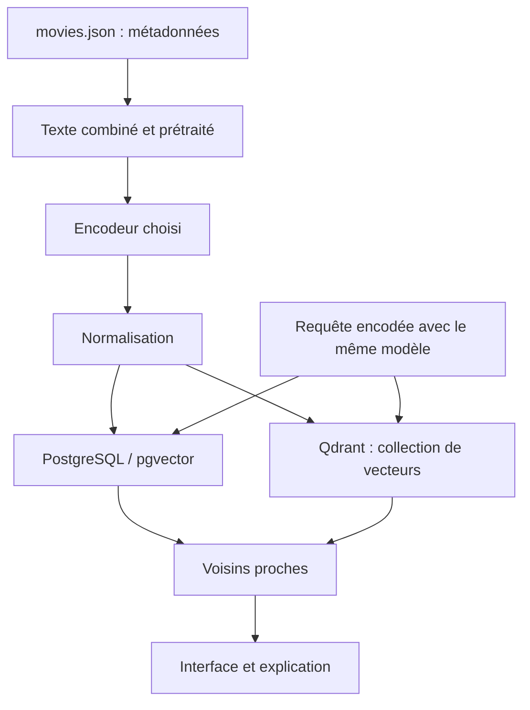
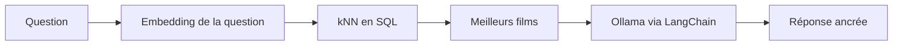

# Similarité entre films et recherche vectorielle

> Récit pédagogique : kNN pgvector en SQL, vecteurs denses et creux Qdrant sur MovieLens derrière une application FastAPI, puis RAG LangChain + Ollama sur le même catalogue.

- Page HTML: https://antoineboucher.info/CV/blog/fr/posts/vector-databases-similar-movies/
- Langue: fr
- Traduction (en): https://antoineboucher.info/CV/blog/posts/vector-databases-similar-movies/index.md
- Publié: 2026-04-13
- Mis à jour: 2026-11-05
- Tags: PostgreSQL, Pgvector, Qdrant, Python, Embeddings, RAG, Machine Learning
- Auteur: Antoine Boucher (https://antoineboucher.info/CV/index-en.html)J’ai enseigné un fil « trouver des films comme celui-ci » qui n’a pas arrêté de grandir : des **embeddings dans PostgreSQL**, la même idée dans **Qdrant** avec deux sens différents du vecteur, puis **récupération + LLM local** ancrés sur les mêmes lignes. Cette page raconte le parcours ; les notebooks et les animations sont dans [AlgoETS/SimilityVectorEmbedding](https://github.com/AlgoETS/SimilityVectorEmbedding) (voir aussi la [page du projet](https://antoineboucher.info/CV/blog/fr/projects/notes/similityvectorembedding/)). La partie 2 s’appuie aussi sur le projet FastAPI d’enseignement que j’ai construit pour servir les parcours Qdrant.

## Les démonstrations originales

Les trois animations ci-dessous proviennent du README du projet. Elles montrent les interfaces et les étapes enregistrées, pas des mesures de latence actuelles.


## Ce que les notebooks construisent réellement

Dans [`postgres/1.create_table.ipynb`](https://github.com/AlgoETS/SimilityVectorEmbedding/blob/main/postgres/1.create_table.ipynb), le texte combine titre, année, genres, acteurs, réalisateur, résumé et pays. Le notebook compare **cinq configurations de modèles** : BART, GTE, MiniLM-L12, RoBERTa et e5-large. C’est un inventaire du code, pas un classement de qualité.

[`qdrant/0.simple.ipynb`](https://github.com/AlgoETS/SimilityVectorEmbedding/blob/main/qdrant/0.simple.ipynb) crée une collection de **384 dimensions**, utilise la distance cosinus et écrit les points par lots de **100**. La taille doit correspondre au modèle choisi. Le notebook recrée la collection : il faut en tenir compte avant de l’exécuter sur une base existante.



Ce schéma remplace une capture d’architecture par une source Mermaid modifiable. Il décrit le parcours dense commun aux notebooks, sans fusionner les espaces vectoriels de modèles différents.

## La question derrière les trois parties

Un système de recommandation cache souvent trois questions différentes :

1. **Langage des synopsis** — « des films dans l’esprit de cette description ».
2. **Chevauchement des goûts** — « des utilisateurs qui notent comme vous ».
3. **Explication** — « pourquoi ces titres ? », à partir du texte que l’utilisateur a écrit.

Les parties 1 à 3 répondent à ces questions. Les mélanger sans nommer le type de vecteur, c’est comme ça que les démos trompent.

## Partie 1 — PostgreSQL, pgvector et SQL transparent

### Construire le catalogue

On part d’un JSON de films structuré ([`movies.json`](https://github.com/AlgoETS/SimilityVectorEmbedding/blob/main/movies.json) dans le dépôt du cours). On concatène titre, année, genres, distribution et résumé ; on encode avec Sentence Transformers (MiniLM, GTE, etc.) ; on stocke des colonnes `vector` typées à côté des champs relationnels.

Pourquoi **pgvector** ? Les vecteurs restent à côté d’un SQL qu’on connaît déjà. Les opérateurs de distance (`<=>` cosinus, `<->` L2) transforment le kNN en `ORDER BY … LIMIT`.

```sql
SELECT title,
       1 - (embedding_minilm <=> (
         SELECT embedding_minilm FROM movies WHERE title = $1
       )) AS similarity
FROM movies
WHERE title IS DISTINCT FROM $1
ORDER BY similarity DESC
LIMIT 10;
```

Changez le nom de colonne selon le modèle : le cours garde plusieurs colonnes `embedding_*` pour comparer les voisinages côte à côte.

### Ce que les étudiants apprennent ici

- Normaliser les embeddings pour le cosinus.
- Comment le choix de l’encodeur déplace le sens de « similaire » (BART, MiniLM, e5-large).
- Que la transparence du SQL vaut mieux qu’une API opaque quand on débogue de mauvais voisins.

### Ce que la partie 1 a mesuré

La distance cosinus compare l’angle entre deux vecteurs, la distance euclidienne (L2) l’écart entre leurs extrémités. Un document court et un document long sur le même sujet pointent dans la même direction mais n’ont pas la même longueur : c’est pourquoi le cosinus est le choix par défaut pour les embeddings de texte.


Pour *Les Indestructibles* (*The Incredibles*), l’article Medium classait les films les plus proches selon cinq encodeurs (BART, GTE, MiniLM, RoBERTa, e5-large) et quatre mesures : similarité cosinus, distance L2, produit scalaire et distance de Jaccard. Le panneau cosinus :


Les barres des meilleurs résultats se ressemblent toutes. Les distributions de scores sur tout le catalogue, elles, diffèrent, et en disent plus sur chaque encodeur que les classements :


BART donne un score élevé à presque tous les films : un seuil comme « similarité supérieure à 0,8 » garde quasiment tout le catalogue. MiniLM étale le même catalogue sur une plage bien plus large, ce qui rend ses classements plus faciles à couper. Un score n’a de sens que par rapport à la distribution de son propre encodeur.

Le code des graphiques et les autres mesures de distance sont dans la [partie 1 sur Medium](https://medium.com/@antoine.boucher012/using-vector-databases-to-find-similar-movies-algorithm-part-1-f14a244bb23d) et dans les notebooks `postgres/` du dépôt.

## Partie 2 — Qdrant, MovieLens, dense et creux

Même « similarité dans l’espace vectoriel », **sens** différent. On commence par le notebook `qdrant/0.simple.ipynb`, puis on passe au projet FastAPI d’enseignement, qui charge MovieLens 100K (1 682 films, 943 utilisateurs) et MovieLens 1M (3 883 films, 6 040 utilisateurs) dans Qdrant, avec trois collections par jeu de données :

| Collection | Type de vecteur | Ce qui est encodé | Question |
|------------|-----------------|-------------------|----------|
| `<dataset>_movies` | Dense, 384 dimensions, cosinus | 1M : titre + genres. 100K : titre + date de sortie | « Des titres qui ressemblent à cette requête » |
| `<dataset>_ratings` | **Creux**, nommé `ratings` : id film → note normalisée | Un point par utilisateur | « Des utilisateurs aux goûts qui se recoupent » |
| `<dataset>_users` | Dense, 384 dimensions | Genre, âge et profession en texte. 1M garde quatre vecteurs nommés (un par attribut plus un combiné) | « Des utilisateurs au profil semblable » |

Deux détails changent la lecture des résultats :

- **Les vecteurs de films MovieLens ne contiennent pas de synopsis.** Ils encodent le titre et les genres (1M) ou le titre et la date de sortie (100K). La recherche dense est donc plus proche d’une correspondance titre et genre que du « langage des synopsis ». Seul le petit chargeur du `movies.json` français encode synopsis, distribution, réalisateur et scénaristes.
- **Les notes sont centrées avant de devenir des valeurs creuses.** Le chargeur 1M les transforme en scores z (on soustrait la moyenne, on divise par l’écart type). Le chargeur 100K ramène l’échelle 1–5 entre −1 et 1. Un film détesté devient une valeur négative plutôt qu’une petite valeur positive.

### Comment l’encodeur est branché

Le projet charge `sentence-transformers/all-MiniLM-L6-v2` avec `transformers` de Hugging Face et fait la moyenne de la dernière couche cachée, ce qui donne 384 dimensions. Ce n’est pas la configuration MiniLM-L12 des notebooks PostgreSQL : les vecteurs des deux parties ne sont pas interchangeables. Avant l’encodage, le texte passe en minuscules, la ponctuation est retirée et les mots vides anglais de NLTK sont supprimés. Une requête doit suivre le même prétraitement, sinon son vecteur s’éloigne de ceux qui sont stockés.

### Filtrage collaboratif avec une recherche creuse

Le parcours par notes n’entraîne aucun modèle. Il transforme vos notes en requête creuse, demande à Qdrant les 20 utilisateurs les plus proches, puis additionne leurs notes pour les films que vous n’avez pas notés :

```python
query = rest.NamedSparseVector(name="ratings", vector=to_vector(user_ratings))
results = client.search(collection_name=f"{dataset}_ratings",
                        query_vector=query, with_vectors=True, limit=20)

movie_scores = defaultdict(float)
for user in results:
    ratings = user.vector["ratings"]
    for movie_id, rating in zip(ratings.indices, ratings.values):
        if movie_id not in user_ratings:
            movie_scores[movie_id] += rating

top_5 = sorted(movie_scores.items(), key=lambda x: x[1], reverse=True)[:5]
```

Les cinq identifiants sont ensuite convertis en titres en parcourant la collection `_movies`. Comme les notes stockées sont centrées, un voisin qui a détesté un film fait baisser son score.

### L’application web autour

L’application FastAPI affiche une seule page Jinja2. On choisit un jeu de données (MovieLens 100K ou 1M) et un mode :

- **By Ratings** : une autocomplétion (alimentée par un point d’accès `/movie_names` qui parcourt la collection de films) construit une liste de paires `titre:note`. Le serveur convertit les titres en identifiants et lance la recherche creuse ci-dessus.
- **By Title/Genre** : le texte libre est prétraité, encodé avec MiniLM et envoyé à une recherche dense sur `<dataset>_movies`. Les cinq premiers résultats reviennent avec leurs genres et leurs scores.

`/recommendations` exige une session. On se connecte avec un compte local ou par OAuth GitHub ou Google, et les choix sont enregistrés dans MongoDB. Docker Compose démarre l’application avec Qdrant, MongoDB et Redis. Le client Qdrant passe de préférence par gRPC.

### Les pièges trouvés en relisant le code

- **La requête et les notes stockées n’ont pas la même échelle.** Le formulaire envoie des notes brutes de 1 à 5, alors que les vecteurs stockés sont centrés. Une note d’une étoile reste positive dans la requête : elle attire vers les utilisateurs qui ont *aimé* ce film. La correction : appliquer à la requête la même normalisation que le chargeur.
- **La table titre → identifiant vient d’un seul parcours de 10 000 points**, refait à chaque requête. Ça couvre les deux catalogues MovieLens, mais un catalogue plus gros serait tronqué sans avertissement.
- **Certaines pièces sont de l’échafaudage, pas encore des fonctionnalités.** Le client Redis est créé, mais rien n’est mis en cache. Les jeux de données IMDb peuvent être chargés dans MongoDB, mais aucune route n’appelle la fonction d’enrichissement. Les recommandations par profil démographique (les vecteurs nommés de `_users`) n’existent que dans la démo du chargeur 1M, pas dans l’API. Les tests importent encore une fonction qui n’existe plus.

Rien de tout ça ne casse la leçon : les parcours dense et creux répondent à des questions différentes, et le code rend la différence visible.

## Partie 3 — RAG avec LangChain + Ollama

On réutilise les lignes pgvector comme **preuves** :



Chaîne : `HuggingFaceEmbeddings` → tri SQL par `<=>` sur `embedding_MiniLM` → prompt qui contient le schéma et les lignes récupérées → `Ollama(model="llama2:13b-chat")`.

La sortie enregistrée du notebook est instructive parce qu’elle échoue poliment :

- LangChain avertit sur le type de colonne `vector` qu’il ne connaît pas.
- Le LLM génère parfois du SQL qui n’est pas du pgvector valide.
- Les gros modèles tombent en **timeout** sous la charge.

Le RAG, ce n’est pas « encoder et oublier » : il faut de la validation, des modèles plus petits ou une récupération hybride.

Notebook : `postgres/3.LLMS.ipynb`.

## Quand éviter cette pile

| Situation | Meilleure voie |
|-----------|----------------|
| Utilisateur sans aucune note | Métadonnées denses seulement |
| Filtrage collaboratif creux à l’échelle du milliard | Pile de filtrage collaboratif dédiée, pas un Qdrant de démo |
| Recommandations à partir des synopsis sur MovieLens | Ajouter d’abord le texte des synopsis : ici, les vecteurs MovieLens n’encodent que titres et genres ou dates |
| Latence sous 10 ms à très fort débit | Base vectorielle gérée + réglages |
| Besoin légal de citations exactes | RAG + vérification des citations, pas un LLM brut |

## Bilan

**Encoder → stocker → plus proches voisins**, trois fois, avec trois sens de « voisin ». La partie 3 apprend l’humilité : un générateur s’éloigne du SQL exécutable si on ne le contraint pas.

## Articles liés

- [Snowflake Data-for-Breakfast](https://antoineboucher.info/CV/blog/fr/posts/snowflake-data-for-breakfast/) — raconter un entrepôt de données
- [Expérimentation avec des indicateurs techniques](https://antoineboucher.info/CV/blog/fr/posts/experimentation-indicateurs-backtesting/) — un autre fil AlgoETS

## Références

- [AlgoETS/SimilityVectorEmbedding](https://github.com/AlgoETS/SimilityVectorEmbedding)
- [Medium — partie 1](https://medium.com/@antoine.boucher012/using-vector-databases-to-find-similar-movies-algorithm-part-1-f14a244bb23d)
- [pgvector](https://github.com/pgvector/pgvector) · [Documentation Qdrant](https://qdrant.tech/documentation/)

---

*Publié d’abord sur [Medium](https://medium.com/@antoine.boucher012/using-vector-databases-to-find-similar-movies-algorithm-part-1-f14a244bb23d) ; cette page fusionne les parties 1 à 3.*
