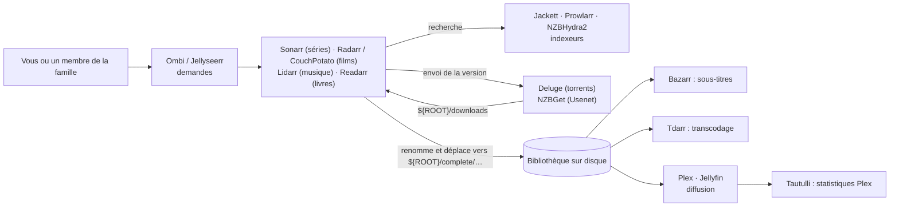

# MediaBoxDockerCompose

> Stack homelab Docker Compose—téléchargements, suite *Arr, Plex/Jellyfin, VPN, Samba et supervision—chemins pilotés par le dépôt.

- Page HTML: https://antoineboucher.info/CV/blog/fr/projects/mediaboxdockercompose/
- Langue: fr
- Traduction (en): https://antoineboucher.info/CV/blog/projects/mediaboxdockercompose/index.md
- Publié: 2024-01-01
- Mis à jour: 2026-11-06
- Tags: Docker, Docker Compose, Homelab, Plex, Sonarr, Radarr
- Auteur: Antoine Boucher (https://antoineboucher.info/CV/index-en.html)[](https://github.com/antoinebou12/MediaBoxDockerCompose)

[Dépôt](https://github.com/antoinebou12/MediaBoxDockerCompose) · [Licence MIT](https://github.com/antoinebou12/MediaBoxDockerCompose/blob/master/LICENSE)

Stack média en Docker Compose : récupération (torrents et Usenet), chaîne *Arr, sous-titres, lecture avec **Plex** ou **Jellyfin**, demandes et supervision. Les volumes et chemins suivent le `docker-compose.yml` du dépôt (variable `ROOT`, etc.).

**Blog :** ce qui tourne dans le compose, scripts Proxmox, et où vit la longue liste — [Notes homelab MediaBox](https://antoineboucher.info/CV/blog/fr/posts/mediabox-homelab-docker-catalog/).

Sur un hôte neuf, le dépôt [**another-install-script**](https://github.com/antoinebou12/another-install-script) propose des installateurs bash à menu pour monter des conteneurs isolés avant d’adopter ce fichier Compose complet.

## Comment les pièces s’assemblent

Tout le `docker-compose.yml` s’articule autour d’un seul dossier, `${ROOT}` (`/media/MediaBox` dans `.env`), avec les mêmes `PUID`, `PGID` et `TZ` pour chaque conteneur. Les téléchargements arrivent dans `${ROOT}/downloads`, les bibliothèques terminées vivent dans `${ROOT}/complete/{tv,movies,music,books}`, et chaque application garde son état dans `${ROOT}/config/<app>`.



Les applications *Arr sont au centre : elles surveillent les épisodes ou films voulus, demandent aux indexeurs une version correspondante, la confient à un client de téléchargement, puis importent le fichier terminé dans la bibliothèque sous un nom propre. Plex et Jellyfin ne font que lire la bibliothèque ; Bazarr et Tdarr la modifient sur place.

## Service par service

Les ports sont les ports de l’hôte du fichier Compose. « hôte » signifie que le conteneur utilise directement le réseau de l’hôte et écoute donc sur le port par défaut de l’application.

| Service | Image | Port | Rôle | Monté depuis `${ROOT}` |
| --- | --- | --- | --- | --- |
| Deluge | `linuxserver/deluge` | hôte (interface web 8112) | Client BitTorrent | `downloads`, `config/deluge` |
| NZBGet | `linuxserver/nzbget` | hôte (6789) | Téléchargement Usenet | `downloads`, `config` |
| Jackett | `linuxserver/jackett` | 9117 | Transforme des sites torrent en API Torznab que les *Arr peuvent interroger | `downloads/torrent-blackhole`, `config/jackett` |
| NZBHydra2 | `linuxserver/hydra2` | 5076 | Métarecherche sur plusieurs indexeurs Usenet | `downloads`, `config/hydra2` |
| Prowlarr | `hotio/prowlarr` | 9696 | Gestionnaire d’indexeurs qui les pousse vers les *Arr | `downloads`, `config/prowlarr` |
| Sonarr | `linuxserver/sonarr:preview` | 8989 | Automatisation des séries | `complete/tv`, `downloads`, `config/sonarr` |
| Radarr | `linuxserver/radarr` | 7878 | Automatisation des films | `complete/movies`, `downloads`, `config/radarr` |
| CouchPotato | `linuxserver/couchpotato` | 5050 | Ancien outil pour les films, recoupe Radarr | `complete/movies`, `downloads` |
| Lidarr | `linuxserver/lidarr` | 8686 | Automatisation de la musique | `complete/music`, `downloads/complete` |
| Readarr | `hotio/readarr` | 8787 | Automatisation des livres | `complete/books` |
| Whisparr | `ghcr.io/hotio/whisparr` | 6969 | Automatisation du contenu pour adultes | `downloads` |
| Bazarr | `linuxserver/bazarr` | hôte (6767) | Récupère les sous-titres des séries et films | `complete/tv`, `complete/movies` |
| Tdarr | `haveagitgat/tdarr_aio` | 8265 | Transcode la bibliothèque par lots selon des règles FFmpeg/HandBrake | `complete`, `config/tdarr` (+ sa base MongoDB) |
| Plex | `plexinc/pms-docker` | 32400 + ports de découverte | Serveur multimédia ; `PLEX_CLAIM` le lie à un compte Plex au premier démarrage | `complete` en `/data`, `config/plex/{db,transcode}` |
| Jellyfin | `linuxserver/jellyfin` | 8096, 8920 | Serveur multimédia libre | `complete/{tv,movies,music}` |
| Tautulli | `linuxserver/tautulli` | 8063 → 8181 | Historique de visionnement et statistiques Plex | `config/tautulli` |
| Ombi | `linuxserver/ombi` | 3579 | Portail de demandes pour les utilisateurs Plex | `config/ombi` |
| Jellyseerr | `hotio/jellyseerr` | 8097 | Portail de demandes pour les utilisateurs Jellyfin | `complete` |
| Stash | `hotio/stash` | 9999 | Organisateur d’une bibliothèque pour adultes | `complete/adult` |
| Netdata | `netdata/netdata` | 19999 | Métriques de l’hôte en direct (lit `/proc`, `/sys`, utilisateurs et groupes en lecture seule) | aucun |
| Dashmachine | `rmountjoy/dashmachine` | 5000 | Page d’accueil avec un lien vers chaque application (`dashmachine/config.ini`) | `config/dashmachine` |
| Filebrowser | `filebrowser/filebrowser` | 8999 → 80 | Gestionnaire de fichiers web sur tout `${ROOT}` | `${ROOT}` en `/srv` |

Les étiquettes `department` (`Media`, `System`) regroupent les conteneurs pour les tableaux de bord qui lisent les étiquettes Docker.

## Organisation du disque

```text
${ROOT}/                     /media/MediaBox par défaut
├── downloads/               Deluge, NZBGet, les *Arr, Prowlarr, NZBHydra2
│   ├── torrent-blackhole/   dossier de téléchargement de Jackett
│   └── complete/            chemin de téléchargement de Lidarr
├── complete/                les bibliothèques lues par Plex, Jellyfin, Bazarr et Tdarr
│   ├── tv/  movies/  music/  books/  adult/
└── config/                  un dossier par application (deluge, sonarr, radarr, plex/db, plex/transcode, tdarr/db …)
```

Garder téléchargements et bibliothèques sur le même système de fichiers permet aux *Arr de déplacer les fichiers terminés au lieu de les copier.

## Réseau

Le fichier Compose ne déclare aucun réseau : Compose crée un réseau pont par défaut pour le projet, et les conteneurs se joignent par leur nom (`http://sonarr:8989` depuis Ombi, par exemple). Deluge, NZBGet et Bazarr tournent en `network_mode: host` : on les joint à l’adresse de l’hôte, et les *Arr doivent donc pointer vers l’IP de l’hôte, pas vers un nom de conteneur.

## Piles optionnelles

Elles vivent dans des fichiers Compose séparés et se démarrent à part :

- `extra/samba/` : `dperson/samba` partage `/mnt/MediaBox` en SMB (ports 137–139 et 445) avec le service de noms NetBIOS activé.
- `extra/wireguard-access-server/` : `place1/wg-access-server`, un VPN WireGuard avec une interface web sur 8000 et le tunnel en UDP 51820 ; demande `NET_ADMIN` et `/dev/net/tun`.
- `extra/portainer/` : Portainer sur 9000 et 8000, avec le socket Docker monté.
- `whisper/` : `openai-whisper-asr-webservice` avec le modèle `base` sur le port 9000.
- `caddy/Caddyfile` : un site par service (`deluge.{$DOMAIN}`, `jackett.{$DOMAIN}`, `nzbget.{$DOMAIN}` …), chacun important des extraits pour les journaux avec rotation, les pages d’erreur, le mandataire inverse vers `localhost:<port>`, le cache, la limitation de débit, une liste d’IP autorisées, l’authentification de base et la compression.

## Le script d’installation

Le dépôt n’a pas d’installateur propre ; les étapes du README sont « installer Docker et Compose, cloner, `docker-compose up -d` ». Le dépôt compagnon [another-install-script](https://github.com/antoinebou12/another-install-script) est l’installateur à menu pour les hôtes qui ne sont pas prêts pour la pile complète :

1. `sudo bash setup.sh` charge `src/menu.sh` et ouvre un menu whiptail : Installation, Ajouter un conteneur, Retirer un conteneur, Désinstaller, Sauvegarde, Aide.
2. L’installation peut ajouter des paquets de base, Docker et Compose, crée un utilisateur `udocker` dans le groupe `docker` avec `/home/udocker/{config,services,volumes,backups,downloads,tv,movies,media,audio}`, et écrit `UDOCKER`, `UDOCKER_ROOT`, `UDOCKER_USERID`, `UDOCKER_GROUPID` et `TZ` dans `/etc/environment`.
3. « Ajouter un conteneur » liste les 92 dossiers de `containers/`. Pour chacun choisi, il charge `containers/<nom>/<nom>.sh` et appelle `create_docker_<nom>`, qui lance `docker-compose -f containers/<nom>/docker-compose.yml up -d` et affiche `http://<ip-hôte>:<port>`.
4. Les noms choisis sont enregistrés dans `/home/udocker/config/containers.txt`, et `manage_firewall_ports_allow_list` relit cette liste pour ouvrir les ports correspondants dans le pare-feu.
5. « Retirer un conteneur » appelle le `remove_docker_<nom>` correspondant (`docker-compose down`) ; `uninstall.sh` défait l’installation.

## Démarrage rapide

1. Installez [Docker](https://docs.docker.com/get-docker/) et Compose sur l’hôte.
2. Clonez le dépôt, puis modifiez `.env` : `ROOT`, `PUID`/`PGID` (donnés par `id`), `TZ`, et un jeton `PLEX_CLAIM` de plex.tv/claim si vous utilisez Plex.
3. Depuis le dossier du projet :

```bash
git clone https://github.com/antoinebou12/MediaBoxDockerCompose.git
cd MediaBoxDockerCompose
docker compose up -d
```

Si votre installation utilise encore l’ancienne commande, `docker-compose up -d` correspond au [README](https://github.com/antoinebou12/MediaBoxDockerCompose#readme). Reliez ensuite les pièces dans les interfaces web : les indexeurs dans Prowlarr ou Jackett, les clients de téléchargement dans Sonarr et Radarr (IP de l’hôte pour Deluge et NZBGet), et les dossiers de bibliothèque dans Plex ou Jellyfin.

## À vérifier avant de le lancer

- Le volume TV de Sonarr s’écrit `${ROOT}/complete/tv://tv`, avec un deux-points et une barre en trop.
- NZBGet monte tout `${ROOT}/config` comme dossier de configuration : il voit la configuration de toutes les autres applications.
- Lidarr lit les téléchargements dans `${ROOT}/downloads/complete` alors que les clients écrivent dans `${ROOT}/downloads` : sans correspondance de chemins distants, Lidarr risque de ne pas trouver les fichiers terminés.
- Dashmachine, Filebrowser, NZBHydra2 et Tdarr écrivent `PUID='${PUID}'` avec des guillemets dans la valeur : les conteneurs reçoivent `'1000'` au lieu de `1000`.
- Le conteneur Jellyseerr écoute par défaut sur 5055 ; la correspondance `8097:8097` ne fonctionne que si son port est changé.
- `filebrowser/database.db` est versionné ; réinitialisez ses utilisateurs avant d’exposer Filebrowser, qui peut lire et écrire tout `${ROOT}`.
- Plusieurs images utilisent les étiquettes `latest` ou `preview` : une reconstruction peut changer de version.
- Portainer et Whisper publient tous deux le port 9000, et Portainer et l’interface WireGuard le port 8000 : ces piles optionnelles ne peuvent pas tourner ensemble telles qu’écrites.
- Les directives `cache` et de limitation de débit du Caddyfile exigent des modules absents de la version standard de Caddy, et `allow`/`deny` n’est pas une syntaxe de Caddy v2 (qui utilise des filtres `remote_ip`).
- Dans another-install-script, `create_docker_user` fixe le mot de passe de `udocker` à partir de la variable du nom d’utilisateur au lieu du mot de passe configuré, et l’utilisateur est ajouté aux sudoers.

## Documentation

Les **ports**, **identifiants**, notes de **sauvegarde/restauration** et règles de **contribution** par défaut sont tenus à jour dans le [README](https://github.com/antoinebou12/MediaBoxDockerCompose#readme) ; cette page explique ce que fait le fichier Compose.
