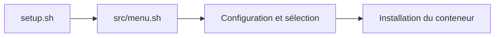

# another-install-script : Un menu d’installation pour le homelab

> another-install-script propose un menu shell pour choisir des opérations système et installer des conteneurs. Les menus et les définitions de services…

- Page HTML: https://antoineboucher.info/CV/blog/fr/projects/notes/another-install-script/
- Langue: fr
- Traduction (en): https://antoineboucher.info/CV/blog/projects/notes/another-install-script/index.md
- Publié: 2026-10-23
- Mis à jour: 2026-10-23
- Auteur: Antoine Boucher (https://antoineboucher.info/CV/index-en.html)
- Dépôt: https://github.com/antoinebou12/another-install-script
- Licence: GPL-3.0
- Révision inspectée: 6e1e193260504106593f6b92bb799aacafdf0e2b

## Résumé

another-install-script propose un menu shell pour choisir des opérations système et installer des conteneurs. Les menus et les définitions de services sont séparés, ce qui évite de placer toutes les commandes dans setup.sh.

**Pourquoi il existe:** Installateur shell interactif (TUI) automatisant le déploiement de conteneurs Docker et de configurations serveur.

**Cas d’usage:** Déploiement rapide de serveurs et d'environnements homelab en une commande.

## Langages (octets GitHub Linguist)

| Langage | % |
| --- | ---: |
| Shell | 93.8 |
| Dockerfile | 3.12 |
| Python | 3.07 |

## Démarrage (commandes du dépôt, non exécutées ici)

### README.md · How to install

```bash
git clone https://github.com/antoinebou13/another-install-script.git
cd another-install-script
sudo bash setup.sh
```

### README.md · Project Structure

```bash
+-- docs
|   +-- vendor
|       +-- ...
|   +-- docs.md
|   +-- generate_docs.md
|   +-- ...
+-- containers
|   +-- $container_name
|   |   |   +-- docker-compose.yml
|   |   |   +-- $container_name.sh
|   |   |   +-- ...
+-- src
```

### README.md · How to run coverage and tests

```bash
cd tests
bash test.sh
```

### README.md · How to run coverage and tests

```bash
cd tests
bash coverage.sh
```

### README.md · How to generate the documentation

```bash
git submodule update --init --recursive
git pull --recurse-submodules
git submodule update --remote
cd docs/generator
chmod +x generate_docs.sh
bash generate_docs.sh ../docs.md
```


## Fonctions et composants

- **Point d’entrée et menus** — setup.sh charge src/menu.sh et appelle main_setup_menu. Le script racine traite les arguments, tandis que le module chargé pilote la navigation. config.yml constitue le fichier de configuration placé à côté du lanceur.
- **Définitions des services** — Le dossier containers contient les éléments d’installation propres aux services. Cette séparation facilite l’ajout de services, mais chaque installation modifie tout de même l’hôte ou son environnement Docker.

## Architecture

Composants et connexions vérifiés dans le dépôt.

- setup.sh → src/menu.sh
- src/menu.sh → Configuration et sélection
- Configuration et sélection → Installation du conteneur



**Un parcours dans le code:** Partez de l’appel à main_setup_menu, puis inspectez le service choisi dans containers avant de l’exécuter. Le menu distribue les actions; le service choisi détermine les changements réels.

## Limites et points à vérifier

Le README présente le projet comme un travail en cours et mentionne une ancienne version d’Ubuntu. Ces notes ne prouvent pas sa compatibilité avec un serveur actuel.

## Fichiers à lire

- [setup.sh](https://github.com/antoinebou12/another-install-script/blob/master/setup.sh)
- [src/menu.sh](https://github.com/antoinebou12/another-install-script/blob/master/src/menu.sh)
- [config.yml](https://github.com/antoinebou12/another-install-script/blob/master/config.yml)

