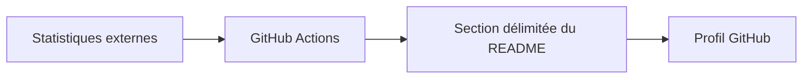

# antoinebou12 : Comment le profil GitHub est assemblé

> Ce dépôt contient le README de mon profil GitHub. Il combine du Markdown, des images, des widgets intégrés et des mises à jour planifiées. Le profil…

- Page HTML: https://antoineboucher.info/CV/blog/fr/projects/notes/antoinebou12/
- Langue: fr
- Traduction (en): https://antoineboucher.info/CV/blog/projects/notes/antoinebou12/index.md
- Publié: 2026-10-23
- Mis à jour: 2026-10-23
- Auteur: Antoine Boucher (https://antoineboucher.info/CV/index-en.html)

- Dépôt: https://github.com/antoinebou12/antoinebou12
- Licence: GPL-3.0
- Révision inspectée: c519c6b47b35d3d391167aa43b6cf6cafe7d0435

## Résumé

Ce dépôt contient le README de mon profil GitHub. Il combine du Markdown, des images, des widgets intégrés et des mises à jour planifiées. Le profil lui-même ne contient pas de serveur applicatif.

**Pourquoi il existe:** Workflow automatisé de rendu de métriques et SVG pour profil GitHub dynamique.

**Cas d’usage:** Génération automatique d'assets de profil.

## Cas d’utilisation

README de profil GitHub avec liens, badges, projets épinglés et statistiques, tenu à jour par des Actions planifiées.

- **Lire le profil et les liens** (Visiteur du profil): README.md commence par le titre plateforme et infographie, puis les liens (GitHub, LinkedIn, site, CV, courriel), les badges de certification et les principaux langages et outils.
- **Parcourir les projets phares** (Visiteur du profil): Une section repliable Featured projects affiche des cartes pour des dépôts comme AINewsTracker, hass_renpho, ipc-toolkit et TrueMapData, ainsi que les organisations DashCTRL, ETSim et UFOKEK.
- **Régénérer le graphe 3D** (GitHub Actions): github-profile-3d-contrib.yml s’exécute chaque jour à 5 h UTC, génère le calendrier 3D des contributions, ne garde que profile-night-green.svg et le valide dans le dépôt.
- **Actualiser badges LeetCode** (GitHub Actions): update-readme.yml s’exécute chaque jour à 12 h UTC, récupère les statistiques sur leetcodestats.cyclic.app et réécrit les badges entre les marqueurs LEETCODE_STATS de README.md.
- **Vérifier les liens** (Propriétaire du profil, GitHub Actions): À chaque push ou pull request vers main ou master, check-links.yml lance lychee sur README.md et docs/**/*.md et écrit un résumé de tâche.
- **Publier la page Jekyll** (Propriétaire du profil, GitHub Actions): jekyll-pages.yml construit docs/ avec le thème jekyll-theme-primer et le déploie sur GitHub Pages ; docs/index.md renvoie au README du profil.

### Scénario : Modifier le profil et laisser l’automatisation suivre

1. Le propriétaire modifie README.md, par exemple la liste Featured projects, et pousse sur master.
2. check-links.yml lance lychee sur README.md et le Markdown de docs et signale les liens brisés.
3. jekyll-pages.yml construit docs/ et déploie le petit site Jekyll sur GitHub Pages.
4. Chaque jour, github-profile-3d-contrib.yml régénère profile-night-green.svg et le valide.
5. Un visiteur ouvre la page de profil et voit le README à jour, les cartes de statistiques et le calendrier 3D.

## Fonctions et composants

- **README et ressources** — README.md est le document visible du profil. Les dossiers images, models et profile-3d-contrib regroupent des ressources associées. GitHub affiche le document, tandis que certains services liés produisent leurs propres images.
- **Modifications planifiées** — Le workflow update-readme récupère des statistiques LeetCode, construit des liens de badges et remplace le texte entre des marqueurs du README. D’autres workflows concernent le graphique de contributions, les liens et Pages.

## Architecture

Composants et connexions vérifiés dans le dépôt.

- Statistiques externes → GitHub Actions
- GitHub Actions → Section délimitée du README
- Section délimitée du README → Profil GitHub

**Un parcours dans le code:** Dans update-readme.yml, suivez la réponse HTTP jusqu’aux chaînes de badges, puis au remplacement entre marqueurs. Si un marqueur manque, ce remplacement n’a pas lieu.

## Limites et points à vérifier

Les services de badges peuvent tomber en panne ou devenir périmés. Un graphique de profil présente les données d’une source, sans mesurer indépendamment la qualité des contributions.

## Fichiers à lire

- [README.md](https://github.com/antoinebou12/antoinebou12/blob/master/README.md)
- [.github/workflows/update-readme.yml](https://github.com/antoinebou12/antoinebou12/blob/master/.github/workflows/update-readme.yml)
- [.github/workflows/github-profile-3d-contrib.yml](https://github.com/antoinebou12/antoinebou12/blob/master/.github/workflows/github-profile-3d-contrib.yml)

