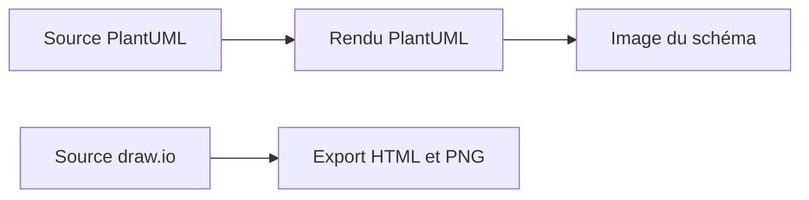

# architecture : L’architecture comme documentation modifiable

> Ce dépôt archivé conserve un diagramme d’infrastructure domestique dans plusieurs formats. Son architecture est celle d’un flux documentaire: des…

- Page HTML: https://antoineboucher.info/CV/blog/fr/projects/notes/architecture/
- Langue: fr
- Traduction (en): https://antoineboucher.info/CV/blog/projects/notes/architecture/index.md
- Publié: 2026-10-23
- Mis à jour: 2026-10-23
- Auteur: Antoine Boucher (https://antoineboucher.info/CV/index-en.html)
- Dépôt: https://github.com/antoinebou12/architecture
- Licence: MIT
- Révision inspectée: a511b1a730ced19f6340548d5a46e20ae6e2df9b

## Résumé

Ce dépôt archivé conserve un diagramme d’infrastructure domestique dans plusieurs formats. Son architecture est celle d’un flux documentaire: des sources modifiables produisent des schémas consultables sans application en cours d’exécution.

**Pourquoi il existe:** Schémas d’infrastructure domestique conservés en sources PlantUML et draw.io, avec des exports HTML et image.

**Cas d’usage:** Consulter un instantané d’infrastructure archivé ou modifier ses sources pour documenter un homelab.

## Langages (octets GitHub Linguist)

| Langage | % |
| --- | ---: |
| HTML | 100 |

## Fonctions et composants

- **Sources modifiables** — La racine contient une source PlantUML et un document draw.io. Il s’agit de deux représentations distinctes. Leur présence ne signifie pas que l’une est automatiquement produite à partir de l’autre.
- **Vues publiées** — Les fichiers PNG et HTML permettent de consulter le schéma. Le README dirige vers ces représentations. Le dépôt décrit l’infrastructure, sans déployer ni surveiller les services représentés.

## Architecture

Composants et connexions vérifiés dans le dépôt.

- Source PlantUML → Rendu PlantUML
- Rendu PlantUML → Image du schéma
- Source draw.io → Export HTML et PNG

**Un parcours dans le code:** Choisissez d’abord le format modifiable, puis comparez son rendu à l’image exportée. Conserver les sources évite qu’une capture d’écran devienne la seule description restante du système.

## Limites et points à vérifier

Il s’agit d’un instantané d’infrastructure archivé. Les noms et connexions du schéma ne prouvent pas que les services fonctionnent encore ou sont accessibles.

## Fichiers à lire

- [README.md](https://github.com/antoinebou12/architecture/blob/main/README.md)
- [architecture.plantuml](https://github.com/antoinebou12/architecture/blob/main/architecture.plantuml)
- [architecture.drawio](https://github.com/antoinebou12/architecture/blob/main/architecture.drawio)

