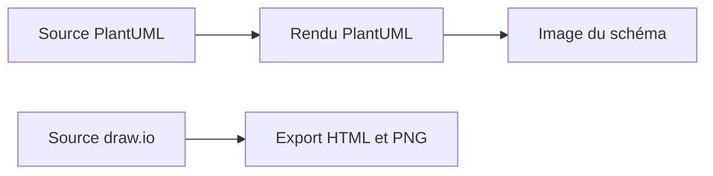

# architecture : L’architecture comme documentation modifiable

> Ce dépôt archivé conserve un diagramme d’infrastructure domestique dans plusieurs formats. Son architecture est celle d’un flux documentaire: des…

- Page HTML: https://antoineboucher.info/CV/blog/fr/projects/notes/architecture/
- Langue: fr
- Traduction (en): https://antoineboucher.info/CV/blog/projects/notes/architecture/index.md
- Publié: 2026-10-23
- Mis à jour: 2026-10-23
- Auteur: Antoine Boucher (https://antoineboucher.info/CV/index-en.html)

- Dépôt: https://github.com/antoinebou12/architecture
- Licence: MIT
- Révision inspectée: a511b1a730ced19f6340548d5a46e20ae6e2df9b

## Résumé

Ce dépôt archivé conserve un diagramme d’infrastructure domestique dans plusieurs formats. Son architecture est celle d’un flux documentaire: des sources modifiables produisent des schémas consultables sans application en cours d’exécution.

**Pourquoi il existe:** Schémas d’infrastructure domestique conservés en sources PlantUML et draw.io, avec des exports HTML et image.

**Cas d’usage:** Consulter un instantané d’infrastructure archivé ou modifier ses sources pour documenter un homelab.

## Cas d’utilisation

Diagrammes C4 PlantUML et draw.io d’un homelab : Cloudflare, un VPS OVH, des hyperviseurs, un NAS et leurs services.

- **Voir le schéma draw.io v1** (Lecteur, Moteurs de rendu): architecture.drawio.html intègre le XML draw.io dans le visualiseur diagrams.net, avec zoom, calques et visionneuse ; le README le présente comme la v1.
- **Générer le diagramme C4 v2** (Lecteur, Moteurs de rendu): architecture.plantuml inclut C4_Deployment et les icônes Font Awesome, OSA et Office ; le lien v2 du README est un rendu encodé sur le serveur PlantUML.
- **Suivre les accès externes** (Lecteur): Les lignes Rel montrent l’utilisateur qui passe par Cloudflare en HTTPS, Cloudflare qui renvoie vers le VPS OVH, le VPS qui joint les réseaux domestique et personnel par WireGuard, et l’admin qui passe par Teleport en SSH.
- **Inventorier VM et conteneurs** (Lecteur): Les nœuds listent les hôtes XCP-ng, Proxmox et Windows, un NAS QNAP avec sa pile média, et des VM comme Talos (Portainer, AI News Tracker, Freqtrade), Home Assistant et Caddy avec Prometheus et Grafana, chacun avec CPU, RAM et disque.
- **Modifier et réexporter** (Mainteneur du schéma, Moteurs de rendu): Le mainteneur modifie architecture.plantuml ou architecture.drawio et exporte une image comme home architecture.png.

### Scénario : Suivre une requête web jusqu’au homelab

1. Ouvrir architecture.plantuml, ou le lien v2 du README.md rendu par le serveur PlantUML.
2. Partir de la personne User, qui joint Cloudflare (CDN et proxy inverse) en HTTPS.
3. Suivre Cloudflare jusqu’au VPS OVH, qui exécute Caddy, Teleport et Uptime Kuma.
4. Suivre le lien WireGuard du VPS vers le Personal Network et son hôte Proxmox.
5. Voir la VM Caddy router le trafic vers AI News Tracker, Marketwatch, Portainer, Plex et Jellyfin.

## Langages (octets GitHub Linguist)

| Langage | % |
| --- | ---: |
| HTML | 100 |

## Fonctions et composants

- **Sources modifiables** — La racine contient une source PlantUML et un document draw.io. Il s’agit de deux représentations distinctes. Leur présence ne signifie pas que l’une est automatiquement produite à partir de l’autre.
- **Vues publiées** — Les fichiers PNG et HTML permettent de consulter le schéma. Le README dirige vers ces représentations. Le dépôt décrit l’infrastructure, sans déployer ni surveiller les services représentés.

## Architecture

Composants et connexions vérifiés dans le dépôt.

- Source PlantUML → Rendu PlantUML
- Rendu PlantUML → Image du schéma
- Source draw.io → Export HTML et PNG

**Un parcours dans le code:** Choisissez d’abord le format modifiable, puis comparez son rendu à l’image exportée. Conserver les sources évite qu’une capture d’écran devienne la seule description restante du système.

## Limites et points à vérifier

Il s’agit d’un instantané d’infrastructure archivé. Les noms et connexions du schéma ne prouvent pas que les services fonctionnent encore ou sont accessibles.

## Fichiers à lire

- [README.md](https://github.com/antoinebou12/architecture/blob/main/README.md)
- [architecture.plantuml](https://github.com/antoinebou12/architecture/blob/main/architecture.plantuml)
- [architecture.drawio](https://github.com/antoinebou12/architecture/blob/main/architecture.drawio)

