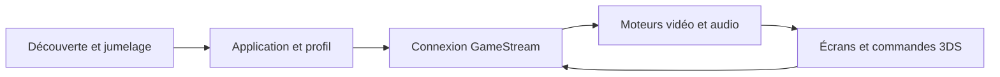

# Artemis-N3DS : Le streaming sur un client à deux écrans

> Artemis-N3DS adapte Moonlight Embedded à la famille Nintendo 3DS. Le projet réunit découverte et jumelage de l’hôte, interface console, commandes et…

- Page HTML: https://antoineboucher.info/CV/blog/fr/projects/notes/artemis-n3ds/
- Langue: fr
- Traduction (en): https://antoineboucher.info/CV/blog/projects/notes/artemis-n3ds/index.md
- Publié: 2026-10-23
- Mis à jour: 2026-10-23
- Auteur: Antoine Boucher (https://antoineboucher.info/CV/index-en.html)

- Dépôt: https://github.com/antoinebou12/Artemis-N3DS
- Licence: GPL-3.0
- Révision inspectée: c5eb0205ba4eb00f4fff96097d987b3267a7be08

## Résumé

Artemis-N3DS adapte Moonlight Embedded à la famille Nintendo 3DS. Le projet réunit découverte et jumelage de l’hôte, interface console, commandes et affichage vidéo. Le parcours matériel de la New 3DS demande une attention particulière.

**Pourquoi il existe:** Défi d'ingénierie sous fortes contraintes : streaming 60 FPS sur architecture ARM11 double écran.

**Cas d’usage:** Accès distant et jeu PC sur matériel New 3DS.

## Cas d’utilisation

Fork de Moonlight Embedded qui diffuse les jeux d’un PC Sunshine sur une New 3DS, avec une interface d’aide à l’écran du bas.

- **Installer le CIA ou le 3DSX** (Joueur sur 3DS): dist/INSTALL.md explique comment installer artemis.cia depuis le menu HOME avec FBI, ou copier artemis.3dsx dans sd:/3ds/artemis/ pour le Homebrew Launcher ; un firmware modifié est requis.
- **Jumeler un hôte** (Joueur sur 3DS, PC hôte Sunshine): Le joueur ajoute un hôte par son IP locale (host_discovery.cpp peut aussi balayer le réseau) et choisit pair ; pair_host dans src/n3ds_main.cpp affiche un NIP à saisir dans Sunshine et garde un enregistrement de jumelage.
- **Diffuser un jeu ou le bureau** (Joueur sur 3DS, PC hôte Sunshine): La vidéo s’affiche à l’écran du haut avec le décodeur H.264 matériel de la New 3DS ; selon le README, les anciens modèles passent au décodage logiciel, avec moins d’images par seconde.
- **Changer de mode tactile** (Joueur sur 3DS, PC hôte Sunshine): Le menu SELECT de l’écran du bas passe d’un gestionnaire à l’autre dans src/input/touch/ : manette, souris, clavier, loupe et miroir, avec les affichages Fit, Fill, Stretch et le zoom.
- **Enregistrer les mesures en CSV** (Joueur sur 3DS): Depuis l’onglet Session, la surcouche de performance affiche la télémétrie ; export_stream_benchmark_csv (src/stream_benchmark.cpp) écrit benchmark_<horodatage>.csv sur la carte SD.
- **Compiler avec devkitPro** (Développeur): Le Dockerfile donne une image devkitPro ; make y produit artemis.3dsx, artemis.cia et artemis.elf. Une installation locale de devkitPro 3ds-dev avec bannertool et makerom fonctionne aussi.

### Scénario : Jouer à un jeu PC sur New 3DS en Wi-Fi

1. Copier artemis.cia sur la carte SD et l’installer dans FBI avec Install and delete CIA.
2. Ouvrir Artemis, appuyer sur A pour ajouter un hôte et saisir l’adresse IP locale du PC.
3. Choisir pair et taper dans la page PIN de Sunshine le NIP affiché sur la 3DS.
4. Choisir stream puis une application ; la vidéo s’affiche à l’écran du haut.
5. Appuyer sur SELECT pour passer en mode Souris ou Loupe, ou ouvrir la surcouche de performance et enregistrer un CSV.
6. Quitter depuis l’onglet Session pour terminer la diffusion.

## Langages (octets GitHub Linguist)

| Langage | % |
| --- | ---: |
| C++ | 76.05 |
| C | 15.71 |
| CMake | 4.36 |
| Makefile | 2.84 |
| Shell | 0.64 |
| Dockerfile | 0.4 |

## Démarrage (commandes du dépôt, non exécutées ici)

### README.md · Docker (easiest)

```bash
docker build --network=host -t moonlight-n3ds .
docker run --rm -it -v .:/moonlight-N3DS -w /moonlight-N3DS moonlight-n3ds:latest
make
```

### README.md · Local (devkitPro)

```bash
make
```


## Fonctions et composants

- **Gestion de la session** — n3ds_main.cpp réunit découverte, jumelage, profils et état de connexion. L’hôte et l’application sélectionnés déterminent la demande de streaming. Le cycle de vie graphique est suivi séparément de la configuration du flux.
- **Médias et interaction** — L’audio, les commandes et la vidéo ont leurs modules dans src. Les capacités matérielles influencent les indications affichées. L’interface peut reprendre après un flux, tandis qu’une fermeture système explicite doit terminer l’application.

## Architecture

Composants et connexions vérifiés dans le dépôt.

- Découverte et jumelage → Application et profil
- Application et profil → Connexion GameStream
- Connexion GameStream → Moteurs vidéo et audio
- Moteurs vidéo et audio → Écrans et commandes 3DS
- Écrans et commandes 3DS → Connexion GameStream



**Un parcours dans le code:** Suivez SelectedHost et le profil avant d’entrer dans le traitement des médias. Une fermeture système et un retour normal au menu sont deux transitions distinctes; un indicateur explicite évite de les confondre.

## Limites et points à vérifier

La 3DS d’origine et la New 3DS ont des capacités de décodage différentes. Les profils proposés dans le code ne garantissent pas une cadence ou des performances réseau mesurées.

## Fichiers à lire

- [src/n3ds_main.cpp](https://github.com/antoinebou12/Artemis-N3DS/blob/n3ds-main/src/n3ds_main.cpp)
- [src/hardware_capabilities.cpp](https://github.com/antoinebou12/Artemis-N3DS/blob/n3ds-main/src/hardware_capabilities.cpp)
- [src/video/video.hpp](https://github.com/antoinebou12/Artemis-N3DS/blob/n3ds-main/src/video/video.hpp)


