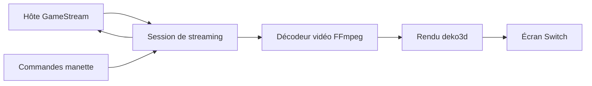

# Artemis-Switch : Une image du PC à l’écran

> Artemis-Switch est un fork de la famille Moonlight. L’hôte exécute le jeu; le client reçoit l’audio et la vidéo compressés tout en renvoyant les…

- Page HTML: https://antoineboucher.info/CV/blog/fr/projects/notes/artemis-switch/
- Langue: fr
- Traduction (en): https://antoineboucher.info/CV/blog/projects/notes/artemis-switch/index.md
- Publié: 2026-10-23
- Mis à jour: 2026-10-23
- Auteur: Antoine Boucher (https://antoineboucher.info/CV/index-en.html)

- Dépôt: https://github.com/antoinebou12/Artemis-Switch
- Licence: GPL-3.0
- Révision inspectée: 33e6854781a47e86ae349e0a7646ff00bd924ddd

## Résumé

Artemis-Switch est un fork de la famille Moonlight. L’hôte exécute le jeu. Le client reçoit la vidéo et l’audio compressés, affiche les images et renvoie les commandes.

**Pourquoi il existe:** Client GameStream C++ accéléré matériellement avec calage d'images NVN pour une fluidité sans saccade.

**Cas d’usage:** Diffusion de jeux PC vers Nintendo Switch en mode portable avec latence minimale.

## Cas d’utilisation

Fork de Moonlight-Switch qui diffuse des jeux PC sur Nintendo Switch, avec mise à l’échelle FSR, profils de flux et télémétrie.

- **Jumeler un hôte et diffuser** (Joueur sur Switch, PC hôte GameStream): GameStreamClient.cpp et MoonlightSession.cpp gèrent le jumelage par NIP et les sessions avec Sunshine, Apollo, Vibeshine ou Punktfunk ; DiscoverManager trouve les hôtes et WakeOnLanManager peut les réveiller.
- **Régler l’affichage vidéo** (Joueur sur Switch): Fit, Fill, Stretch, zoom et panoramique, rotation et plage complète passent par un seul chemin de présentation deko3d, avec mise à l’échelle FSR/EASU, netteté RCAS et tramage après le décodage NVDEC.
- **Enregistrer des profils** (Joueur sur Switch, PC hôte GameStream): Les profils nommés enregistrent FPS (30 à 120), résolution, débit, codec et présentation dans profile.json ; on peut les associer à un hôte, les modifier, les importer ou les exporter (StreamProfileStore.cpp, ProfileEditorDialog.cpp).
- **Exporter un banc d’essai** (Joueur sur Switch): La page Performance affiche débit, latence, file d’images, temps GPU et fréquences de la Switch ; les commandes Benchmark démarrer, arrêter et enregistrer écrivent un fichier via app/src/benchmark/BenchmarkExport.cpp.
- **Compiler et tester l’appli** (Développeur): Avec devkitA64 et CMake, la cible Moonlight.nro construit le binaire Switch, publié par la CI sous le nom Artemis-Switch.nro ; tests/ contient des tests unitaires portables lancés avec ctest, plus des vérifications Python d’i18n et de publication.

### Scénario : Diffuser un jeu PC sur Switch

1. Copier Artemis-Switch.nro dans sdmc:/switch/Artemis-Switch/ et lancer hbmenu par redirection de titre.
2. Ouvrir Artemis Switch, choisir le PC hôte et terminer le jumelage par NIP dans l’interface web de l’hôte.
3. Créer un profil de flux (par exemple 60 FPS, H.265, Fit avec FSR) et l’associer à cet hôte.
4. Lancer une application et appuyer ensemble sur - et + pour ouvrir la surcouche.
5. Ouvrir Performance pour suivre le débit et la latence du pipeline, puis lancer et enregistrer un Benchmark.

## Langages (octets GitHub Linguist)

| Langage | % |
| --- | ---: |
| C++ | 53.78 |
| C | 33.23 |
| Java | 5.69 |
| CMake | 3.51 |
| Objective-C++ | 1.95 |
| Shell | 0.75 |
| Swift | 0.38 |
| Python | 0.35 |
| GLSL | 0.34 |
| Makefile | 0.02 |
| PowerShell | 0.01 |

## Démarrage (commandes du dépôt, non exécutées ici)

### README.md · Developer build

```bash
git clone --recursive https://github.com/antoinebou12/Artemis-Switch.git
cd Artemis-Switch
cmake -B build/switch -DCMAKE_BUILD_TYPE=Release -DPLATFORM_SWITCH=ON -DUSE_DEKO3D=ON
cmake --build build/switch --target Moonlight.nro --parallel
```

### README.md · Developer validation

```bash
python tests/i18n_consistency_test.py
python tests/release_contract_test.py
cmake -S tests -B build/tests -DCMAKE_BUILD_TYPE=Debug
cmake --build build/tests --parallel
ctest --test-dir build/tests --output-on-failure
```

### README.md · Developer validation

```bash
python -m pip install ruff==0.12.10
python scripts/lint.py
cmake -S tests -B build/lint -DCMAKE_BUILD_TYPE=Debug -DARTEMIS_STRICT_WARNINGS=ON -DARTEMIS_ENABLE_CLANG_TIDY=ON
cmake --build build/lint --parallel
```

### README.md · Developer validation

```bash
cmake -S ci/integration -B build/integration -DCMAKE_BUILD_TYPE=Debug
cmake --build build/integration --parallel
ctest --test-dir build/integration --output-on-failure
```

### app/platforms/android-project/README.md · Building

```bash
cd android-project
```

### app/platforms/android-project/README.md · Building

```bash
./build_libromfs_generator.sh
```

### app/platforms/android-project/README.md · Building

```bash
export JAVA_HOME=/Applications/Android\ Studio.app/Contents/jbr/Contents/Home
export ANDROID_SDK_ROOT=~/Library/Android/sdk
./gradlew assembleDebug
./gradlew installDebug
```


## Fonctions et composants

- **Session et interface** — L’interface Borealis gère le choix de l’hôte et les réglages. MoonlightSession coordonne le streaming et son fournisseur Switch choisit les implémentations vidéo et audio. L’interface et le traitement des médias ont des cycles de vie différents.
- **Sortie propre à la plateforme** — Le fournisseur construit FFmpegVideoDecoder. Avec BOREALIS_USE_DEKO3D, il choisit ArtemisDKVideoRenderer; d’autres options choisissent d’autres moteurs. L’audio Switch utilise AudrenAudioRenderer. Ces choix sont explicites à la compilation.

## Architecture

Composants et connexions vérifiés dans le dépôt.

- Hôte GameStream → Session de streaming
- Session de streaming → Décodeur vidéo FFmpeg
- Décodeur vidéo FFmpeg → Rendu deko3d
- Rendu deko3d → Écran Switch
- Commandes manette → Session de streaming
- Session de streaming → Hôte GameStream



**Un parcours dans le code:** Lisez les méthodes du fournisseur pour identifier le moteur compilé, puis suivez les images décodées vers ce moteur. Les délais réseau, de décodage et d’affichage doivent être mesurés séparément pour expliquer un flux lent.

## Limites et points à vérifier

Une compilation réussie ne mesure ni la latence matérielle ni la stabilité ou les codecs de chaque cible. Le crédit des auteurs Moonlight d’origine est conservé.

## Fichiers à lire

- [app/src/main.cpp](https://github.com/antoinebou12/Artemis-Switch/blob/main/app/src/main.cpp)
- [app/src/streaming/MoonlightSession.cpp](https://github.com/antoinebou12/Artemis-Switch/blob/main/app/src/streaming/MoonlightSession.cpp)
- [app/src/streaming/switch/SwitchMoonlightSessionDecoderAndRenderProvider.cpp](https://github.com/antoinebou12/Artemis-Switch/blob/main/app/src/streaming/switch/SwitchMoonlightSessionDecoderAndRenderProvider.cpp)


