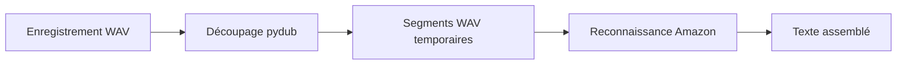

# AudioTranscript : Des segments WAV à la transcription

> AudioTranscript découpe un enregistrement WAV autour des silences, transmet les segments à un service de reconnaissance et rassemble le texte.…

- Page HTML: https://antoineboucher.info/CV/blog/fr/projects/notes/audiotranscript/
- Langue: fr
- Traduction (en): https://antoineboucher.info/CV/blog/projects/notes/audiotranscript/index.md
- Publié: 2026-10-23
- Mis à jour: 2026-10-23
- Auteur: Antoine Boucher (https://antoineboucher.info/CV/index-en.html)

- Dépôt: https://github.com/antoinebou12/AudioTranscript
- Licence: MIT
- Révision inspectée: 91b458e4385f0be729d8af54d8b500dc9d00a274

## Résumé

AudioTranscript découpe un enregistrement WAV autour des silences, transmet les segments à un service de reconnaissance et rassemble le texte. L’implémentation utilise Amazon, même si ses docstrings mentionnent encore Google.

**Pourquoi il existe:** Pipeline de traitement et de transcription audio avec alignement temporel.

**Cas d’usage:** Transcription automatique par lots d'enregistrements audio.

## Cas d’utilisation

CLI Python qui découpe un fichier WAV aux silences et transcrit chaque segment pour former un seul texte.

- **Découper l’audio aux silences** (Utilisateur de la CLI): main.py charge le WAV avec pydub et appelle split_on_silence avec --min-silence-len, --silence-thresh (relatif au dBFS du fichier) et --keep-silence, puis écrit chaque morceau dans audio-chunks/chunkN.wav.
- **Transcrire les segments** (Utilisateur de la CLI, Amazon Transcribe): Chaque segment passe par recognize_amazon (us-east-1, compartiment S3 du .env) et les textes sont joints puis affichés. Le README parle de Google Speech Recognition, mais le code appelle Amazon ; l’option --language n’est pas transmise.
- **Mettre les clés AWS dans .env** (Utilisateur de la CLI, Amazon Transcribe): load_dotenv lit AWS_ACCESS_KEY_ID, AWS_SECRET_ACCESS_KEY et AWS_BUCKET_NAME ; main.py lève une erreur si l’une manque.
- **Tester Whisper sur un exemple** (Utilisateur de la CLI, Hugging Face Hub): ai.py est un script à part qui charge openai/whisper-large-v2 avec transformers et transcrit un échantillon LibriSpeech de test ; il n’est pas relié à la CLI et ses paquets ne figurent pas dans requirements.txt.

### Scénario : Transcrire une entrevue enregistrée

1. Lancer pip install -r requirements.txt, puis python-dotenv, que main.py importe mais que le fichier n’inclut pas.
2. Créer un fichier .env avec AWS_ACCESS_KEY_ID, AWS_SECRET_ACCESS_KEY et AWS_BUCKET_NAME.
3. Lancer python main.py entrevue.wav -m 700 -s -16 (le chemin est positionnel, caro.wav par défaut).
4. main.py écrit les segments dans audio-chunks/ et affiche une barre de progression Rich.
5. Chaque segment est envoyé à Amazon Transcribe et le texte complet s’affiche à la fin.

## Langages (octets GitHub Linguist)

| Langage | % |
| --- | ---: |
| Python | 100 |

## Démarrage (commandes du dépôt, non exécutées ici)

### README.md · Usage

```bash
python main.py --path <audio_file_path> --min-silence-len <min_silence_length> --silence-thresh <silence_threshold> --keep-silence <keep_silence_duration> --language <language_code>
```


## Fonctions et composants

- **Découpage audio** — main.py charge un WAV avec pydub et appelle split_on_silence. Le seuil est calculé par rapport au niveau dBFS de l’enregistrement. Chaque segment est exporté dans audio-chunks avant la reconnaissance.
- **Reconnaissance et sortie** — Un Recognizer de SpeechRecognition lit chaque fichier exporté et appelle recognize_amazon. La boucle ajoute le résultat à whole_text, ensuite affiché et retourné. Typer expose le fichier et les paramètres de découpage.

## Architecture

Composants et connexions vérifiés dans le dépôt.

- Enregistrement WAV → Découpage pydub
- Découpage pydub → Segments WAV temporaires
- Segments WAV temporaires → Reconnaissance Amazon
- Reconnaissance Amazon → Texte assemblé



**Un parcours dans le code:** Suivez transcribe_audio_file plutôt que sa docstring: la fonction vérifie les variables AWS juste avant recognize_amazon. L’argument de langue est exposé par la CLI, sans être transmis à cet appel.

## Limites et points à vérifier

L’audio quitte la machine pour la reconnaissance. Le code réutilise des noms fixes de tâche et de fichier; des exécutions simultanées nécessitent une gestion distincte des noms et fichiers temporaires.

## Fichiers à lire

- [main.py](https://github.com/antoinebou12/AudioTranscript/blob/main/main.py)
- [requirements.txt](https://github.com/antoinebou12/AudioTranscript/blob/main/requirements.txt)


