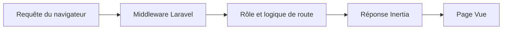

# AuthLaravel : Sessions, rôles et pages Inertia

> AuthLaravel est un projet d’apprentissage du contrôle d’accès avec Laravel et des pages Vue servies par Inertia. Les routes montrent comment les…

- Page HTML: https://antoineboucher.info/CV/blog/fr/projects/notes/authlaravel/
- Langue: fr
- Traduction (en): https://antoineboucher.info/CV/blog/projects/notes/authlaravel/index.md
- Publié: 2026-10-23
- Mis à jour: 2026-10-23
- Auteur: Antoine Boucher (https://antoineboucher.info/CV/index-en.html)
- Dépôt: https://github.com/antoinebou12/AuthLaravel
- Révision inspectée: 2ec4e5d4367341fa789c0027d17ecd43ba80cf01

## Résumé

AuthLaravel est un projet d’apprentissage du contrôle d’accès avec Laravel et des pages Vue servies par Inertia. Les routes montrent comment les utilisateurs authentifiés accèdent au tableau de bord et comment les administrateurs obtiennent une vue différente.

**Pourquoi il existe:** Modèle d'authentification Laravel implémentant JWT, sessions et politiques de rôles.

**Cas d’usage:** Socle d'authentification robuste pour projets et API Laravel.

## Langages (octets GitHub Linguist)

| Langage | % |
| --- | ---: |
| PHP | 53.63 |
| TypeScript | 35.05 |
| Blade | 10.93 |
| JavaScript | 0.37 |
| CSS | 0.02 |

## Démarrage (commandes du dépôt, non exécutées ici)

### AuthLaravel/README.md · Steps

```bash
./vendor/bin/sail up -d
npm build
./vendor/bin/sail artisan migrate
./vendor/bin/sail artisan db:seed
http://localhost/login
email: http://localhost:8025
```

### README.md · Steps

```bash
./vendor/bin/sail up -d
npm build
./vendor/bin/sail artisan migrate
./vendor/bin/sail artisan db:seed
http://localhost/login
email: http://localhost:8025
```


## Fonctions et composants

- **Routes et middleware** — La route du tableau de bord utilise auth et verified, puis vérifie le rôle admin. Cette branche charge les utilisateurs et affiche AdminDashboard; les autres utilisateurs reçoivent Dashboard. La route /admin déclare son propre middleware.
- **Pages et gestion du compte** — Inertia relie les décisions des routes serveur aux pages frontend. ProfileController gère les modifications du profil, tandis que les routes de réinitialisation utilisent le mécanisme de mots de passe de Laravel. L’authentification et le choix de page restent deux opérations distinctes.

## Architecture

Composants et connexions vérifiés dans le dépôt.

- Requête du navigateur → Middleware Laravel
- Middleware Laravel → Rôle et logique de route
- Rôle et logique de route → Réponse Inertia
- Réponse Inertia → Page Vue



**Un parcours dans le code:** Comparez /dashboard et /admin dans routes/web.php. Les deux choisissent une page administrative, mais leurs middleware diffèrent. Il faut aussi vérifier les autorisations sur les opérations de données, au-delà de la navigation.

## Limites et points à vérifier

Il s’agit d’un travail scolaire, sans certification de sécurité. Les routes seules ne prouvent pas que chaque opération de contrôleur respecte le modèle de rôles prévu.

## Fichiers à lire

- [AuthLaravel/routes/web.php](https://github.com/antoinebou12/AuthLaravel/blob/main/AuthLaravel/routes/web.php)
- [AuthLaravel/composer.json](https://github.com/antoinebou12/AuthLaravel/blob/main/AuthLaravel/composer.json)
- [AuthLaravel/package.json](https://github.com/antoinebou12/AuthLaravel/blob/main/AuthLaravel/package.json)

