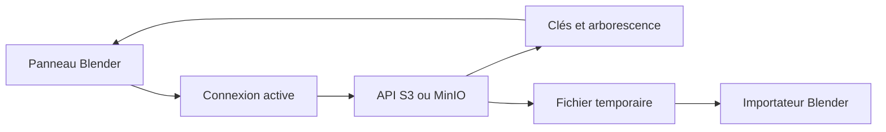

# bloc : Le stockage objet dans Blender

> Mon fork bloc propose un parcours Blender autour du stockage S3 et MinIO. Il conserve le crédit du projet Blender-Cloud-Storage d’origine. L’extension…

- Page HTML: https://antoineboucher.info/CV/blog/fr/projects/notes/bloc/
- Langue: fr
- Traduction (en): https://antoineboucher.info/CV/blog/projects/notes/bloc/index.md
- Publié: 2026-10-23
- Mis à jour: 2026-10-23
- Auteur: Antoine Boucher (https://antoineboucher.info/CV/index-en.html)

- Dépôt: https://github.com/antoinebou12/bloc
- Licence: GPL-3.0
- Révision inspectée: 6c83c217d541b632fdb0b8acc998c37e6f910075

## Résumé

Mon fork bloc propose un parcours Blender autour du stockage S3 et MinIO. Il conserve le crédit du projet Blender-Cloud-Storage d’origine. L’extension transforme les clés d’objets en arborescence, puis télécharge les ressources avant leur import dans Blender.

**Pourquoi il existe:** Intégration directe du stockage objet AWS S3 dans Blender via Boto3, éliminant la saturation des disques locaux pour les assets 3D.

**Cas d’usage:** Synchronisation cloud d'assets 3D, sauvegardes et flux de rendu distribués.

## Cas d’utilisation

Extension Blender qui liste, envoie, télécharge et importe des fichiers de compartiments MinIO ou AWS S3 dans un panneau latéral.

- **Ajouter une connexion** (Utilisateur Blender): Dans les préférences de l’extension, chaque CloudConnection contient le type (MinIO ou AWS S3), le point d’accès ou la région, les clés et le nom du compartiment ; plusieurs connexions peuvent être listées.
- **Parcourir et chercher** (Utilisateur Blender, Compartiment MinIO/S3): Refresh File List appelle list_objects (MinIO) ou list_objects_v2 (boto3) et dessine une arborescence dans l’onglet Cloud de la vue 3D ; le champ Search filtre les noms par sous-chaîne.
- **Envoyer le .blend courant** (Utilisateur Blender, Compartiment MinIO/S3): Upload Current File envoie le .blend enregistré sous son nom de fichier. Le README parle d’envoyer aussi textures et dépendances, mais addon.py n’envoie que le .blend.
- **Importer un maillage** (Utilisateur Blender, Compartiment MinIO/S3): Download enregistre un objet dans le dossier temporaire du système ; Load to Scene le télécharge puis appelle l’importateur STL, OBJ, USD ou PLY de Blender.
- **Supprimer un fichier distant** (Utilisateur Blender, Compartiment MinIO/S3): Delete appelle remove_object (MinIO) ou delete_object (S3) puis rafraîchit la liste.

### Scénario : Importer un scan d’un compartiment MinIO dans Blender

1. Installer l’extension dans Edit > Preferences > Add-ons ; au premier chargement, elle installe boto3, minio et rapidfuzz avec pip.
2. Dans les préférences, ajouter une connexion MinIO avec URL, clés et nom du compartiment.
3. Ouvrir l’onglet Cloud dans la barre latérale de la vue 3D et cliquer sur Refresh File List.
4. Taper une partie du nom dans Search pour filtrer la liste.
5. Cliquer sur Load to Scene sur un fichier .obj ou .stl pour l’importer.

## Langages (octets GitHub Linguist)

| Langage | % |
| --- | ---: |
| Python | 100 |

## Fonctions et composants

- **Connexion et liste** — CloudConnection contient les réglages de fournisseur, service, bucket et région. La connexion active détermine le client boto3 ou MinIO. Les clés reçues sont découpées aux barres obliques pour construire le dictionnaire imbriqué du panneau.
- **Recherche et import** — CloudSearchManager évalue les noms et chemins avec RapidFuzz. Le téléchargement produit d’abord un fichier local temporaire. L’opérateur choisit ensuite un importateur STL, OBJ, PLY ou USD; le transfert et l’import ont donc des états de réussite distincts.

## Architecture

Composants et connexions vérifiés dans le dépôt.

- Panneau Blender → Connexion active
- Connexion active → API S3 ou MinIO
- API S3 ou MinIO → Clés et arborescence
- Clés et arborescence → Panneau Blender
- API S3 ou MinIO → Fichier temporaire
- Fichier temporaire → Importateur Blender

**Un parcours dans le code:** Suivez l’actualisation des clés vers l’arborescence, puis le chargement de la clé choisie vers un fichier et un opérateur d’import. La liste en arrière-plan transmet les mises à jour de l’interface par les timers Blender. L’objet stocké n’est pas un dossier local.

## Limites et points à vérifier

Le parcours S3 effectue un seul appel list_objects_v2 sans pagination. L’envoi du .blend sauvegardé ne prouve pas que les textures externes ont été regroupées.

## Fichiers à lire

- [addon.py](https://github.com/antoinebou12/bloc/blob/main/addon.py)
- [blender_manifest.toml](https://github.com/antoinebou12/bloc/blob/main/blender_manifest.toml)

