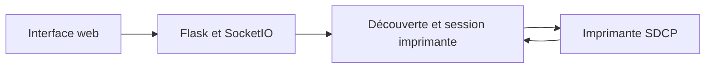

# ChitUI : Une passerelle locale vers les imprimantes résine

> ChitUI fournit une interface web pour des imprimantes résine SDCP. Un processus Python sert les ressources web, découvre les imprimantes sur le réseau…

- Page HTML: https://antoineboucher.info/CV/blog/fr/projects/notes/chitui/
- Langue: fr
- Traduction (en): https://antoineboucher.info/CV/blog/projects/notes/chitui/index.md
- Publié: 2026-10-23
- Mis à jour: 2026-10-23
- Auteur: Antoine Boucher (https://antoineboucher.info/CV/index-en.html)

- Dépôt: https://github.com/antoinebou12/ChitUI
- Révision inspectée: a4236172836c65116a88dcd39a934441691be34c

## Résumé

ChitUI fournit une interface web pour des imprimantes résine SDCP. Un processus Python sert les ressources web, découvre les imprimantes sur le réseau local et traduit les actions du navigateur en communications avec les machines.

**Pourquoi il existe:** Interface de contrôle web pour imprimantes 3D résine SDCP 3.0 avec découverte UDP sur LAN.

**Cas d’usage:** Contrôle à distance d'imprimantes 3D résine sans poste dédié.

## Cas d’utilisation

Interface web Flask qui trouve les imprimantes résine SDCP 3.0 (Chitubox) du réseau, envoie des fichiers et lance l’impression.

- **Découvrir les imprimantes** (Opérateur d’impression, Imprimante résine SDCP): Au démarrage, discover_printers (main.py) diffuse M99999 en UDP sur le port 3000, enregistre les réponses et ouvre un WebSocket vers chaque imprimante sur ws://<ip>:3030/websocket.
- **Suivre l’état de l’imprimante** (Opérateur d’impression, Imprimante résine SDCP): Le navigateur interroge par Socket.IO ; main.py envoie les commandes SDCP 0 (état) et 1 (attributs) et relaie les messages de l’imprimante vers web/js/chitui.js et sdcp.js.
- **Téléverser un fichier** (Opérateur d’impression, Imprimante résine SDCP): POST /upload accepte les fichiers .ctb, .goo et .prz, calcule un MD5 et envoie des morceaux de 1 Mo à http://<ip>:3030/uploadFile/upload ; /progress diffuse le pourcentage.
- **Lister et effacer les fichiers** (Opérateur d’impression, Imprimante résine SDCP): printer_files envoie la commande SDCP 258 avec un chemin de stockage ; action_delete envoie la commande 259 avec la liste des fichiers.
- **Lancer une impression** (Opérateur d’impression, Imprimante résine SDCP): action_print envoie la commande SDCP 128 avec le nom du fichier et StartLayer 0.

### Scénario : Envoyer un modèle tranché à une imprimante résine depuis le navigateur

1. Installer requirements.txt dans un virtualenv et lancer python main.py, ou docker run --net=host pour que la diffusion UDP fonctionne.
2. Au démarrage, ChitUI diffuse M99999 sur le port UDP 3000 et se connecte au WebSocket de chaque imprimante sur le port 3030.
3. Ouvrir http://127.0.0.1:54780/ pour voir les imprimantes trouvées et leur état.
4. Téléverser un fichier .ctb ; ChitUI l’enregistre dans /tmp puis l’envoie en morceaux de 1 Mo avec contrôle MD5.
5. Choisir le fichier dans la liste de l’imprimante et lancer l’impression.

## Langages (octets GitHub Linguist)

| Langage | % |
| --- | ---: |
| JavaScript | 48.61 |
| HTML | 24.57 |
| Python | 22.86 |
| CSS | 3.51 |
| Dockerfile | 0.45 |

## Technologies vérifiées

- SDCP 3.0 — README title
- Docker — README Docker section
- Browser UI — README Usage, default port 54780
- Local network — README Docker host networking for UDP discovery

## Démarrage (commandes du dépôt, non exécutées ici)

### README.md · Setup

```bash
python -mvenv .venv
source .venv/bin/activate
pip install -r requirements.txt
```

### README.md · Usage

```bash
python main.py
```


### Docker

```bash
docker build -t chitui:latest .
docker run --rm --name chitui --net=host chitui:latest
```

## Fonctions et composants

- **Navigateur et serveur local** — main.py crée une application Flask dont les fichiers statiques se trouvent dans web et y ajoute Flask-SocketIO. Les registres d’imprimantes et de WebSocket restent en mémoire. La découverte locale explique l’exigence de réseau hôte Docker du README.
- **Transfert de fichier** — La route d’envoi valide l’extension et conserve temporairement le fichier. La fonction de transfert calcule une empreinte MD5 et transmet des blocs d’un mégaoctet avec leurs décalages. Une route de flux d’événements expose la progression.

## Architecture

Composants et connexions vérifiés dans le dépôt.

- Interface web → Flask et SocketIO
- Flask et SocketIO → Découverte et session imprimante
- Découverte et session imprimante → Imprimante SDCP
- Imprimante SDCP → Découverte et session imprimante



**Un parcours dans le code:** Suivez /upload jusqu’au fichier temporaire et à la fonction de transfert. La progression est globale dans cette implémentation; des envois simultanés nécessiteraient un état par tâche pour éviter de mélanger leurs pourcentages.

## Parcours

1. **Choisir un fichier** — Sélectionnez un fichier d’impression pris en charge pour une imprimante découverte. Le gestionnaire d’envoi accepte les champs multipart file et printer.
2. **Valider la requête** — Le gestionnaire vérifie les champs file ou printer manquants et les extensions ctb, goo et prz avant de continuer.
3. **Stockage temporaire** — Le serveur reçoit le fichier dans un stockage temporaire avant le transfert vers l’imprimante.
4. **Transférer vers l’imprimante** — L’assistant envoie des blocs à l’imprimante sélectionnée sur le réseau local. La progression est disponible sur GET /progress en text/event-stream.
5. **Confirmer le résultat** — Vérifiez la réponse et le fichier sur l’imprimante. L’assistant peut signaler un succès après un bloc en échec; le corps de succès seul ne prouve pas la livraison.

## API


- `POST /upload`
- `GET /upload`
- `GET /progress`

## Limites et points à vérifier

Ce fork est un prototype pour réseau local. Une interface accessible ne confirme ni la compatibilité avec un firmware donné ni la sûreté d’un accès distant.

## Fichiers à lire

- [main.py](https://github.com/antoinebou12/ChitUI/blob/master/main.py)
- [Dockerfile](https://github.com/antoinebou12/ChitUI/blob/master/Dockerfile)
- [requirements.txt](https://github.com/antoinebou12/ChitUI/blob/master/requirements.txt)


