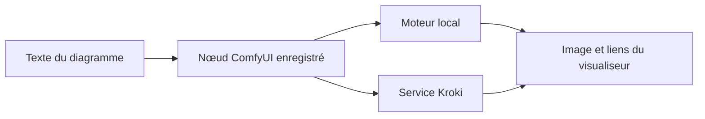

# ComfyUI-UML : Le rendu de diagrammes dans un graphe de nœuds

> ComfyUI-UML ajoute des nœuds de diagrammes à ComfyUI. Le texte entre dans un workflow, un moteur le convertit en image et le workflow peut conserver la…

- Page HTML: https://antoineboucher.info/CV/blog/fr/projects/notes/comfyui-uml/
- Langue: fr
- Traduction (en): https://antoineboucher.info/CV/blog/projects/notes/comfyui-uml/index.md
- Publié: 2026-10-23
- Mis à jour: 2026-10-23
- Auteur: Antoine Boucher (https://antoineboucher.info/CV/index-en.html)
- Dépôt: https://github.com/antoinebou12/ComfyUI-UML
- Révision inspectée: 1f1411580e0db67efd7a4ad669e42ba8677f546a

## Résumé

ComfyUI-UML ajoute des nœuds de diagrammes à ComfyUI. Le texte entre dans un workflow, un moteur le convertit en image et le workflow peut conserver la source ainsi que les liens du visualiseur.

**Pourquoi il existe:** Nœuds personnalisés pour ComfyUI intégrant la synthèse de diagrammes dans les pipelines d'IA générative.

**Cas d’usage:** Pipelines IA visuels associant schémas d'architecture et post-traitement graphique.

## Langages (octets GitHub Linguist)

| Langage | % |
| --- | ---: |
| Python | 50.91 |
| JavaScript | 45.75 |
| HTML | 3.34 |

## Démarrage (commandes du dépôt, non exécutées ici)

### README.md · Installation

```bash
comfy node install comfyui-uml
```


## Fonctions et composants

- **Enregistrement du module** — Le fichier __init__.py charge le paquet nodes sous le nom unique comfyui_uml_nodes pour éviter un conflit avec le module nodes de ComfyUI. Il expose les correspondances de classes et le dossier web de l’extension.
- **Rendu et visualiseur** — Le dossier nodes sépare la génération de diagrammes, les échanges Kroki et les liens du visualiseur. WEB_DIRECTORY expose les ressources du navigateur et l’enregistrement des routes permet de sauvegarder depuis le visualiseur. Le rendu local et Kroki constituent des moteurs distincts.

## Architecture

Composants et connexions vérifiés dans le dépôt.

- Texte du diagramme → Nœud ComfyUI enregistré
- Nœud ComfyUI enregistré → Moteur local
- Nœud ComfyUI enregistré → Service Kroki
- Moteur local → Image et liens du visualiseur
- Service Kroki → Image et liens du visualiseur



**Un parcours dans le code:** Partez de NODE_CLASS_MAPPINGS, puis suivez un nœud vers son moteur de rendu. Le chargeur utilise une spécification de module explicite, car ComfyUI peut importer l’extension directement depuis un chemin de fichier.

## Limites et points à vérifier

Le rendu Kroki transmet le texte au service configuré. Pour des schémas confidentiels, utilisez un service privé adapté et vérifiez les dépendances des moteurs locaux.

## Fichiers à lire

- [__init__.py](https://github.com/antoinebou12/ComfyUI-UML/blob/main/__init__.py)
- [nodes/uml_diagram.py](https://github.com/antoinebou12/ComfyUI-UML/blob/main/nodes/uml_diagram.py)
- [nodes/kroki_client.py](https://github.com/antoinebou12/ComfyUI-UML/blob/main/nodes/kroki_client.py)

