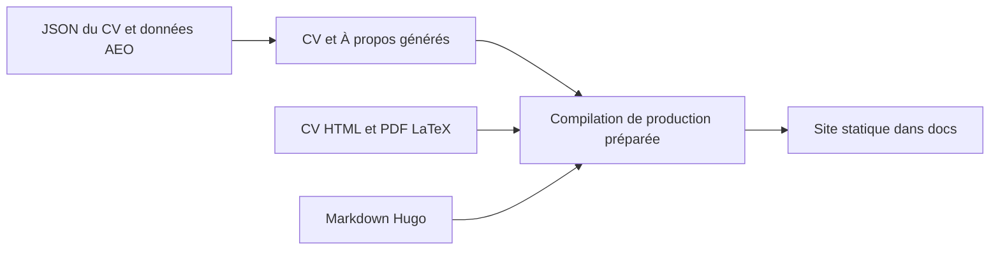

# CV : Un dépôt, plusieurs parcours de publication

> Ce site réunit des CV HTML bilingues, des données structurées, des pages À propos générées, des PDF LaTeX et un blog Hugo. La compilation rassemble ces…

- Page HTML: https://antoineboucher.info/CV/blog/fr/projects/notes/cv/
- Langue: fr
- Traduction (en): https://antoineboucher.info/CV/blog/projects/notes/cv/index.md
- Publié: 2026-10-23
- Mis à jour: 2026-10-23
- Auteur: Antoine Boucher (https://antoineboucher.info/CV/index-en.html)

- Dépôt: https://github.com/antoinebou12/CV
- Licence: MIT
- Révision inspectée: 2fdf469a3056498868554d59661713206d435b7b

## Résumé

Ce site réunit des CV bilingues, des données structurées, des PDF LaTeX et un blog Hugo. Un script local compile et valide le CV et le blog, puis les publie ensemble depuis docs/ sur main.

**Pourquoi il existe:** Portfolio et CV statique bilingue haute performance avec schémas AEO, CI/CD et zéro dépendance runtime.

**Cas d’usage:** Présentation professionnelle et vitrine technique d'ingénierie logicielle.

## Langages (octets GitHub Linguist)

| Langage | % |
| --- | ---: |
| JavaScript | 36.98 |
| HTML | 34.21 |
| Python | 10.17 |
| TeX | 8.19 |
| CSS | 7.68 |
| PowerShell | 0.99 |
| Shell | 0.72 |
| Batchfile | 0.54 |
| Mermaid | 0.39 |
| Go Template | 0.1 |
| Jinja | 0.04 |

## Démarrage (commandes du dépôt, non exécutées ici)

### README.md · Hugo blog (Paper)

```bash
cd hugo/themes/paper
npm ci
npm run build:css
cd ../..
hugo server -D
```

### README.md · Building CVs

```bash
python build_cv.py build --language en
python build_cv.py build --all
python build_cv.py build --all --parallel
python build_cv.py build --language en --output ./output/cv.pdf
python build_cv.py build --language en --clean
python build_cv.py build --language en --verbose
python build_cv.py build --all --ci
```

### README.md · LaTeX CVs

```bash
python build_cv.py build --language en
```

### helm/cv-stack/README.md · Installation

```bash
helm install cv-stack ./helm/cv-stack
helm install cv-stack ./helm/cv-stack -f my-values.yaml
helm install cv-stack ./helm/cv-stack --namespace cv-stack --create-namespace
```

### tools/medium-mirror/README.md · Setup

```bash
cd tools/medium-mirror
npm install
npx playwright install chromium
```


## Fonctions et composants

- **Sources du contenu** — data/resume.en.json et resume.fr.json contiennent le CV lisible par machine. Les pages index HTML restent les sources de leur mise en page. data/aeo.yaml produit les pages À propos, tandis que Hugo gère les articles Markdown et les notes de projets.
- **Assemblage et vérification** — build_docs.py prépare les pages et ressources, compile Hugo sous le chemin du blog, fusionne le sitemap et vérifie le déploiement avant de copier vers docs. Cette préparation empêche une compilation échouée d’écraser l’arbre publié.

## Architecture

Composants et connexions vérifiés dans le dépôt.

- JSON du CV et données AEO → CV et À propos générés
- CV et À propos générés → Compilation de production préparée
- CV HTML et PDF LaTeX → Compilation de production préparée
- Markdown Hugo → Compilation de production préparée
- Compilation de production préparée → Site statique dans docs



**Un parcours dans le code:** Suivez une modification du blog depuis hugo/content vers Hugo, puis vers le dossier de préparation du déploiement. Le CV suit un autre parcours: modifier un JSON ne réécrit pas automatiquement toutes les sections HTML ou LaTeX manuelles.

## Limites et points à vérifier

Les sorties françaises et anglaises nécessitent des vérifications de parité. Une compilation locale réussie reste distincte du push et de la vérification du déploiement public.

## Fichiers à lire

- [scripts/deploy/build_docs.py](https://github.com/antoinebou12/CV/blob/main/scripts/deploy/build_docs.py)
- [scripts/build/render_resume_md.py](https://github.com/antoinebou12/CV/blob/main/scripts/build/render_resume_md.py)
- [scripts/build/generate_aeo_content.py](https://github.com/antoinebou12/CV/blob/main/scripts/build/generate_aeo_content.py)
- [hugo/hugo.toml](https://github.com/antoinebou12/CV/blob/main/hugo/hugo.toml)


