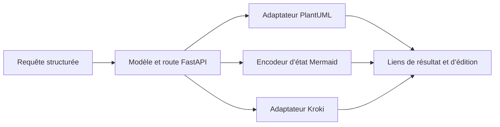

# D2COpenAIPlugin : Acheminer le texte vers les moteurs de diagrammes

> D2COpenAIPlugin est un service FastAPI de diagrammes avec un manifeste de plugin et une interface OpenAPI. L’implémentation choisit un parcours…

- Page HTML: https://antoineboucher.info/CV/blog/fr/projects/notes/d2copenaiplugin/
- Langue: fr
- Traduction (en): https://antoineboucher.info/CV/blog/projects/notes/d2copenaiplugin/index.md
- Publié: 2026-10-23
- Mis à jour: 2026-10-23
- Auteur: Antoine Boucher (https://antoineboucher.info/CV/index-en.html)

- Dépôt: https://github.com/antoinebou12/D2COpenAIPlugin
- Licence: MIT
- Révision inspectée: 7d15ee155d5f392b1d90192dc2e21ec479a6291a

## Résumé

D2COpenAIPlugin est un service FastAPI de diagrammes avec un manifeste de plugin et une interface OpenAPI. L’implémentation choisit un parcours PlantUML, Mermaid ou Kroki selon le langage demandé.

**Pourquoi il existe:** Plugin ChatGPT officiel avec spécification OpenAPI pour convertir des descriptions en diagrammes.

**Cas d’usage:** Intégration ChatGPT pour architectes et développeurs logiciels.

## Langages (octets GitHub Linguist)

| Langage | % |
| --- | ---: |
| Python | 100 |

## Démarrage (commandes du dépôt, non exécutées ici)

### README.md · Quick start

```bash
git clone https://github.com/antoinebou12/D2COpenAIPlugin.git
cd D2COpenAIPlugin
python -m venv .venv
```

### README.md · Quick start

```bash
.\.venv\Scripts\Activate.ps1
```

### README.md · Quick start

```bash
source .venv/bin/activate
```

### README.md · Quick start

```bash
pip install -r requirements-dev.txt
python -m pytest
uvicorn app:app --host 127.0.0.1 --port 5003
```

### README.md · Quick start

```bash
python app.py
```

### plantuml/README.md · Installation

```bash
pip install plantumlapi
```

### plantuml/README.md · Command Line Usage

```bash
usage: plantuml.py [-h] [-o OUT] [-s SERVER] filename [filename ...]
Generate images from PlantUML defined files using PlantUML server
positional arguments: 
  filename            file(s) to generate images from
optional arguments: 
  -h, --help          show this help message and exit 
  -o OUT, --out OUT   directory to put the files into 
  -s SERVER, --server SERVER 
                      server to generate from; defaults to plantuml.com 
```


## Fonctions et composants

- **Modèle de requête** — DiagramRequest contient lang, type, code et theme. Des validations contrôlent le langage et la longueur de la source. /generate_diagram rejette les champs manquants avant de choisir un moteur et de construire les liens de résultat et d’édition.
- **Adaptateurs de rendu** — PlantUML utilise son client dédié, Mermaid construit un état d’éditeur et les alias D2 passent au moteur d2 de Kroki. Les autres langages utilisent le registre Kroki. Les adaptateurs isolent les conventions de liens et d’encodage.

## Architecture

Composants et connexions vérifiés dans le dépôt.

- Requête structurée → Modèle et route FastAPI
- Modèle et route FastAPI → Adaptateur PlantUML
- Modèle et route FastAPI → Encodeur d’état Mermaid
- Modèle et route FastAPI → Adaptateur Kroki
- Adaptateur PlantUML → Liens de résultat et d’édition
- Encodeur d’état Mermaid → Liens de résultat et d’édition
- Adaptateur Kroki → Liens de résultat et d’édition



**Un parcours dans le code:** Comparez les branches PlantUML et D2 dans app.py. Elles partagent le modèle d’entrée, mais utilisent des adaptateurs distincts. La validation de type journalise une valeur invalide sans lever d’erreur; elle diffère donc du contrôle strict du langage.

## Limites et points à vérifier

Le manifeste décrit le format d’intégration d’origine. Sa présence ne prouve ni la disponibilité actuelle dans un produit tiers ni la confidentialité d’un rendu distant.

## Fichiers à lire

- [app.py](https://github.com/antoinebou12/D2COpenAIPlugin/blob/main/app.py)
- [kroki/kroki.py](https://github.com/antoinebou12/D2COpenAIPlugin/blob/main/kroki/kroki.py)
- [mermaid/mermaid.py](https://github.com/antoinebou12/D2COpenAIPlugin/blob/main/mermaid/mermaid.py)


