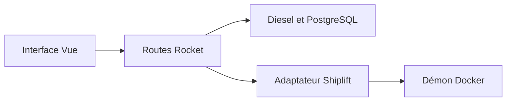

# DasherControl : Un tableau de bord et ses trois frontières

> DasherControl réunit des liens et des applications intégrées dans des espaces de travail sauvegardés. Vue gère l’interface, Rust et Rocket exposent…

- Page HTML: https://antoineboucher.info/CV/blog/fr/projects/notes/dashercontrol/
- Langue: fr
- Traduction (en): https://antoineboucher.info/CV/blog/projects/notes/dashercontrol/index.md
- Publié: 2026-10-23
- Mis à jour: 2026-10-23
- Auteur: Antoine Boucher (https://antoineboucher.info/CV/index-en.html)
- Dépôt: https://github.com/antoinebou12/DasherControl
- Licence: MIT
- Révision inspectée: d5e4b5af44ce8a19025fd41569978f9a3b1b910d

## Résumé

DasherControl réunit des liens et des applications intégrées dans des espaces de travail sauvegardés. Vue gère l’interface, Rust et Rocket exposent l’API, et Diesel conserve la disposition dans PostgreSQL. Le contrôle Docker suit un parcours distinct.

**Pourquoi il existe:** Architecture homelab découplée : backend Rust/Rocket pilotant le démon Docker via Shiplift, associé à un frontend Vue réactif.

**Cas d’usage:** Tableau de bord centralisé pour services conteneurisés en homelab, signets et gestion d'espaces de travail.

## Langages (octets GitHub Linguist)

| Langage | % |
| --- | ---: |
| Rust | 46.84 |
| Vue | 43.67 |
| JavaScript | 4 |
| Shell | 2.55 |
| Dockerfile | 2.05 |
| PLpgSQL | 0.89 |

## Technologies vérifiées

- Rust (Rocket) — Rocket web framework in Cargo.toml
- Vue 3 — Frontend SPA in package.json
- PostgreSQL — Diesel ORM migrations with PostgreSQL
- Docker Compose — Multi-stage Dockerfile and docker-compose.yml

## Démarrage (commandes du dépôt, non exécutées ici)

### README.md · Install (Tested only on Ubuntu 20.04)

```bash
// bash scripts/rust-setup-dev.sh
// bash scripts/js-dev-setup.sh
cd frontend && npm install && npm run build && cd ..
cargo install diesel_cli --no-default-features --features postgres
// go in Rocket.toml and .env and change DATABASE_URL to your postgresql server
diesel migration run
// create admin user
cargo run --bin create_admin
// run web app
cargo run
```

### README.md · Docker

```bash
DOCKER_BUILDKIT=1 docker build -t antoinebou13/dashercontrol .
```

### README.md · Docker-compose

```bash
DOCKER_BUILDKIT=1 docker-compose up -d --build && docker-compose logs
```


### Docker

```bash
DOCKER_BUILDKIT=1 docker build -t antoinebou13/dashercontrol .
DOCKER_BUILDKIT=1 docker-compose up -d --build && docker-compose logs -f
```

## Fonctions et composants

- **Propriété des espaces** — Les routes de liste obtiennent l’identifiant du tenant depuis un jeton. La route de lecture des applets vérifie le tenant de l’espace avant de retourner son contenu. L’espace et ses applets constituent ainsi une disposition persistante liée à un utilisateur.
- **Opérations sur les conteneurs** — src/containers/docker.rs regroupe des opérations Docker avec Shiplift. Ces appels gèrent des conteneurs et des images, plutôt que les dispositions. Leur gestion d’échec est importante: une liste en erreur affiche un message et retourne un vecteur vide.

## Architecture

Composants et connexions vérifiés dans le dépôt.

- Interface Vue → Routes Rocket
- Routes Rocket → Diesel et PostgreSQL
- Routes Rocket → Adaptateur Shiplift
- Adaptateur Shiplift → Démon Docker



**Un parcours dans le code:** Le chargement d’un espace passe par ses routes et ses applets. Le redémarrage d’un conteneur passe plutôt par l’adaptateur Docker. L’interface doit distinguer un espace vide, Docker indisponible et une iframe bloquée par l’application intégrée.

## Services Compose

| Service | Runtime | Ports | Dépend de |
| --- | --- | --- | --- |
| dashercontrol | Build from multi-stage Dockerfile | 8000:8000 | postgres, startup healthcheck |
| postgres | postgres:14-alpine | 5432:5432 |  |

## Limites et points à vérifier

D’anciennes routes de création et suppression appliquent des vérifications différentes. Ce prototype nécessite une revue des autorisations opération par opération avant un déploiement partagé.

## Fichiers à lire

- [src/workspaces/handler.rs](https://github.com/antoinebou12/DasherControl/blob/main/src/workspaces/handler.rs)
- [src/containers/docker.rs](https://github.com/antoinebou12/DasherControl/blob/main/src/containers/docker.rs)
- [Cargo.toml](https://github.com/antoinebou12/DasherControl/blob/main/Cargo.toml)

