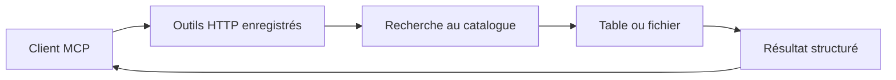

# donneesqc-mcp : Une passerelle MCP vers les données ouvertes

> donneesqc-mcp est un fork qui expose des opérations de données ouvertes du Québec et de Montréal par MCP. Le point d’entrée enregistre les outils et…

- Page HTML: https://antoineboucher.info/CV/blog/fr/projects/notes/donneesqc-mcp/
- Langue: fr
- Traduction (en): https://antoineboucher.info/CV/blog/projects/notes/donneesqc-mcp/index.md
- Publié: 2026-10-23
- Mis à jour: 2026-10-23
- Auteur: Antoine Boucher (https://antoineboucher.info/CV/index-en.html)

- Dépôt: https://github.com/antoinebou12/donneesqc-mcp
- Licence: MIT
- Révision inspectée: 53a6ee4209c44ccfe360556a1b86c29d855f3e2f

## Résumé

donneesqc-mcp est un fork qui expose des opérations de données ouvertes du Québec et de Montréal par MCP. Le point d’entrée enregistre les outils et démarre le transport HTTP; les accès aux données et outils géographiques restent séparés.

**Pourquoi il existe:** Serveur MCP robuste reliant les assistants IA aux données ouvertes du Québec et de Montréal avec validation stricte.

**Cas d’usage:** Interrogation en langage naturel des jeux de données municipaux et provinciaux ouverts.

## Langages (octets GitHub Linguist)

| Langage | % |
| --- | ---: |
| Python | 98.28 |
| Shell | 1.36 |
| Dockerfile | 0.36 |

## Démarrage (commandes du dépôt, non exécutées ici)

### README.md · Installation manuelle

```bash
git clone https://github.com/Stefen-Taime/donneesqc-mcp.git
cd donneesqc-mcp
uv sync
cp .env.example .env
set -a && source .env && set +a
uv run python main.py
```

### README.md · Quick start

```bash
git clone https://github.com/Stefen-Taime/donneesqc-mcp.git
cd donneesqc-mcp
docker compose up -d
```


## Fonctions et composants

- **Démarrage du serveur** — main.py configure les logs, initialise Sentry si demandé, appelle register_all_tools et lance MCP en streamable-http. La surveillance est optionnelle et ne sert pas elle-même les requêtes de données.
- **Frontière des services de données** — Les groupes d’outils couvrent découverte du catalogue, accès CKAN DataStore, téléchargement et enrichissement géographique. Un résultat de catalogue décrit une ressource; le tableau ou fichier demande un accès distinct, parfois dans un autre format.

## Architecture

Composants et connexions vérifiés dans le dépôt.

- Client MCP → Outils HTTP enregistrés
- Outils HTTP enregistrés → Recherche au catalogue
- Recherche au catalogue → Table ou fichier
- Table ou fichier → Résultat structuré
- Résultat structuré → Client MCP



**Un parcours dans le code:** Suivez main vers register_all_tools, puis l’outil d’accès derrière le résultat du catalogue. Les identifiants, formats et systèmes de coordonnées comptent davantage que le seul titre.

## Limites et points à vérifier

Les catalogues et schémas peuvent changer. Une requête réussie ne prouve pas que chaque ressource est récente, complète ou compatible avec un calcul.

## Fichiers à lire

- [main.py](https://github.com/antoinebou12/donneesqc-mcp/blob/main/main.py)
- [tools/__init__.py](https://github.com/antoinebou12/donneesqc-mcp/blob/main/tools/__init__.py)
- [README.md](https://github.com/antoinebou12/donneesqc-mcp/blob/main/README.md)


