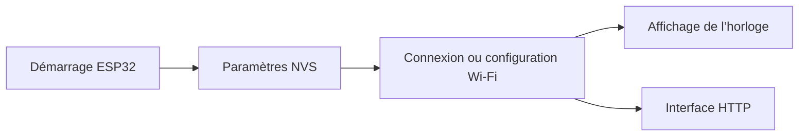

# ESP32-7SEG : Une horloge embarquée avec configuration réseau

> ESP32-7SEG relie une horloge sur ESP32 à une configuration réseau et une interface HTTP. Le démarrage détermine si les paramètres Wi-Fi sauvegardés…

- Page HTML: https://antoineboucher.info/CV/blog/fr/projects/notes/esp32-7seg/
- Langue: fr
- Traduction (en): https://antoineboucher.info/CV/blog/projects/notes/esp32-7seg/index.md
- Publié: 2026-10-23
- Mis à jour: 2026-10-23
- Auteur: Antoine Boucher (https://antoineboucher.info/CV/index-en.html)

- Dépôt: https://github.com/antoinebou12/ESP32-7SEG
- Licence: MIT
- Révision inspectée: 6cac20eed8dc6293d011a0c8a8341654e0870b80

## Résumé

ESP32-7SEG relie une horloge sur ESP32 à une configuration réseau et une interface HTTP. Le démarrage détermine si les paramètres Wi-Fi sauvegardés peuvent être réutilisés ou si le parcours de configuration est nécessaire.

**Pourquoi il existe:** Firmware embarqué et contrôleur pour affichage 7 segments multi-chiffres sur microcontrôleur ESP32.

**Cas d’usage:** Affichage matériel déporté pour métriques ou domotique.

## Cas d’utilisation

Un micrologiciel ESP32 et une appli Android qui pilotent un afficheur 7 segments I2C en minuterie ou chronomètre par Wi-Fi.

- **Connecter la carte au Wi-Fi** (Opérateur de minuterie, ESP32 + afficheur): Sans identifiants enregistrés, wifi.cpp lance un point d’accès ESPTimer ; la page / sert alors le formulaire, et POST /connect enregistre SSID et mot de passe en NVS.
- **Lancer minuterie ou chrono** (Opérateur de minuterie, ESP32 + afficheur): POST /timer-action avec action, mode, minutes et seconds démarre, met en pause ou arrête une tâche FreeRTOS (COUNTDOWN ou STOPWATCH) dans display.cpp.
- **Fixer l’affichage directement** (Opérateur de minuterie, ESP32 + afficheur): POST /update-display avec minutes et seconds appelle updateDisplay() et diffuse un message displayUpdated.
- **Suivre l’état en direct** (Appli Android, ESP32 + afficheur): Le WebSocket /ws diffuse des messages JSON timerStarted, timerStopped et displayUpdated ; le WebSocketClient Android les écoute.
- **Piloter depuis Android** (Opérateur de minuterie, Appli Android): TimerApiService.kt reprend les mêmes points d’accès avec Retrofit (/timer-action, /connect, /scan, /update-display, /device-info) derrière les fragments TimerControl et WiFiConnect.

### Scénario : Préparer un compte à rebours de 5 minutes sur une carte neuve

1. Câbler le module I2C Adafruit sur SDA, SCL, VCC et GND, puis flasher avec pio run -t upload (env firebeetle).
2. Au premier démarrage, rien n’est en NVS : rejoindre le point d’accès ESPTimer et ouvrir la page de la carte.
3. Choisir un réseau dans /scan et l’envoyer à /connect ; la carte l’enregistre et rejoint le réseau local.
4. Lire la nouvelle adresse IP au moniteur série à 115200 bauds et l’ouvrir dans un navigateur ou l’appli Android.
5. Envoyer action=start, mode=countdown, minutes=5, seconds=0 à /timer-action ; l’afficheur décompte et /ws signale chaque mise à jour.

## Langages (octets GitHub Linguist)

| Langage | % |
| --- | ---: |
| Kotlin | 58.26 |
| C++ | 39.56 |
| C | 2.18 |

## Fonctions et composants

- **Démarrage et connectivité** — setup initialise NVS et vérifie le résultat. Il charge les paramètres enregistrés, tente une connexion et revient à setupWiFi en cas d’échec. Ce parcours sert aussi lorsqu’aucun paramètre n’est sauvegardé.
- **Modules d’affichage et web** — Après la configuration réseau, main.cpp appelle startClockDisplay et setupWebServer. display.cpp, wifi.cpp et web_server.cpp séparent l’affichage matériel, la connexion et le traitement HTTP.

## Architecture

Composants et connexions vérifiés dans le dépôt.

- Démarrage ESP32 → Paramètres NVS
- Paramètres NVS → Connexion ou configuration Wi-Fi
- Connexion ou configuration Wi-Fi → Affichage de l’horloge
- Connexion ou configuration Wi-Fi → Interface HTTP

**Un parcours dans le code:** Suivez la branche des paramètres sauvegardés dans setup. Le réseau mémorisé est essayé d’abord, mais un échec rejoint setupWiFi. L’affichage et le serveur web démarrent après cette branche.

## Limites et points à vérifier

Le câblage, l’affichage et le Wi-Fi doivent être vérifiés sur le matériel. Cette interface HTTP ne doit pas être supposée sûre pour une exposition Internet libre.

## Fichiers à lire

- [src/main.cpp](https://github.com/antoinebou12/ESP32-7SEG/blob/main/src/main.cpp)
- [src/display.cpp](https://github.com/antoinebou12/ESP32-7SEG/blob/main/src/display.cpp)
- [src/web_server.cpp](https://github.com/antoinebou12/ESP32-7SEG/blob/main/src/web_server.cpp)
- [platformio.ini](https://github.com/antoinebou12/ESP32-7SEG/blob/main/platformio.ini)

