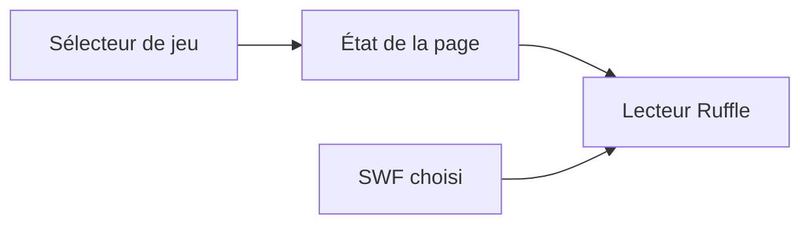

# FlashGames : Une page statique autour d’un lecteur Flash

> FlashGames conserve de petits jeux Flash dans une collection web. La page choisit un SWF et héberge Ruffle. Le fichier du jeu et l’interface HTML qui…

- Page HTML: https://antoineboucher.info/CV/blog/fr/projects/notes/flashgames/
- Langue: fr
- Traduction (en): https://antoineboucher.info/CV/blog/projects/notes/flashgames/index.md
- Publié: 2026-10-23
- Mis à jour: 2026-10-23
- Auteur: Antoine Boucher (https://antoineboucher.info/CV/index-en.html)

- Dépôt: https://github.com/antoinebou12/FlashGames
- Licence: MIT
- Révision inspectée: 7ee14ee2c3029c3b797d22f7594d04c4c900441c

## Résumé

FlashGames conserve de petits jeux Flash dans une collection web. La page choisit un SWF et héberge Ruffle. Le fichier du jeu et l’interface HTML qui l’entoure restent deux éléments distincts.

**Pourquoi il existe:** Archive de préservation de jeux ActionScript/Flash des années 2010.

**Cas d’usage:** Préservation numérique de créations historiques.

## Cas d’utilisation

Une page web qui fait rejouer trois jeux Flash de 2010 grâce à l’émulateur Ruffle, sans aucun plugiciel.

- **Choisir un jeu dans la liste** (Joueur): La liste déroulante #swfSelector d’index.html propose Tag, Ricochet Kill et Ballon, chacun avec une courte description.
- **Jouer à un SWF en ligne** (Joueur, Émulateur Ruffle): loadSWF() crée un lecteur Ruffle avec RufflePlayer.newest() et charge tag.swf, ricochet kill.swf ou jeux.swf dans #swfContainer.
- **Ouvrir un jeu par l’URL** (Joueur): updateHash() inscrit la clé du jeu dans le fragment d’URL ; les écouteurs load et hashchange rechargent ce jeu, donc un lien #tag l’ouvre directement.
- **Lancer la collection en local** (Joueur, Émulateur Ruffle): Le README indique de cloner le dépôt et d’ouvrir index.html ; Ruffle vient d’unpkg, donc une connexion réseau reste nécessaire.

### Scénario : Rejouer Ricochet Kill depuis un lien partagé

1. Ouvrir https://antoinebou12.github.io/FlashGames/ (ou index.html depuis un clone).
2. La page charge le premier jeu, Tag, puisqu’aucun fragment n’est défini.
3. Choisir Ricochet Kill dans la liste Select a Game ; l’URL devient #ricochet_kill.
4. Ruffle charge ricochet kill.swf dans la zone de jeu noire et la barre de description se met à jour.
5. Jouer à la souris, puis copier l’URL pour envoyer quelqu’un directement au même jeu.

## Langages (octets GitHub Linguist)

| Langage | % |
| --- | ---: |
| HTML | 100 |

## Fonctions et composants

- **Sélection et lecteur** — index.html inclut le script Ruffle, un sélecteur et un conteneur de lecture. La sélection modifie l’état de la page avant de charger le SWF choisi. Les styles et icônes viennent de CDN, sans compilation frontend locale.
- **Fichiers de jeux conservés** — Le dépôt conserve les SWF à côté de la page. Ruffle fournit la couche d’exécution compatible avec le navigateur; la page ne réécrit pas les jeux en source JavaScript.

## Architecture

Composants et connexions vérifiés dans le dépôt.

- Sélecteur de jeu → État de la page
- État de la page → Lecteur Ruffle
- SWF choisi → Lecteur Ruffle

**Un parcours dans le code:** Suivez updateHash depuis le sélecteur vers le lecteur. Cette distinction aide au diagnostic: un problème de sélection relève de la page, tandis qu’un comportement de jeu non pris en charge peut relever du lecteur.

## Limites et points à vérifier

La compatibilité doit être vérifiée jeu par jeu. Les scripts externes influencent aussi la disponibilité, même si la page est statique.

## Fichiers à lire

- [index.html](https://github.com/antoinebou12/FlashGames/blob/main/index.html)
- [README.md](https://github.com/antoinebou12/FlashGames/blob/main/README.md)

