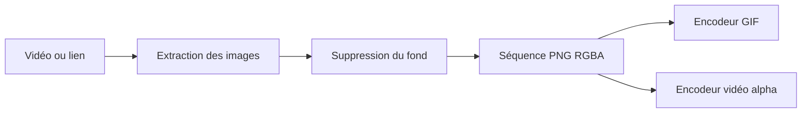

# GreenScreenVideotoAlphaPNGs : Un pipeline d’images transparentes

> GreenScreenVideotoAlphaPNGs sépare acquisition vidéo, extraction des images et suppression du fond de l’encodage final. Les PNG RGBA servent de sortie…

- Page HTML: https://antoineboucher.info/CV/blog/fr/projects/notes/greenscreenvideotoalphapngs/
- Langue: fr
- Traduction (en): https://antoineboucher.info/CV/blog/projects/notes/greenscreenvideotoalphapngs/index.md
- Publié: 2026-10-23
- Mis à jour: 2026-10-23
- Auteur: Antoine Boucher (https://antoineboucher.info/CV/index-en.html)

- Dépôt: https://github.com/antoinebou12/GreenScreenVideotoAlphaPNGs
- Licence: MIT
- Révision inspectée: b487e51f3c702aee2b21f0149727c3cb2708f09a

## Résumé

GreenScreenVideotoAlphaPNGs sépare acquisition vidéo, extraction des images et suppression du fond de l’encodage final. Les PNG RGBA servent de sortie intermédiaire vers un GIF ou une vidéo avec canal alpha.

**Pourquoi il existe:** Pipeline de traitement OpenCV convertissant des vidéos fond vert en séquences PNG avec canal alpha.

**Cas d’usage:** Préparation d'assets d'animation 2D pour la réalité augmentée.

## Cas d’utilisation

Un outil Python qui transforme une vidéo sur fond vert en PNG transparents, GIF ou .mov alpha pour Lens Studio.

- **Télécharger une vidéo par URL** (Créateur de filtres AR, YouTube (yt-dlp)): greenscreen convert accepte une URL YouTube ; convert.py appelle download_video() et download_audio() de download.py, qui s’appuient sur yt-dlp.
- **Découper la vidéo en images** (Créateur de filtres AR, ffmpeg): frames.py écrit des PNG numérotés (0.png, 1.png…) avec ffmpeg, ou avec OpenCV si l’option --no-ffmpeg est donnée.
- **Retirer le fond vert** (Créateur de filtres AR): chroma.py calcule une distance YCbCr à la couleur clé (pixel 1,1 par défaut, tolérance 50–130) et écrit des PNG RVBA dans un dossier voisin *_alpha.
- **Créer un GIF transparent** (Créateur de filtres AR, ffmpeg): greenscreen gif <dossier> utilise par défaut numpngw et l’extension facultative APNGLib, ou une palette ffmpeg avec --fast-ffmpeg ; le GIF est écrit à côté du dossier.
- **Encoder un .mov avec alpha** (Créateur de filtres AR, ffmpeg): greenscreen video <dossier> --fps 30 encode la séquence en Videogen-<horodatage>.mov avec le codec qtrle ou prores_4444.

### Scénario : D’un clip sur fond vert à une animation Lens Studio

1. Lancer bash install.sh (ou .\install.ps1 sous Windows), puis uv run greenscreen --help.
2. Lancer uv run greenscreen convert clip.mp4 pour extraire les images dans clip/ et les images détourées dans clip_alpha/.
3. Les fichiers qui commencent par le nom du clip sont déplacés dans project_clip/, sauf avec --no-project-dir.
4. Lancer uv run greenscreen gif project_clip/clip_alpha --fast-ffmpeg pour obtenir un GIF transparent sans APNGLib.
5. Dans Lens Studio, passer par Resources → Add New → 2D animation from files et choisir les PNG *_alpha.

## Langages (octets GitHub Linguist)

| Langage | % |
| --- | ---: |
| C++ | 57.96 |
| Python | 32.32 |
| JavaScript | 7.93 |
| PowerShell | 0.94 |
| Shell | 0.85 |

## Démarrage (commandes du dépôt, non exécutées ici)

### README.md · Quick start (uv)

```bash
.\install.ps1
uv run greenscreen --help
```

### README.md · Quick start (uv)

```bash
bash install.sh
uv run greenscreen --help
```

### README.md · APNGLib (optional C++ extension)

```bash
$env:SKIP_APNGLIB='1'; uv sync --extra dev
```

### README.md · APNGLib (optional C++ extension)

```bash
$env:SKIP_APNGLIB='0'; uv sync --extra dev
```


## Fonctions et composants

- **Étape de conversion** — La commande Typer convert délègue à run_convert. Elle accepte une vidéo locale ou un lien et peut privilégier FFmpeg ou imposer OpenCV. Le module chroma traite la transparence séparément de l’acquisition.
- **Choix d’encodage** — gif et video prennent un dossier de PNG. Le GIF propose une palette FFmpeg; video accepte qtrle ou prores_4444. Cette étape permet de changer cadence et format sans recommencer l’acquisition.

## Architecture

Composants et connexions vérifiés dans le dépôt.

- Vidéo ou lien → Extraction des images
- Extraction des images → Suppression du fond
- Suppression du fond → Séquence PNG RGBA
- Séquence PNG RGBA → Encodeur GIF
- Séquence PNG RGBA → Encodeur vidéo alpha



**Un parcours dans le code:** Suivez cmd_convert vers run_convert, puis utilisez ses PNG dans cmd_video. Conserver ces images permet d’inspecter les contours de transparence avant que la compression les masque.

## Limites et points à vérifier

Les codecs dépendent de la compilation FFmpeg installée. La transparence GIF et le canal alpha vidéo ont des capacités différentes.

## Fichiers à lire

- [src/greenscreen/cli.py](https://github.com/antoinebou12/GreenScreenVideotoAlphaPNGs/blob/master/src/greenscreen/cli.py)
- [src/greenscreen/chroma.py](https://github.com/antoinebou12/GreenScreenVideotoAlphaPNGs/blob/master/src/greenscreen/chroma.py)
- [src/greenscreen/video_pipeline.py](https://github.com/antoinebou12/GreenScreenVideotoAlphaPNGs/blob/master/src/greenscreen/video_pipeline.py)


