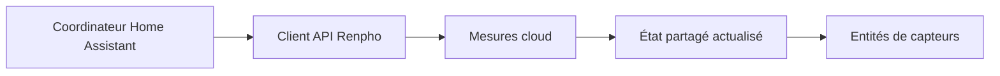

# hass_renpho : Interroger une API cloud pour Home Assistant

> hass_renpho est un fork d’intégration Home Assistant pour les mesures Renpho. Un coordinateur actualise les données cloud et les entités de capteurs…

- Page HTML: https://antoineboucher.info/CV/blog/fr/projects/notes/hass-renpho/
- Langue: fr
- Traduction (en): https://antoineboucher.info/CV/blog/projects/notes/hass-renpho/index.md
- Publié: 2026-10-23
- Mis à jour: 2026-10-23
- Auteur: Antoine Boucher (https://antoineboucher.info/CV/index-en.html)

- Dépôt: https://github.com/antoinebou12/hass_renpho
- Révision inspectée: b38c9dfa5416e5c1d09619d963b7bfaac238494b

## Résumé

hass_renpho est un fork d’intégration Home Assistant pour les mesures Renpho. Un coordinateur actualise les données cloud et les entités de capteurs exposent cet état. Le dépôt avertit que l’ancien parcours API ne fonctionne plus de façon fiable.

**Pourquoi il existe:** Composant Home Assistant personnalisé décodant la télémétrie biométrique des balances connectées Renpho.

**Cas d’usage:** Centralisation des données de santé privées dans Home Assistant.

## Langages (octets GitHub Linguist)

| Langage | % |
| --- | ---: |
| Python | 99.51 |
| Dockerfile | 0.49 |

## Démarrage (commandes du dépôt, non exécutées ici)

### README.md · Installation

```bash
Stable
Use the latest release
Not stable
git clone https://github.com/antoinebou12/hass_renpho
```


## Fonctions et composants

- **Actualisation coordonnée** — RenphoWeightCoordinator étend DataUpdateCoordinator avec un intervalle configurable. Une actualisation appelle get_measurements, list_girth et list_girth_goal, puis conserve l’heure de mise à jour.
- **Erreurs et état des capteurs** — Le coordinateur transforme les délais et erreurs API en UpdateFailed. L’annulation lors de l’arrêt est traitée séparément. Les définitions des capteurs et le client API restent hors de cette classe.

## Architecture

Composants et connexions vérifiés dans le dépôt.

- Coordinateur Home Assistant → Client API Renpho
- Client API Renpho → Mesures cloud
- Mesures cloud → État partagé actualisé
- État partagé actualisé → Entités de capteurs



**Un parcours dans le code:** Suivez _async_update_data à travers ses trois appels et exceptions. Une valeur peut être la dernière lecture réussie; l’état et l’heure d’actualisation permettent de la distinguer d’une nouvelle mesure.

## Limites et points à vérifier

L’API est non officielle et le README rapporte des pannes. Cet article ne confirme ni la compatibilité actuelle ni la précision médicale des mesures.

## Fichiers à lire

- [custom_components/renpho/coordinator.py](https://github.com/antoinebou12/hass_renpho/blob/master/custom_components/renpho/coordinator.py)
- [custom_components/renpho/sensor.py](https://github.com/antoinebou12/hass_renpho/blob/master/custom_components/renpho/sensor.py)
- [custom_components/renpho/api_renpho.py](https://github.com/antoinebou12/hass_renpho/blob/master/custom_components/renpho/api_renpho.py)


