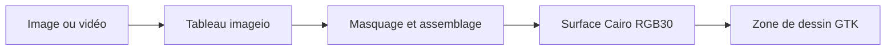

# HDR-10bpp-Display-Test : Assembler des canaux dix bits pour Cairo

> Cette expérience affiche des images dans GTK avec Cairo. Viewer3.py rend la représentation explicite: les canaux sont masqués et assemblés dans un…

- Page HTML: https://antoineboucher.info/CV/blog/fr/projects/notes/hdr-10bpp-display-test/
- Langue: fr
- Traduction (en): https://antoineboucher.info/CV/blog/projects/notes/hdr-10bpp-display-test/index.md
- Publié: 2026-10-23
- Mis à jour: 2026-10-23
- Auteur: Antoine Boucher (https://antoineboucher.info/CV/index-en.html)

- Dépôt: https://github.com/antoinebou12/HDR-10bpp-Display-Test
- Révision inspectée: 9c72e072cdcae0c7d922f502049b6a155fa2daed

## Résumé

Cette expérience affiche des images dans GTK avec Cairo. Viewer3.py rend la représentation explicite: les canaux sont masqués et assemblés dans un tampon uint32 avant la création d’une surface RGB30.

**Pourquoi il existe:** Pipeline de test d'affichage 10 bits HDR vérifiant le banding de couleur et la luminance sous Linux.

**Cas d’usage:** Calibration et vérification d'écrans HDR 10 bits sur stations de travail Linux.

## Langages (octets GitHub Linguist)

| Langage | % |
| --- | ---: |
| Python | 98.43 |
| Shell | 1.57 |

## Démarrage (commandes du dépôt, non exécutées ici)

### README.md · Prerequisites

```bash
sudo apt-get install xserver-xorg python3 python3-gi python3-gi-cairo gir1.2-gtk-3.0 imagej
```

### README.md · Installing

```bash
pip3 install imageio
```

### README.md · Running the test

```bash
git clone https://github.com/yourusername/HDR-10bpp-Display-Test.git
```

### README.md · Running the test

```bash
cd HDR-10bpp-Display-Test
```

### README.md · Running the test

```bash
sudo systemctl stop lightdm || sudo systemctl stop gdm
sudo pkill Xorg
```


## Fonctions et composants

- **Pixels et affichage** — imageio lit le tableau source. _draw_on alloue un tampon et décale chaque canal selon la profondeur choisie, puis le transmet à cairo.ImageSurface.create_for_data. Le callback GTK affiche cette surface.
- **Parcours vidéo** — Un thread lit les images vidéo et met à jour l’image courante à la cadence demandée. Le dessin traite aussi manuellement les événements GTK. Cette ancienne approche demande de vérifier quel thread possède les opérations d’interface.

## Architecture

Composants et connexions vérifiés dans le dépôt.

- Image ou vidéo → Tableau imageio
- Tableau imageio → Masquage et assemblage
- Masquage et assemblage → Surface Cairo RGB30
- Surface Cairo RGB30 → Zone de dessin GTK



**Un parcours dans le code:** Examinez _draw_on pour voir comment la profondeur change les décalages et le format de surface. Le stockage dix bits concerne la précision numérique; les courbes HDR, les métadonnées et la calibration demandent un travail supplémentaire.

## Limites et points à vérifier

La table mentionne une entrée douze bits sans format Cairo correspondant. Ce code ne démontre pas un pipeline d’affichage HDR complet.

## Fichiers à lire

- [Viewer3.py](https://github.com/antoinebou12/HDR-10bpp-Display-Test/blob/master/Viewer3.py)
- [Xdepth.sh](https://github.com/antoinebou12/HDR-10bpp-Display-Test/blob/master/Xdepth.sh)
- [xorg.conf](https://github.com/antoinebou12/HDR-10bpp-Display-Test/blob/master/xorg.conf)


