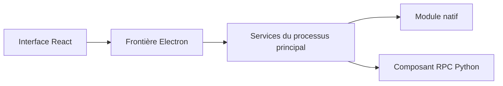

# hydra : Une application Electron entre plusieurs processus

> Ce fork Hydra est un lanceur desktop avec Electron et React. Sa compilation comprend aussi un module natif et un composant RPC Python. Ces frontières…

- Page HTML: https://antoineboucher.info/CV/blog/fr/projects/notes/hydra/
- Langue: fr
- Traduction (en): https://antoineboucher.info/CV/blog/projects/notes/hydra/index.md
- Publié: 2026-10-23
- Mis à jour: 2026-10-23
- Auteur: Antoine Boucher (https://antoineboucher.info/CV/index-en.html)
- Dépôt: https://github.com/antoinebou12/hydra
- Licence: MIT
- Révision inspectée: e769e3b398c039a9e3d9977dbb1e5aa70776732e

## Résumé

Ce fork Hydra est un lanceur desktop avec Electron et React. Sa compilation comprend aussi un module natif et un composant RPC Python, chacun avec sa chaîne d’outils.

**Pourquoi il existe:** Application de bureau orchestrant métadonnées et gestion de ludothèque.

**Cas d’usage:** Lanceur et gestionnaire de jeux open source.

## Langages (octets GitHub Linguist)

| Langage | % |
| --- | ---: |
| TypeScript | 81.85 |
| SCSS | 10.64 |
| Rust | 6.46 |
| Python | 0.55 |
| JavaScript | 0.49 |
| HTML | 0.01 |
| NSIS | 0 |

## Fonctions et composants

- **Processus principal et affichage** — package.json dirige Electron vers out/main/index.js. Des vérifications TypeScript distinctes couvrent les parties node et web. Electron-Vite compile l’application, tandis que React et ses bibliothèques appartiennent à l’affichage.
- **Modules natifs et Python** — build:native lance un script de module natif. build:python-rpc prépare python_rpc séparément et les paquets de plateforme utilisent ces parcours. Installer les dépendances JavaScript ne constitue donc pas toute la compilation de livraison.

## Architecture

Composants et connexions vérifiés dans le dépôt.

- Interface React → Frontière Electron
- Frontière Electron → Services du processus principal
- Services du processus principal → Module natif
- Services du processus principal → Composant RPC Python

**Un parcours dans le code:** Partez des scripts et distinguez compilation de l’interface, module natif et paquet Python. Examinez ensuite l’API entre processus pour une fonction donnée; les dépendances seules n’indiquent pas son propriétaire.

## Limites et points à vérifier

Cette note décrit la structure d’un fork et conserve le crédit d’origine. Elle ne revendique pas la création du lanceur et ne vérifie pas ses sources de téléchargement.

## Fichiers à lire

- [package.json](https://github.com/antoinebou12/hydra/blob/main/package.json)
- [electron.vite.config.ts](https://github.com/antoinebou12/hydra/blob/main/electron.vite.config.ts)
- [README.md](https://github.com/antoinebou12/hydra/blob/main/README.md)

