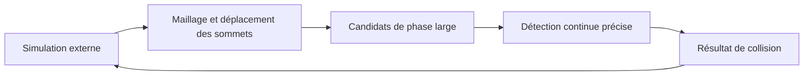

# ipc-toolkit : Les requêtes de collision comme frontière de bibliothèque

> ipc-toolkit fournit des composants géométriques pour la simulation avec contacts. Ce fork contient maillages de collision, candidats, détection continue…

- Page HTML: https://antoineboucher.info/CV/blog/fr/projects/notes/ipc-toolkit/
- Langue: fr
- Traduction (en): https://antoineboucher.info/CV/blog/projects/notes/ipc-toolkit/index.md
- Publié: 2026-10-23
- Mis à jour: 2026-10-23
- Auteur: Antoine Boucher (https://antoineboucher.info/CV/index-en.html)

- Dépôt: https://github.com/antoinebou12/ipc-toolkit
- Licence: MIT
- Révision inspectée: 4d9e47e9f5b2afd46be99234d127d12e3c7a74cd

## Résumé

ipc-toolkit fournit des composants géométriques pour la simulation avec contacts. Ce fork contient maillages de collision, candidats, détection continue et énergies de contact. Une simulation externe conserve la gestion du temps et de la résolution.

**Pourquoi il existe:** Boîte à outils d'ingénierie pour la gestion du contact et de la friction dans les simulations par éléments finis.

**Cas d’usage:** Mécanique du contact continu non linéaire pour moteurs physiques.

## Cas d’utilisation

Bibliothèque C++ avec liaisons Python pour l’Incremental Potential Contact : barrières, CCD et frottement pour simulateurs.

- **Construire un maillage** (Développeur simulation): ipc::CollisionMesh reçoit les matrices de sommets, d’arêtes et de faces (Eigen), comme dans le démarrage rapide du README.
- **Trouver les contacts sous dhat** (Développeur simulation, Simulateur hôte): NormalCollisions::build() s’appuie sur une phase large (grille de hachage, LBVH, balayage…) pour réunir les paires de primitives plus proches que dhat.
- **Évaluer barrière et dérivées** (Développeur simulation, Simulateur hôte): BarrierPotential renvoie l’énergie, le gradient et la hessienne creuse que le solveur hôte ajoute à son objectif.
- **Obtenir un pas sans collision** (Développeur simulation, Simulateur hôte): compute_collision_free_stepsize() lance la détection de collision continue (Tight Inclusion par défaut, variantes non linéaire et additive dans src/ipc/ccd) entre deux états de sommets.
- **Ajouter le frottement** (Développeur simulation, Simulateur hôte): FrictionPotential agit sur les TangentialCollisions ; smooth_mu.hpp ajoute des coefficients de frottement anisotrope elliptique (commit Anisotropic friction #210).
- **Le piloter depuis Python** (Développeur simulation): Les liaisons pybind11 de python/src exposent la même API sous ipctk (pip install ipctk), compilées quand IPC_TOOLKIT_BUILD_PYTHON est activé.

### Scénario : Ajouter le contact à un pas de temps implicite

1. Installer les liaisons avec pip install ipctk, ou ajouter la bibliothèque à un projet CMake.
2. Créer un CollisionMesh à partir des sommets, arêtes et faces de la scène.
3. Construire les NormalCollisions avec dhat = 1e-3 pour les positions actuelles.
4. Ajouter l’énergie, le gradient et la hessienne de BarrierPotential au système de Newton du solveur.
5. Avant d’accepter le pas de Newton, le limiter avec compute_collision_free_stepsize pour qu’aucune surface ne se traverse.

## Langages (octets GitHub Linguist)

| Langage | % |
| --- | ---: |
| C++ | 94.46 |
| CMake | 2.98 |
| Python | 2.1 |
| Cuda | 0.38 |
| Dockerfile | 0.08 |

## Technologies vérifiées

- C++ — Library language from repository sources
- CCD — Continuous collision detection in ipc.hpp / ipc.cpp
- CMake — CMakeLists.txt build system

## Démarrage (commandes du dépôt, non exécutées ici)

### python/README.md · Installation

```bash
pip install ipctk
```

### python/README.md · Installation

```bash
pip install git+https://github.com/ipc-sim/ipc-toolkit
```

### python/README.md · Build

```bash
pip install .
```

### python/README.md · Build

```bash
python -c "import ipctk"
```

### python/README.md · CMake Build

```bash
mkdir build
cd build
cmake -DCMAKE_BUILD_TYPE=Release -DIPC_TOOLKIT_BUILD_PYTHON=ON ..
make -j$(nproc)
```


## Fonctions et composants

- **Géométrie et requêtes de collision** — ipc.hpp prend un CollisionMesh et des positions pour vérifier les intersections ou un déplacement sans collision. Les phases large et étroite ont des paramètres explicites avec valeurs par défaut, séparant candidats et tests détaillés.
- **Calculs de contact** — L’arborescence sépare distance, barrière, friction, tangente et potentiels. Ces composants alimentent les objectifs et dérivées de l’appelant, sans intégrer automatiquement toute une scène physique.

## Architecture

Composants et connexions vérifiés dans le dépôt.

- Simulation externe → Maillage et déplacement des sommets
- Maillage et déplacement des sommets → Candidats de phase large
- Candidats de phase large → Détection continue précise
- Détection continue précise → Résultat de collision
- Résultat de collision → Simulation externe



**Un parcours dans le code:** Suivez is_step_collision_free depuis sa déclaration. Le résultat répond à une requête géométrique pour un déplacement proposé. L’appelant décide comment cela change son pas, sa recherche linéaire ou sa résolution de contact.

## Limites et points à vérifier

La présence du fork ne prouve pas l’acceptation de modifications en amont. Le comportement numérique dépend des entrées, tolérances et de l’intégration au solveur.

## Fichiers à lire

- [src/ipc/ipc.hpp](https://github.com/antoinebou12/ipc-toolkit/blob/main/src/ipc/ipc.hpp)
- [src/ipc/ipc.cpp](https://github.com/antoinebou12/ipc-toolkit/blob/main/src/ipc/ipc.cpp)
- [CMakeLists.txt](https://github.com/antoinebou12/ipc-toolkit/blob/main/CMakeLists.txt)


