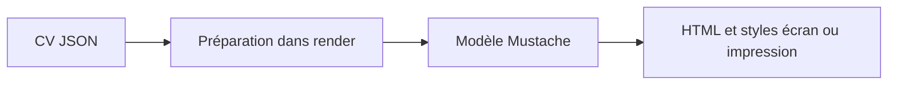

# jsonresume-theme-kendall : D’un document JSON au modèle de CV

> Ce fork du thème Kendall JSON Resume transforme un CV structuré en HTML. Le moteur prépare les champs de présentation, puis utilise un modèle Mustache…

- Page HTML: https://antoineboucher.info/CV/blog/fr/projects/notes/jsonresume-theme-kendall/
- Langue: fr
- Traduction (en): https://antoineboucher.info/CV/blog/projects/notes/jsonresume-theme-kendall/index.md
- Publié: 2026-10-23
- Mis à jour: 2026-10-23
- Auteur: Antoine Boucher (https://antoineboucher.info/CV/index-en.html)
- Dépôt: https://github.com/antoinebou12/jsonresume-theme-kendall
- Licence: MIT
- Révision inspectée: d1401cef84466c09cb84f8752c185fc96e3f5c6e

## Résumé

Ce fork du thème Kendall JSON Resume transforme un CV structuré en HTML. Le moteur prépare les champs de présentation, puis utilise un modèle Mustache avec les styles écran et impression.

**Pourquoi il existe:** Thème CV minimaliste parfait pour l'impression avec balisage sémantique schema.org.

**Cas d’usage:** Génération automatique de CV à partir de fichiers JSON structurés.

## Langages (octets GitHub Linguist)

| Langage | % |
| --- | ---: |
| JavaScript | 55.76 |
| CSS | 44.24 |

## Démarrage (commandes du dépôt, non exécutées ici)

### README.md · Install the command line

```bash
sudo npm install -g resume-cli
```

### README.md · Install npm packages

```bash
sudo npm install
```

### README.md · Serve theme

```bash
resume serve --theme .
```

### README.md · Serve theme

```bash
Preview: http://localhost:4000
Press ctrl-c to stop
```


## Fonctions et composants

- **Préparation des données** — index.js associe les réseaux aux icônes, formate les dates et prépare les indicateurs de sections optionnelles. Il choisit aussi une image explicite ou Gravatar. Cette logique adapte les données au modèle.
- **Modèle et styles** — resume.template contient la structure HTML; style.css et print.css distinguent écran et impression. La transformation des données et la mise en page peuvent être examinées séparément.

## Architecture

Composants et connexions vérifiés dans le dépôt.

- CV JSON → Préparation dans render
- Préparation dans render → Modèle Mustache
- Modèle Mustache → HTML et styles écran ou impression



**Un parcours dans le code:** Suivez startDate vers les champs de mois et d’année. Le moteur modifie l’objet fourni; un appelant qui le réutilise doit tenir compte des données de présentation ajoutées.

## Limites et points à vérifier

Les anciennes dépendances et les champs attendus demandent une vérification. Un JSON valide ne garantit pas une mise en page imprimée correcte.

## Fichiers à lire

- [index.js](https://github.com/antoinebou12/jsonresume-theme-kendall/blob/master/index.js)
- [resume.template](https://github.com/antoinebou12/jsonresume-theme-kendall/blob/master/resume.template)
- [print.css](https://github.com/antoinebou12/jsonresume-theme-kendall/blob/master/print.css)

