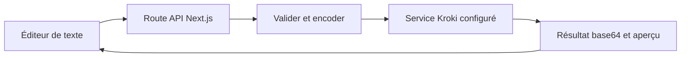

# kroki-playground : Un éditeur, une API et un moteur de rendu

> kroki-playground est une interface Next.js pour modifier des diagrammes textuels et prévisualiser leur rendu. Sa route serveur valide le type et le…

- Page HTML: https://antoineboucher.info/CV/blog/fr/projects/notes/kroki-playground/
- Langue: fr
- Traduction (en): https://antoineboucher.info/CV/blog/projects/notes/kroki-playground/index.md
- Publié: 2026-10-23
- Mis à jour: 2026-10-23
- Auteur: Antoine Boucher (https://antoineboucher.info/CV/index-en.html)

- Dépôt: https://github.com/antoinebou12/kroki-playground
- Licence: MIT
- Révision inspectée: 8def712a64de0f9badb65f2e1a3bb855aeb25523

## Résumé

kroki-playground est une interface Next.js pour modifier des diagrammes textuels et prévisualiser leur rendu. Sa route serveur valide le type et le format, encode la source et récupère le résultat auprès de Kroki.

**Pourquoi il existe:** Suite d'expérimentation de diagrammes en TypeScript déployée sur Vercel avec rendu instantané.

**Cas d’usage:** Prototypage rapide de diagrammes d'architecture variés.

## Langages (octets GitHub Linguist)

| Langage | % |
| --- | ---: |
| TypeScript | 98.19 |
| JavaScript | 0.99 |
| CSS | 0.82 |

## Fonctions et composants

- **Validation avant le rendu** — app/api/generate-diagram/route.ts traite GET et POST avec une validation commune. encodeDiagramPayload prépare la source pour le lien Kroki. KROKI_BASE_URL choisit le service de rendu côté serveur.
- **Réponse et états d’échec** — La route lit les octets reçus et retourne diagramUrl, diagramData en base64 et mimeType. Une erreur HTTP de Kroki devient une réponse 502 avec un code d’erreur externe, distincte d’une entrée invalide.

## Architecture

Composants et connexions vérifiés dans le dépôt.

- Éditeur de texte → Route API Next.js
- Route API Next.js → Valider et encoder
- Valider et encoder → Service Kroki configuré
- Service Kroki configuré → Résultat base64 et aperçu
- Résultat base64 et aperçu → Éditeur de texte

**Un parcours dans le code:** Suivez POST depuis req.json jusqu’à la validation et l’appel externe. La réponse contient les octets encodés de l’image, plutôt qu’un corps HTTP entièrement en SVG. Le client doit utiliser le type MIME retourné pour les afficher.

## API

## Limites et points à vérifier

Un lien de partage encodé contient toujours une source récupérable. La compression et le base64 ne rendent pas un diagramme confidentiel privé.

## Fichiers à lire

- [app/api/generate-diagram/route.ts](https://github.com/antoinebou12/kroki-playground/blob/main/app/api/generate-diagram/route.ts)
- [lib/kroki/encode.ts](https://github.com/antoinebou12/kroki-playground/blob/main/lib/kroki/encode.ts)
- [lib/kroki/validate.ts](https://github.com/antoinebou12/kroki-playground/blob/main/lib/kroki/validate.ts)
- [package.json](https://github.com/antoinebou12/kroki-playground/blob/main/package.json)

