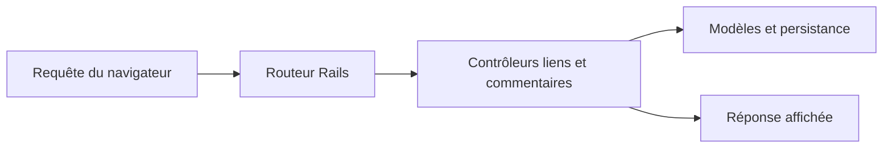

# linkshare : Une application Rails de partage de liens

> linkshare est un projet Rails archivé pour publier des liens, commenter et voter. Ses routes décrivent une application web classique avec gestion des…

- Page HTML: https://antoineboucher.info/CV/blog/fr/projects/notes/linkshare/
- Langue: fr
- Traduction (en): https://antoineboucher.info/CV/blog/projects/notes/linkshare/index.md
- Publié: 2026-10-23
- Mis à jour: 2026-10-23
- Auteur: Antoine Boucher (https://antoineboucher.info/CV/index-en.html)

- Dépôt: https://github.com/antoinebou12/linkshare
- Révision inspectée: 2e223f99a50c07f3e60377f6c3252051b815c468

## Résumé

linkshare est un projet Rails archivé pour partager des liens, commenter et voter. Les pages sont rendues sur le serveur, avec une gestion des comptes et une interface administrative.

**Pourquoi il existe:** Plateforme Ruby on Rails avec extraction asynchrone de métadonnées OpenGraph.

**Cas d’usage:** Partage social et organisation de liens avec prévisualisation riche.

## Langages (octets GitHub Linguist)

| Langage | % |
| --- | ---: |
| Ruby | 55.29 |
| HTML | 19.55 |
| CSS | 13.28 |
| JavaScript | 11.56 |
| CoffeeScript | 0.32 |

## Fonctions et composants

- **Ressources et actions** — config/routes.rb associe les liens aux actions de ressources et y imbrique les commentaires. Les routes like et dislike appellent upvote et downvote. La page racine utilise links#index.
- **Comptes et administration** — Devise fournit les routes de compte et RailsAdmin est monté sous /admin. Les contrôleurs et modèles sont distincts des routes; déclarer une route ne décrit pas toutes ses autorisations ou sa persistance.

## Architecture

Composants et connexions vérifiés dans le dépôt.

- Requête du navigateur → Routeur Rails
- Routeur Rails → Contrôleurs liens et commentaires
- Contrôleurs liens et commentaires → Modèles et persistance
- Contrôleurs liens et commentaires → Réponse affichée

**Un parcours dans le code:** Suivez PUT /links/:id/like jusqu’à upvote, puis à l’opération du modèle. Cela distingue l’action HTTP, l’identité et le vote conservé.

## Limites et points à vérifier

Les dépendances archivées et l’administration exposée demandent une revue avant redéploiement. Les routes seules ne prouvent pas la justesse des autorisations.

## Fichiers à lire

- [config/routes.rb](https://github.com/antoinebou12/linkshare/blob/master/config/routes.rb)
- [Gemfile](https://github.com/antoinebou12/linkshare/blob/master/Gemfile)
- [README.md](https://github.com/antoinebou12/linkshare/blob/master/README.md)

