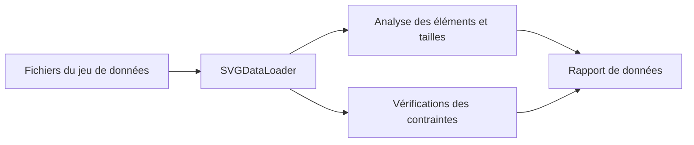

# LLM2SVG : Analyser les données avant de parler de modèle

> Ce fork LLM2SVG contient des outils de données SVG et une structure d’évaluation. L’implémentation permet d’examiner exemples et contraintes, sans…

- Page HTML: https://antoineboucher.info/CV/blog/fr/projects/notes/llm2svg/
- Langue: fr
- Traduction (en): https://antoineboucher.info/CV/blog/projects/notes/llm2svg/index.md
- Publié: 2026-10-23
- Mis à jour: 2026-10-23
- Auteur: Antoine Boucher (https://antoineboucher.info/CV/index-en.html)
- Dépôt: https://github.com/antoinebou12/LLM2SVG
- Révision inspectée: a8337761b49bbdcbac24f58c6adc5f17d1ac2a07

## Résumé

Ce fork LLM2SVG contient des outils de données SVG et une structure d’évaluation. L’implémentation permet d’examiner exemples et contraintes, sans démontrer un modèle texte-vers-SVG terminé ou entraîné.

**Pourquoi il existe:** Générateur et validateur Python d'illustrations vectorielles SVG à partir de descriptions en langage naturel.

**Cas d’usage:** Génération automatisée d'icônes et d'illustrations vectorielles pour systèmes de design.

## Langages (octets GitHub Linguist)

| Langage | % |
| --- | ---: |
| Python | 100 |

## Démarrage (commandes du dépôt, non exécutées ici)

### README.md · Dependencies

```bash
pip install cairosvg torch torchvision
```


## Fonctions et composants

- **Chargement et contraintes** — SVGAnalyzer utilise SVGDataLoader et SVGConstraints. Il énumère les exemples, relève les tailles et vérifie les contraintes. Le chargement et la validation constituent des responsabilités distinctes.
- **Rapports sur les données** — L’analyseur compte les noms d’éléments et conserve des résultats de validation par exemple. Sa méthode de résumé retourne un DataFrame pandas. Le comptage utilise une expression régulière pour tolérer du SVG mal formé.

## Architecture

Composants et connexions vérifiés dans le dépôt.

- Fichiers du jeu de données → SVGDataLoader
- SVGDataLoader → Analyse des éléments et tailles
- SVGDataLoader → Vérifications des contraintes
- Analyse des éléments et tailles → Rapport de données
- Vérifications des contraintes → Rapport de données



**Un parcours dans le code:** Suivez validate_all_svgs et comparez-le à analyze_elements. Respecter les contraintes et posséder des noms d’éléments plausibles sont deux vérifications différentes; aucune ne prouve la ressemblance visuelle avec une consigne.

## Limites et points à vérifier

L’analyseur possède un chemin de données par défaut propre à une machine. Ces utilitaires ne permettent pas de déduire qualité du modèle, résultats d’entraînement ou scores.

## Fichiers à lire

- [utils/svg_analyzer.py](https://github.com/antoinebou12/LLM2SVG/blob/main/utils/svg_analyzer.py)
- [utils/data_loader.py](https://github.com/antoinebou12/LLM2SVG/blob/main/utils/data_loader.py)
- [utils/svg_constraints.py](https://github.com/antoinebou12/LLM2SVG/blob/main/utils/svg_constraints.py)

