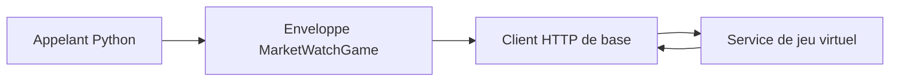

# marketwatch : Un client pour un jeu boursier virtuel

> marketwatch est un client Python archivé pour le jeu boursier virtuel de MarketWatch. Il regroupe connexion, lecture du jeu et ordres simulés. Ces…

- Page HTML: https://antoineboucher.info/CV/blog/fr/projects/notes/marketwatch/
- Langue: fr
- Traduction (en): https://antoineboucher.info/CV/blog/projects/notes/marketwatch/index.md
- Publié: 2026-10-23
- Mis à jour: 2026-10-23
- Auteur: Antoine Boucher (https://antoineboucher.info/CV/index-en.html)

- Dépôt: https://github.com/antoinebou12/marketwatch
- Licence: Apache-2.0
- Révision inspectée: 9a8bd76c464501f249aff141f1e105e7345155c6

## Résumé

marketwatch est un client Python archivé pour le jeu boursier virtuel de MarketWatch. Il regroupe connexion, lecture du jeu et ordres simulés. Ces opérations concernent le jeu, sans connexion à un compte de courtage.

**Pourquoi il existe:** Client Python robuste pour interagir avec le jeu boursier virtuel de MarketWatch.

**Cas d’usage:** Développement de bots de trading automatisés et analyse de portefeuilles.

## Langages (octets GitHub Linguist)

| Langage | % |
| --- | ---: |
| Python | 77.68 |
| Jupyter Notebook | 13.22 |
| Jinja | 7.65 |
| Dockerfile | 1.45 |

## Démarrage (commandes du dépôt, non exécutées ici)

### README.md · Installation

```bash
pip install marketwatch
```

### README.md · Installation

```bash
pip install git+https://github.com/antoinebou12/marketwatch.git
```

### README.md · Installation

```bash
git clone https://github.com/antoinebou12/marketwatch.git
```


## Fonctions et composants

- **Session et périmètre du jeu** — MarketWatchGame hérite de MarketWatch et conserve l’identifiant du jeu. buy et sell délèguent au client de base avec cet identifiant. Les opérations de registre et de portefeuille sont liées au jeu.
- **Dépendance distante** — Le client dépend de l’authentification et des réponses du site. La présence d’une méthode Python ne signifie pas que l’opération distante reste accessible. Un échec de connexion peut bloquer les méthodes sans changement local.

## Architecture

Composants et connexions vérifiés dans le dépôt.

- Appelant Python → Enveloppe MarketWatchGame
- Enveloppe MarketWatchGame → Client HTTP de base
- Client HTTP de base → Service de jeu virtuel
- Service de jeu virtuel → Client HTTP de base



**Un parcours dans le code:** Suivez buy depuis l’enveloppe jusqu’au client de base. L’enveloppe ajoute l’identifiant; la session et la requête HTTP se trouvent plus bas.

## Limites et points à vérifier

Le README indique que la connexion est bloquée par un CAPTCHA. Ce client historique ne doit pas être présenté comme une intégration de trading automatisé fonctionnelle.

## Fichiers à lire

- [marketwatch/game.py](https://github.com/antoinebou12/marketwatch/blob/main/marketwatch/game.py)
- [marketwatch/__init__.py](https://github.com/antoinebou12/marketwatch/blob/main/marketwatch/__init__.py)
- [README.md](https://github.com/antoinebou12/marketwatch/blob/main/README.md)


