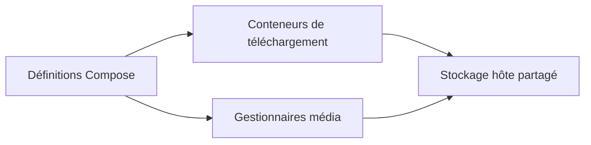

# MediaBoxDockerCompose : Une pile média reliée par volumes et réseaux

> MediaBoxDockerCompose rassemble des services homelab avec Docker Compose. Son architecture réside surtout dans les définitions, chemins partagés et…

- Page HTML: https://antoineboucher.info/CV/blog/fr/projects/notes/mediaboxdockercompose/
- Langue: fr
- Traduction (en): https://antoineboucher.info/CV/blog/projects/notes/mediaboxdockercompose/index.md
- Publié: 2026-10-23
- Mis à jour: 2026-10-23
- Auteur: Antoine Boucher (https://antoineboucher.info/CV/index-en.html)

- Dépôt: https://github.com/antoinebou12/MediaBoxDockerCompose
- Licence: MIT
- Révision inspectée: 57d930a836819f7fd3a3421ee5ece5efe3e41778

## Résumé

MediaBoxDockerCompose rassemble des services homelab avec Docker Compose. Les définitions de services, chemins partagés et connexions réseau décrivent leur fonctionnement commun.

**Pourquoi il existe:** Stack GitOps complète combinant réseau sécurisé WireGuard VPN et plus de 15 microservices d'automatisation homelab.

**Cas d’usage:** Serveur multimédia privé conteneurisé avec accès distant chiffré et routage sécurisé.

## Cas d’utilisation

Pile Docker Compose pour un serveur multimédia maison : téléchargements automatisés, Plex/Jellyfin, outils d’admin et proxy Caddy.

- **Démarrer la pile multimédia** (Admin du homelab, Hôte Docker): docker-compose.yml définit une vingtaine de conteneurs qui lisent PUID, PGID, TZ et ROOT dans .env ; docker-compose up -d les lance tous.
- **Automatiser le téléchargement** (Admin du homelab, Hôte Docker): Sonarr, Radarr, Lidarr et Bazarr gèrent séries, films, musique et sous-titres, alimentés par Jackett, Prowlarr ou NZBHydra2 et confiés à Deluge ou NZBGet, le tout sous ${ROOT}.
- **Regarder ou demander un titre** (Spectateur, Hôte Docker): Plex (port 32400) et Jellyfin (port 8096) diffusent la bibliothèque ; Ombi et Jellyseerr reçoivent les demandes et Tautulli suit l’activité de Plex.
- **Surveiller et parcourir l’hôte** (Admin du homelab, Hôte Docker): Netdata (port 19999) affiche les métriques, FileBrowser donne accès aux fichiers et Dashmachine (port 5000) sert de page d’accueil configurée par dashmachine/config.ini.
- **Publier via Caddy** (Admin du homelab): caddy/Caddyfile relie des sous-domaines comme sonarr.{$DOMAIN} aux ports locaux, avec journaux, limite de débit, liste d’IP permises et authentification de base tirée de caddy/.env.
- **Ajouter des services en option** (Admin du homelab, Hôte Docker): Des fichiers compose distincts sous extra/ ajoutent un partage Samba, un serveur d’accès WireGuard et Portainer ; whisper/docker-compose.yml lance un service Whisper ASR sur le port 9000.

### Scénario : Monter un serveur séries et films sur une machine

1. Installer Docker et Docker Compose, puis cloner le dépôt.
2. Modifier .env : régler TZ, PUID, PGID, ROOT (par exemple /media/MediaBox) et PLEX_CLAIM.
3. Lancer docker-compose up -d à la racine du dépôt.
4. Ouvrir Prowlarr sur le port 9696 et Sonarr sur le port 8989 pour relier indexeurs et client de téléchargement.
5. Pointer Plex (port 32400) ou Jellyfin (port 8096) vers les dossiers terminés sous ROOT, puis regarder.

## Technologies vérifiées

- Docker Compose — docker-compose.yml multi-service stack
- WireGuard VPN — Secure VPN tunnel integration
- Whisper AI — Automated audio transcription worker
- Portainer — Container management interface

## Démarrage (commandes du dépôt, non exécutées ici)

### README.md · Usage

```bash
docker-compose up -d
```


### Docker

```bash
docker-compose up -d
```

## Fonctions et composants

- **Rôles des services** — Le fichier Compose contient des clients de téléchargement et gestionnaires comme Deluge, Jackett, Sonarr et Radarr. Chaque conteneur a son image et sa configuration. Les liens du README doivent être distingués des services réellement activés.
- **Chemins persistants** — Les volumes relient les chemins des conteneurs au stockage hôte. Les services doivent s’accorder sur les chemins lors d’un déplacement de fichiers. Réseau et persistance résolvent deux problèmes d’intégration différents.

## Architecture

Composants et connexions vérifiés dans le dépôt.

- Définitions Compose → Conteneurs de téléchargement
- Définitions Compose → Gestionnaires média
- Conteneurs de téléchargement → Stockage hôte partagé
- Gestionnaires média → Stockage hôte partagé



**Un parcours dans le code:** Choisissez un service et comparez ses volumes de téléchargement et bibliothèque à ceux du consommateur. Vérifiez ensuite réseau et ports. Deux conteneurs en bon état peuvent ne pas partager la même vue des fichiers.

## Services Compose

| Service | Runtime | Ports | Dépend de |
| --- | --- | --- | --- |
| plex | plexinc/pms-docker | 32400:32400 |  |
| wireguard | linuxserver/wireguard | 51820:51820/udp |  |
| whisper | local build / compose | 9000:9000 |  |
| portainer | portainer/portainer-ce | 9443:9443 |  |
| samba | dperson/samba | 139:139, 445:445 |  |

## Limites et points à vérifier

Les images et services externes évoluent séparément. Vérifiez identifiants, ports publiés et permissions hôte avant de lancer cette pile personnelle ailleurs.

## Fichiers à lire

- [docker-compose.yml](https://github.com/antoinebou12/MediaBoxDockerCompose/blob/master/docker-compose.yml)
- [README.md](https://github.com/antoinebou12/MediaBoxDockerCompose/blob/master/README.md)


