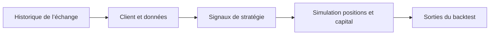

# nova-backtest : Des bougies historiques à la simulation

> nova-backtest est un fork archivé d’un framework de backtesting. Sa classe centrale choisit un client d’échange, charge une période historique et gère…

- Page HTML: https://antoineboucher.info/CV/blog/fr/projects/notes/nova-backtest/
- Langue: fr
- Traduction (en): https://antoineboucher.info/CV/blog/projects/notes/nova-backtest/index.md
- Publié: 2026-10-23
- Mis à jour: 2026-10-23
- Auteur: Antoine Boucher (https://antoineboucher.info/CV/index-en.html)

- Dépôt: https://github.com/antoinebou12/nova-backtest
- Licence: MIT
- Révision inspectée: dda19e6e09bdd59dd483a964f2e47085d2a1bdef

## Résumé

nova-backtest est un fork archivé d’un framework de backtesting. Sa classe centrale choisit un client d’échange, charge une période historique et gère un capital simulé avec des contraintes de position.

**Pourquoi il existe:** Moteur de backtest financier communiquant avec les API d'exchanges crypto pour stratégies quantitatives.

**Cas d’usage:** Validation de stratégies algorithmiques sur données historiques.

## Cas d’utilisation

Bibliothèque Python qui télécharge les chandelles des plateformes crypto et teste une stratégie avec profits et drawdown.

- **Télécharger l’historique** (Auteur de stratégies, API REST de plateforme): BackTest.get_historical_data (novalabs-backtest/utils/backtest.py) appelle le client de la plateforme et garde les données OHLCV dans database/<exchange>/hist_<pair>_<candle>.csv, à partir du 2019-01-01.
- **Choisir une plateforme** (Auteur de stratégies, API REST de plateforme): clients() (novalabs-backtest/clients/clients.py) renvoie un client Binance, Bybit, OKX, Huobi, KuCoin, MEXC, Oanda ou BTCEX, chacun conforme à BackTestClientInterface.
- **Définir entrées et sorties** (Auteur de stratégies): Une stratégie hérite de BackTest et remplit build_indicators, entry_strategy (entry_signal, take_profit, stop_loss, position_size) et exit_strategy (exit_signal).
- **Lancer le backtest** (Auteur de stratégies): run_backtest simule les positions par paire avec les frais de la plateforme, un nombre maximal de positions et une durée de détention maximale, puis trace le profit cumulé.
- **Enregistrer les statistiques** (Auteur de stratégies): L’exécution écrit results/<strategy>_pairs_stats.csv et results/<strategy>_overall_stats.json avec rendements, drawdown et chiffres par paire.
- **Créer des indicateurs** (Auteur de stratégies): TechnicalIndicatorsCreation (novalabs-backtest/utils/indicators.py) ajoute décalages, ratios de clôture et niveaux de support ou de résistance à un DataFrame de chandelles.

### Scénario : Tester une stratégie MACD sur des paires Binance

1. Installer les dépendances de requirements.txt (la commande pip du README écrit le paquet novelabs-backtest).
2. Hériter de BackTest avec exchange="binance", candle="1h", list_pairs=["BTCUSDT", "ETHUSDT"], un capital de départ, un levier et max_pos.
3. Calculer l’histogramme MACD dans build_indicators et fixer entry_signal, take_profit et stop_loss dans entry_strategy.
4. Appeler run_backtest() ; les paires absentes sont téléchargées dans database/binance/ la première fois.
5. Lire le graphique de profit et les fichiers JSON et CSV écrits sous results/.

## Langages (octets GitHub Linguist)

| Langage | % |
| --- | ---: |
| Python | 99.74 |
| Dockerfile | 0.26 |

## Fonctions et composants

- **Entrées et clients** — BackTest reçoit l’échange, la stratégie, l’intervalle, les paires et les dates. La classe construit un client avec la factory clients et charge les hypothèses de frais depuis FEES.
- **État de simulation** — Le constructeur conserve le capital initial et courant, le levier, le nombre de positions et leur durée. Le dimensionnement géométrique est une option explicite. Les résultats dépendent de ces hypothèses autant que des signaux.

## Architecture

Composants et connexions vérifiés dans le dépôt.

- Historique de l’échange → Client et données
- Client et données → Signaux de stratégie
- Signaux de stratégie → Simulation positions et capital
- Simulation positions et capital → Sorties du backtest

**Un parcours dans le code:** Lisez le constructeur BackTest avant d’interpréter un graphique. Les frais, le levier et les tailles changent le capital simulé; modifier une hypothèse crée une autre expérience même avec les mêmes données.

## Limites et points à vérifier

Une simulation historique n’est ni une exécution réelle ni une preuve de rendement futur. Ce fork est archivé et les API d’échange doivent être retestées.

## Fichiers à lire

- [novalabs-backtest/utils/backtest.py](https://github.com/antoinebou12/nova-backtest/blob/Master/novalabs-backtest/utils/backtest.py)
- [novalabs-backtest/utils/constant.py](https://github.com/antoinebou12/nova-backtest/blob/Master/novalabs-backtest/utils/constant.py)
- [README.md](https://github.com/antoinebou12/nova-backtest/blob/Master/README.md)

