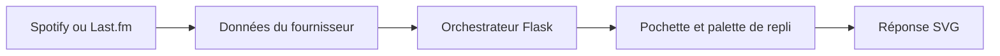

# novatorem : Des données musicales à un widget SVG

> Ce fork novatorem produit des widgets musicaux depuis des services externes. Un orchestrateur Flask gère le rendu; Spotify et Last.fm ont des modules…

- Page HTML: https://antoineboucher.info/CV/blog/fr/projects/notes/novatorem/
- Langue: fr
- Traduction (en): https://antoineboucher.info/CV/blog/projects/notes/novatorem/index.md
- Publié: 2026-10-23
- Mis à jour: 2026-10-23
- Auteur: Antoine Boucher (https://antoineboucher.info/CV/index-en.html)

- Dépôt: https://github.com/antoinebou12/novatorem
- Licence: Unlicense
- Révision inspectée: 5496fe08e19da0da1042236b2600e77b6df39f5d

## Résumé

Ce fork novatorem produit des widgets musicaux depuis des services externes. Un orchestrateur Flask gère le rendu; Spotify et Last.fm ont des modules distincts. La pochette fournit une image et des couleurs au SVG.

**Pourquoi il existe:** Générateur dynamique mettant à jour le profil GitHub avec l'écoute Spotify en temps réel.

**Cas d’usage:** Personnalisation dynamique de profil GitHub via webhooks.

## Cas d’utilisation

Service Flask qui génère une carte SVG « en écoute » depuis Spotify ou Last.fm pour un README de profil GitHub.

- **Afficher le titre en écoute** (Propriétaire du profil, API Web Spotify): La route générique de api/orchestrator.py lit le morceau en cours, tire les couleurs de la pochette et renvoie une carte image/svg+xml ; vercel.json y associe /api/spotify.
- **Personnaliser les couleurs** (Propriétaire du profil): Les paramètres background_color, border_color, background_type, show_status et compact sont validés dans api/config.py avant le rendu du gabarit Jinja2 choisi dans api/templates.json.
- **Utiliser Last.fm comme source** (Propriétaire du profil, API Last.fm): Si seuls LAST_FM_API_KEY et LAST_FM_USERNAME sont définis, ou si l’authentification Spotify échoue, get_now_playing passe à api/lastfm.py, qui peut chercher la pochette sur Deezer.
- **Ouvrir le morceau en cours** (Propriétaire du profil, API Web Spotify): GET /redirect envoie le visiteur vers l’URL du morceau, ou vers le dépôt d’origine si rien ne joue.
- **Renouveler le jeton Spotify** (Propriétaire du profil, API Web Spotify): scripts/spotify_local_auth.py capte le code OAuth sur http://127.0.0.1:8000/callback et écrit un nouveau jeton, avec option --update-vercel pour le pousser vers Vercel.
- **Prévisualiser en local** (Propriétaire du profil): python start.py crée .venv, installe les dépendances, lance Flask sur le port 5000 et ouvre /preview ; docker-compose.yml exécute la même application avec une vérification /health.

### Scénario : Ajouter une carte Spotify à un profil GitHub

1. Créer une application Spotify avec l’URI de redirection http://127.0.0.1:8000/callback.
2. Copier .env.example vers .env et remplir SPOTIFY_CLIENT_ID et SPOTIFY_SECRET_ID.
3. Lancer python scripts/spotify_local_auth.py pour obtenir SPOTIFY_REFRESH_TOKEN.
4. Lancer python start.py et vérifier la carte sur http://127.0.0.1:5000/preview.
5. Déployer sur Vercel et intégrer <déploiement>/api/spotify comme image liée à /redirect dans le README du profil.

## Langages (octets GitHub Linguist)

| Langage | % |
| --- | ---: |
| Python | 81.61 |
| Jinja | 16.06 |
| HTML | 1.64 |
| Dockerfile | 0.64 |
| Procfile | 0.04 |

## Fonctions et composants

- **Fournisseur et présentation** — api/orchestrator.py contient Flask et les fonctions de rendu. Les modules des fournisseurs sont à côté. La configuration pilote modèles et palettes, séparant l’accès propre au service de l’apparence du SVG.
- **Traitement de la pochette** — ImageData récupère la pochette une fois par objet et réutilise les octets pour le base64 et les palettes ColorThief. load_image_with_fallback essaie l’image, un remplacement, puis des couleurs par défaut en cas d’échec.

## Architecture

Composants et connexions vérifiés dans le dépôt.

- Spotify ou Last.fm → Données du fournisseur
- Données du fournisseur → Orchestrateur Flask
- Orchestrateur Flask → Pochette et palette de repli
- Pochette et palette de repli → Réponse SVG

**Un parcours dans le code:** Suivez ImageData._fetch vers get_base64 et get_palette. Réutiliser les octets évite des téléchargements répétés dans cet objet, sans constituer un cache persistant entre requêtes.

## Limites et points à vérifier

La récupération d’image désactive actuellement la vérification TLS avec verify=False. Ce point doit être corrigé avant de s’appuyer sur des pochettes distantes en production.

## Fichiers à lire

- [api/orchestrator.py](https://github.com/antoinebou12/novatorem/blob/master/api/orchestrator.py)
- [api/spotify.py](https://github.com/antoinebou12/novatorem/blob/master/api/spotify.py)
- [api/lastfm.py](https://github.com/antoinebou12/novatorem/blob/master/api/lastfm.py)

