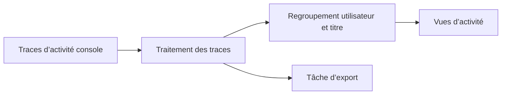

# NX-Activity-Log : Transformer les activités console en vues

> NX-Activity-Log est un fork d’un visualiseur d’activité homebrew Switch. L’application lit les traces de jeu de la console et présente des résumés par…

- Page HTML: https://antoineboucher.info/CV/blog/fr/projects/notes/nx-activity-log/
- Langue: fr
- Traduction (en): https://antoineboucher.info/CV/blog/projects/notes/nx-activity-log/index.md
- Publié: 2026-10-23
- Mis à jour: 2026-10-23
- Auteur: Antoine Boucher (https://antoineboucher.info/CV/index-en.html)

- Dépôt: https://github.com/antoinebou12/NX-Activity-Log
- Licence: MIT
- Révision inspectée: 757928a164399801dca1445a3cb3300f16abda06

## Résumé

NX-Activity-Log est un fork d’un visualiseur d’activité homebrew Switch. L’application lit les traces de jeu de la console et présente des résumés par utilisateur et titre. Ces traces proviennent de la console, et non de l’interface.

**Pourquoi il existe:** Analyseur télémétrique lisant les journaux de jeu Switch bruts sans risque de bannissement.

**Cas d’usage:** Suivi précis et analytique du temps de jeu sur Nintendo Switch.

## Cas d’utilisation

Homebrew Nintendo Switch qui affiche le temps de jeu, les sessions et les lancements par utilisateur, maintenu pour HOS 22.

- **Voir le temps de jeu total** (Joueur Switch, Service PDM (Switch)): L’écran All Activity liste pour chaque jeu le temps total, le nombre de lancements, le premier et le dernier lancement, triés au choix ; les totaux viennent des statistiques PDM du système.
- **Tracer les sessions récentes** (Joueur Switch, Service PDM (Switch)): PlayData::readPlayDataFromPdm parcourt pdmqryQueryPlayEvent par pages ; RecentActivity et Details tracent un graphique par jour, mois ou année et listent chaque session.
- **Exporter ou importer** (Joueur Switch): Les réglages lancent ExportJob, qui écrit /switch/NX-Activity-Log/export.json, et ImportJob, qui lit import.json vers importedData.json en associant les comptes par nom.
- **Personnaliser le thème** (Joueur Switch): CustomTheme et ColourPicker permettent de changer chaque couleur ; un PNG placé à /config/NX-Activity-Log/background.png sert de fond.
- **Mettre à jour dans l’app** (Joueur Switch, Versions GitHub): UpdateUtils.cpp interroge l’API GitHub pour la dernière version d’antoinebou12/NX-Activity-Log et télécharge son premier fichier avec curl.
- **Remplacer la page utilisateur** (Joueur Switch): Forwarder/ est un nx-hbloader modifié qui ouvre l’application depuis la page utilisateur ; le README prévient que ce mode est instable depuis HOS 21.

### Scénario : Transférer l’historique vers une nouvelle Switch

1. Copier NX-Activity-Log.nro depuis la page Releases dans /switch/NX-Activity-Log/ et le lancer depuis le menu homebrew.
2. Choisir un utilisateur, ouvrir les réglages et choisir Export pour écrire export.json.
3. Copier export.json sur la carte SD de l’autre console sous /switch/NX-Activity-Log/import.json.
4. Y lancer Import dans les réglages, puis redémarrer l’application.
5. Vérifier que les sessions importées apparaissent dans Recent Activity et que All Activity affiche les totaux fusionnés.

## Langages (octets GitHub Linguist)

| Langage | % |
| --- | ---: |
| C++ | 92.17 |
| Makefile | 4.16 |
| C | 3.44 |
| Assembly | 0.23 |

## Fonctions et composants

- **Cycle de vie de l’application** — main.cpp crée Main::Application, l’exécute puis le libère. L’arborescence sépare le code console dans nx, l’interface et les utilitaires. Les tâches d’import et d’export possèdent leurs propres fichiers source.
- **Traces et présentation** — Les vues décrites organisent l’activité par utilisateur, jeu et période. L’extraction doit donc rester distincte du regroupement et de l’affichage. Les données exportées sont une sortie supplémentaire, pas un remplacement des traces d’origine.

## Architecture

Composants et connexions vérifiés dans le dépôt.

- Traces d’activité console → Traitement des traces
- Traitement des traces → Regroupement utilisateur et titre
- Regroupement utilisateur et titre → Vues d’activité
- Traitement des traces → Tâche d’export

**Un parcours dans le code:** Commencez par Main::Application et les modules nx avant les vues. Cela distingue une modification des regroupements d’une modification des traces disponibles sur la console.

## Limites et points à vérifier

Il s’agit d’un fork et l’accès aux traces dépend de l’environnement console. Le dépôt ne garantit pas un historique exhaustif ou inviolable.

## Fichiers à lire

- [Application/source/main.cpp](https://github.com/antoinebou12/NX-Activity-Log/blob/main/Application/source/main.cpp)
- [Application/source/Application.cpp](https://github.com/antoinebou12/NX-Activity-Log/blob/main/Application/source/Application.cpp)
- [Application/source/Application.ExportJob.cpp](https://github.com/antoinebou12/NX-Activity-Log/blob/main/Application/source/Application.ExportJob.cpp)

