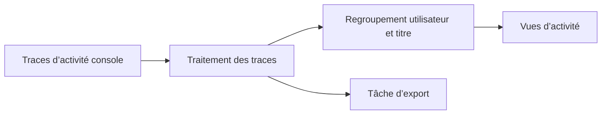

# NX-Activity-Log : Transformer les activités console en vues

> NX-Activity-Log est un fork d’un visualiseur d’activité homebrew Switch. L’application lit les traces de jeu de la console et présente des résumés par…

- Page HTML: https://antoineboucher.info/CV/blog/fr/projects/notes/nx-activity-log/
- Langue: fr
- Traduction (en): https://antoineboucher.info/CV/blog/projects/notes/nx-activity-log/index.md
- Publié: 2026-10-23
- Mis à jour: 2026-10-23
- Auteur: Antoine Boucher (https://antoineboucher.info/CV/index-en.html)

- Dépôt: https://github.com/antoinebou12/NX-Activity-Log
- Licence: MIT
- Révision inspectée: 757928a164399801dca1445a3cb3300f16abda06

## Résumé

NX-Activity-Log est un fork d’un visualiseur d’activité homebrew Switch. L’application lit les traces de jeu de la console et présente des résumés par utilisateur et titre. Ces traces proviennent de la console, et non de l’interface.

**Pourquoi il existe:** Analyseur télémétrique lisant les journaux de jeu Switch bruts sans risque de bannissement.

**Cas d’usage:** Suivi précis et analytique du temps de jeu sur Nintendo Switch.

## Langages (octets GitHub Linguist)

| Langage | % |
| --- | ---: |
| C++ | 92.17 |
| Makefile | 4.16 |
| C | 3.44 |
| Assembly | 0.23 |

## Fonctions et composants

- **Cycle de vie de l’application** — main.cpp crée Main::Application, l’exécute puis le libère. L’arborescence sépare le code console dans nx, l’interface et les utilitaires. Les tâches d’import et d’export possèdent leurs propres fichiers source.
- **Traces et présentation** — Les vues décrites organisent l’activité par utilisateur, jeu et période. L’extraction doit donc rester distincte du regroupement et de l’affichage. Les données exportées sont une sortie supplémentaire, pas un remplacement des traces d’origine.

## Architecture

Composants et connexions vérifiés dans le dépôt.

- Traces d’activité console → Traitement des traces
- Traitement des traces → Regroupement utilisateur et titre
- Regroupement utilisateur et titre → Vues d’activité
- Traitement des traces → Tâche d’export

**Un parcours dans le code:** Commencez par Main::Application et les modules nx avant les vues. Cela distingue une modification des regroupements d’une modification des traces disponibles sur la console.

## Limites et points à vérifier

Il s’agit d’un fork et l’accès aux traces dépend de l’environnement console. Le dépôt ne garantit pas un historique exhaustif ou inviolable.

## Fichiers à lire

- [Application/source/main.cpp](https://github.com/antoinebou12/NX-Activity-Log/blob/main/Application/source/main.cpp)
- [Application/source/Application.cpp](https://github.com/antoinebou12/NX-Activity-Log/blob/main/Application/source/Application.cpp)
- [Application/source/Application.ExportJob.cpp](https://github.com/antoinebou12/NX-Activity-Log/blob/main/Application/source/Application.ExportJob.cpp)

