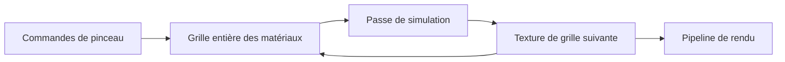

# nxsand : Une grille GPU pour le sable

> nxsand est une simulation de sable sur Switch avec une cible de développement desktop. Les matériaux occupent une grille d’entiers. Des passes mettent…

- Page HTML: https://antoineboucher.info/CV/blog/fr/projects/notes/nxsand/
- Langue: fr
- Traduction (en): https://antoineboucher.info/CV/blog/projects/notes/nxsand/index.md
- Publié: 2026-10-23
- Mis à jour: 2026-10-23
- Auteur: Antoine Boucher (https://antoineboucher.info/CV/index-en.html)

- Dépôt: https://github.com/antoinebou12/nxsand
- Révision inspectée: af70da331e9e74ce0d5bd0365e1447f42cfc97d0

## Résumé

nxsand est une simulation de sable sur Switch avec une cible de développement desktop. Les matériaux occupent une grille d’entiers. Des passes mettent cette grille à jour et un parcours de rendu transforme les identifiants en image.

**Pourquoi il existe:** Moteur de simulation de particules et physique cellulaire optimisé sous libnx.

**Cas d’usage:** Simulation physique interactive sur écran tactile de console.

## Cas d’utilisation

Bac à sable de particules pour Nintendo Switch (homebrew), simulé sur GPU en OpenGL ES 3.0, avec versions bureau.

- **Peindre des matériaux** (Joueur, GPU (OpenGL ES 3.0)): Le tactile, les Joy-Con ou la souris deviennent des traits de pinceau (source/sim/brush_stroke.cpp) écrits dans la grille par shaders/paint.frag ; le bouton X ouvre la roue des matériaux (source/ui/material_wheel.cpp).
- **Voir réagir les matériaux** (Joueur, GPU (OpenGL ES 3.0)): Un automate cellulaire de Margolus tourne sur des textures GL_R8UI en alternance dans shaders/sim.frag ou sim.comp ; les réactions, comme lave plus eau qui donne de la pierre, sont dans shaders/sim_common.glsl et le sim_rules_body.glsl qu’il inclut.
- **Sauver et charger un monde** (Joueur): source/save/save.cpp garde jusqu’à trois emplacements en JSON avec grille en base64 dans sdmc:/switch/nxsand/ (./nxsand_save/ sur bureau) ; Y ou F5 fait une sauvegarde rapide.
- **Régler les performances** (Joueur, GPU (OpenGL ES 3.0)): settings.json et le menu Engine règlent la résolution, les sous-pas, les tuiles actives, le moteur fragment ou compute et les préréglages Battery Saver, Balanced ou Quality.
- **Importer un tampon Powder Toy** (Développeur homebrew): nx::importTptStampJson (source/save/tpt_stamp_import.cpp) associe les éléments de The Powder Toy aux matériaux NXSand et met le tampon à l’échelle de la grille.
- **Compiler et tester le NRO** (Développeur homebrew): make produit build/NXSand.nro avec devkitPro ; make desktop et make test compilent la version bureau SDL2 et les tests de référence CPU de tests/ ; la CI fait de même dans .github/workflows/native-nro.yml.

### Scénario : Compiler NXSand et jouer un premier monde

1. Installer devkitPro, puis lancer dkp-pacman -S switch-dev switch-sdl2 switch-mesa switch-glm switch-freetype switch-harfbuzz.
2. Lancer make à la racine du dépôt pour obtenir build/NXSand.nro.
3. Le copier dans sdmc:/switch/NXSand.nro et le lancer depuis le menu homebrew.
4. Appuyer sur X pour choisir la lave, peindre avec A, puis passer à l’eau et la verser sur la lave pour voir apparaître pierre et fumée.
5. Appuyer sur Y pour sauvegarder le monde dans sdmc:/switch/nxsand/.

## Langages (octets GitHub Linguist)

| Langage | % |
| --- | ---: |
| C++ | 80.07 |
| GLSL | 10 |
| Python | 4.44 |
| PowerShell | 3.32 |
| Makefile | 1.63 |
| Shell | 0.31 |
| Just | 0.23 |

## Démarrage (commandes du dépôt, non exécutées ici)

### README.md · Reference versions (June 2026)

```bash
dkp-pacman -Q libnx switch-sdl2
dkp-pacman -Syu    # pull newer libnx / switch-sdl2 when available
```

### README.md · 2. Install Switch libraries

```bash
dkp-pacman -S switch-dev switch-sdl2 switch-mesa switch-glm switch-freetype switch-harfbuzz
```

### README.md · 3. Build the NRO

```bash
make
```

### README.md · Desktop (optional)

```bash
make desktop
./build/NXSand
make test         # CPU reference tests, no GPU
```

### README.md · Desktop (optional)

```bash
pacman -S --needed mingw-w64-x86_64-gcc mingw-w64-x86_64-make mingw-w64-x86_64-SDL2 mingw-w64-x86_64-freetype mingw-w64-x86_64-angleproject
```


## Fonctions et composants

- **État de simulation** — SimState contient les dimensions, le compteur et les paramètres du pinceau. SimPipeline possède deux textures et framebuffers avec des opérations de peinture, calcul, lecture et chargement. Le stockage alterné conserve la grille précédente pendant le calcul de la suivante.
- **Moteur et tests** — Le parcours fragment utilise GL_R8UI; le parcours compute utilise GL_R32UI pour imageStore. Le pipeline expose les tuiles actives et les replis. Le Makefile sépare les tests CPU, les tests GPU et l’application Switch.

## Architecture

Composants et connexions vérifiés dans le dépôt.

- Commandes de pinceau → Grille entière des matériaux
- Grille entière des matériaux → Passe de simulation
- Passe de simulation → Texture de grille suivante
- Texture de grille suivante → Grille entière des matériaux
- Texture de grille suivante → Pipeline de rendu



**Un parcours dans le code:** Suivez paintDisk vers la modification de grille, puis step vers le moteur choisi. readTexture désigne la grille courante pour le rendu. La sauvegarde doit aussi tenir compte de l’orientation des lignes OpenGL, plutôt que copier une capture.

## Limites et points à vérifier

Les fonctions GPU et les performances dépendent du matériel et du moteur. Les tests desktop ne remplacent pas les mesures sur Switch.

## Fichiers à lire

- [source/gpu/sim_pipeline.hpp](https://github.com/antoinebou12/nxsand/blob/main/source/gpu/sim_pipeline.hpp)
- [source/sim/sim_state.hpp](https://github.com/antoinebou12/nxsand/blob/main/source/sim/sim_state.hpp)
- [Makefile](https://github.com/antoinebou12/nxsand/blob/main/Makefile)


