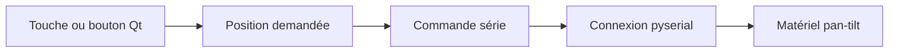

# Pan-Tilt-Controller : Du clavier aux commandes série des moteurs

> Ce contrôleur pan-tilt archivé relie une interface desktop à une unité de positionnement série. L’implémentation combine une boucle Qt et des commandes…

- Page HTML: https://antoineboucher.info/CV/blog/fr/projects/notes/pan-tilt-controller/
- Langue: fr
- Traduction (en): https://antoineboucher.info/CV/blog/projects/notes/pan-tilt-controller/index.md
- Publié: 2026-10-23
- Mis à jour: 2026-10-23
- Auteur: Antoine Boucher (https://antoineboucher.info/CV/index-en.html)

- Dépôt: https://github.com/antoinebou12/Pan-Tilt-Controller
- Révision inspectée: b565efdf9d3fc83096d18c667b6d7a7e21383377

## Résumé

Ce contrôleur pan-tilt archivé relie une interface desktop à une unité de positionnement série. L’implémentation combine une boucle Qt et des commandes pyserial, avec les positions demandées conservées dans des variables globales.

**Pourquoi il existe:** Contrôleur série et démon de mouvement pour unité robotique pan-tilt de précision PTU-46.

**Cas d’usage:** Positionnement robotique de caméras pour la vision par ordinateur.

## Cas d’utilisation

Outils Python 2 (interface et ligne de commande) qui pilotent une tourelle PTU-46-17.5 par port série.

- **Initialiser au démarrage** (Tourelle PTU-46-17.5): Au lancement, pantiltcontroller.py ouvre COM3 à 9600 bauds et envoie les commandes de vitesse, d’accélération, de remise à zéro, de position d’origine et de limites (pxu1500, pnu-1000, tnu-850, txu585).
- **Aller à une position** (Opérateur de labo, Tourelle PTU-46-17.5): La fenêtre PyQt5 de pantiltcontroller.py a des champs Pan et Tilt ; OK envoie pp<valeur> et tp<valeur> et affiche la réponse de la tourelle dans un journal.
- **Déplacer par flèches** (Opérateur de labo, Tourelle PTU-46-17.5): Le menu Control (Ctrl+O) ouvre une fenêtre dont les boutons fléchés, comme les flèches du clavier, déplacent le pan ou le tilt de 5 positions par appui.
- **Revenir à l’origine** (Opérateur de labo, Tourelle PTU-46-17.5): Le bouton Reset envoie pp0 et tp0 et remet les positions mémorisées à zéro.
- **Envoyer des commandes brutes** (Opérateur de labo, Tourelle PTU-46-17.5): PTC-command.py est une invite qui transmet chaque ligne tapée (par exemple r, pnu 1000, pp0) à la tourelle et affiche la réponse jusqu’à la commande exit.

### Scénario : Orienter la tourelle vers une cible

1. Brancher la PTU-46-17.5 sur COM3 (port codé en dur) d’un PC Windows avec Python 2.7, pyserial, PyQt5 et pywin32.
2. Lancer python pantiltcontroller.py ; le script fixe les limites et ramène la tourelle à 0,0.
3. Saisir 500 dans Pan et -200 dans Tilt, puis cliquer sur OK.
4. Ouvrir Control, Control et ajuster avec les flèches par pas de 5.
5. Cliquer sur Reset pour ramener la tourelle à l’origine.

## Langages (octets GitHub Linguist)

| Langage | % |
| --- | ---: |
| Python | 100 |

## Fonctions et composants

- **Événements d’interface** — pantiltcontroller.py utilise PyQt5 et installe un filtre de touches. Les flèches et boutons modifient une position, puis construisent une commande pp ou tp. Ce code diffère de l’ancien framework décrit dans le README.
- **Initialisation du matériel** — Le module ouvre COM3 à 9600 bauds et écrit des commandes dès son chargement. L’interface dépend donc immédiatement du matériel, avant le choix d’un port ou la confirmation d’un mouvement.

## Architecture

Composants et connexions vérifiés dans le dépôt.

- Touche ou bouton Qt → Position demandée
- Position demandée → Commande série
- Commande série → Connexion pyserial
- Connexion pyserial → Matériel pan-tilt

**Un parcours dans le code:** Suivez une flèche depuis positionPan ou positionTilt jusqu’à ser.write. La variable représente la cible commandée, pas une mesure indépendante de la position physique.

## Limites et points à vérifier

Ne chargez pas ce script avec du matériel connecté sans vérifier les mouvements initiaux, limites et arrêts d’urgence. Il utilise aussi une syntaxe de l’époque Python 2.

## Fichiers à lire

- [pantiltcontroller.py](https://github.com/antoinebou12/Pan-Tilt-Controller/blob/master/pantiltcontroller.py)
- [PTC-command.py](https://github.com/antoinebou12/Pan-Tilt-Controller/blob/master/PTC-command.py)
- [README.md](https://github.com/antoinebou12/Pan-Tilt-Controller/blob/master/README.md)

