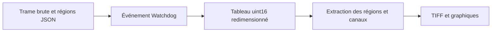

# RawAnalyser : Des valeurs brutes aux graphiques de diagnostic

> RawAnalyser est une ancienne expérience Python pour analyser écrêtage, canaux, gamma et vignettage. Le code expose ses hypothèses d’entrée, dont une…

- Page HTML: https://antoineboucher.info/CV/blog/fr/projects/notes/rawanalyser/
- Langue: fr
- Traduction (en): https://antoineboucher.info/CV/blog/projects/notes/rawanalyser/index.md
- Publié: 2026-10-23
- Mis à jour: 2026-10-23
- Auteur: Antoine Boucher (https://antoineboucher.info/CV/index-en.html)

- Dépôt: https://github.com/antoinebou12/RawAnalyser
- Révision inspectée: ff745802fe293ebba44bf54389509dbb95d0fe5f

## Résumé

RawAnalyser est une ancienne expérience Python pour analyser écrêtage, canaux, gamma et vignettage. Le code expose ses hypothèses d’entrée, dont une taille de trame fixe et des régions choisies dans un fichier JSON.

**Pourquoi il existe:** Outil d'analyse de capteur photographique calculant histogrammes d'écrêtage et plage dynamique sur fichiers RAW.

**Cas d’usage:** Évaluation de capteurs et calibration d'exposition en photographie computationnelle.

## Cas d’utilisation

Scripts Python 2 pour l’ajustement de caméras : vérifier écrêtage, gamma et vignettage dans des images brutes Bayer.

- **Marquer ROI et gris neutres** (Ingé. qualité d’image): GUI.py (PyQt5) ouvre un fichier .raw ou .tiff, convertit le brut en TIFF pour l’affichage et enregistre la zone d’intérêt et les coins des gris cliqués dans json/points.json.
- **Analyser chaque capture brute** (Ingé. qualité d’image, Dossier de captures): RawAnalyser.py surveille le dossier donné avec watchdog ; chaque nouveau fichier brut 1928 x 1088 sur 16 bits est séparé en canaux Bayer, enregistré en TIFF puis analysé.
- **Détecter l’écrêtage** (Ingé. qualité d’image): clipping() affiche les niveaux minimum et maximum sur 10 bits par canal et signale en couleur l’écrêtage du noir ou du blanc quand les valeurs atteignent les limites du capteur.
- **Mesurer gamma et vignettage** (Ingé. qualité d’image): gamma() échantillonne les gris de points.json ; vignette() retire le niveau de noir (--bl, 1024 par défaut), divise par une carte .npy de vignettage et écrit un TIFF corrigé.
- **Inspecter un pixel** (Ingé. qualité d’image): RawPixel.py affiche la valeur et la couleur Bayer du pixel x, y selon la largeur, la hauteur et la profondeur données, et vide les canaux dans array/*.txt.
- **Convertir le brut en TIFF** (Ingé. qualité d’image, Dossier de captures): Raw2Tiff.py écrit un TIFF à partir d’un fichier brut ; 20MPto5MP.py regroupe les images 20 Mpx de l’OV20880 en additionnant des blocs 2 x 2 de même couleur pour obtenir 5 Mpx.

### Scénario : Vérifier une capture de mire OV2740

1. Installer Python 2.7 et les paquets de requirements.txt, ainsi que tifffile.
2. Lancer python GUI.py, ouvrir une capture de raw/ et cliquer la zone d’intérêt et les gris pour mettre à jour json/points.json.
3. Démarrer python RawAnalyser.py raw json/points.json --func basic --bl 1024 pour surveiller le dossier.
4. Copier une nouvelle capture .raw dans raw/ ; le script affiche les alertes d’écrêtage et le gamma et écrit un TIFF sous tiff/.
5. Vérifier un point suspect avec python RawPixel.py <fichier> x y --width 1928 --height 1088.

## Langages (octets GitHub Linguist)

| Langage | % |
| --- | ---: |
| Python | 100 |

## Démarrage (commandes du dépôt, non exécutées ici)

### README.md · Usage

```bash
python RawAnalyser.py <pathfolder> <pointfile> --func <clipping,gamma,vignette,histogram,noHist,basic, default all> --bl <black level, default 1024> --vignette <pathvignette>
```

### README.md · Usage

```bash
python GUI.py
```

### README.md · Usage

```bash
python RawPixel.pt input<file> x y  --bitdepth <8,10,16,default 16>
```


## Fonctions et composants

- **Surveillance et disposition brute** — NewAnalyse réagit à la création d’un fichier, charge les coordonnées et lit des uint16. Le tableau devient une image de 1088 par 1928 pixels, ensuite écrite en TIFF. Ces dimensions sont imposées par le code, pas déduites du fichier.
- **Régions et canaux** — L’analyse construit les matrices de recadrage et de référence grise avant de séparer les canaux par des indices fixes. Les graphiques et statistiques dépendent donc des régions et de la disposition supposée du capteur.

## Architecture

Composants et connexions vérifiés dans le dépôt.

- Trame brute et régions JSON → Événement Watchdog
- Événement Watchdog → Tableau uint16 redimensionné
- Tableau uint16 redimensionné → Extraction des régions et canaux
- Extraction des régions et canaux → TIFF et graphiques



**Un parcours dans le code:** Suivez np.fromfile puis reshape et comparez les limites de recadrage aux boucles de canaux. Un graphique plausible peut rester faux si les dimensions ou la disposition Bayer diffèrent des hypothèses fixes.

## Limites et points à vérifier

La syntaxe Python 2 et les appels scientifiques obsolètes en font du code historique. Ce n’est ni un décodeur RAW général ni un outil de calibration validé.

## Fichiers à lire

- [RawAnalyser.py](https://github.com/antoinebou12/RawAnalyser/blob/master/RawAnalyser.py)
- [GUI.py](https://github.com/antoinebou12/RawAnalyser/blob/master/GUI.py)
- [RawPixel.py](https://github.com/antoinebou12/RawAnalyser/blob/master/RawPixel.py)


