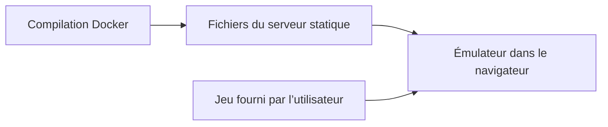

# retroarch-web-games : Préparer un émulateur pour un serveur web statique

> retroarch-web-games est une ancienne configuration conteneur autour de RetroArch web. Le dépôt réunit des fichiers d’exécution navigateur, des scripts…

- Page HTML: https://antoineboucher.info/CV/blog/fr/projects/notes/retroarch-web-games/
- Langue: fr
- Traduction (en): https://antoineboucher.info/CV/blog/projects/notes/retroarch-web-games/index.md
- Publié: 2026-10-23
- Mis à jour: 2026-10-23
- Auteur: Antoine Boucher (https://antoineboucher.info/CV/index-en.html)

- Dépôt: https://github.com/antoinebou12/retroarch-web-games
- Licence: MIT
- Révision inspectée: 71b41f91e252873023336b14d4582aa1ac5e2b44

## Résumé

retroarch-web-games est une ancienne configuration conteneur autour de RetroArch web. Le dépôt réunit des fichiers d’exécution navigateur, des scripts et une image conteneur. Héberger le lecteur et fournir les jeux sont deux responsabilités distinctes.

**Pourquoi il existe:** Émulateur RetroArch conteneurisé en WebAssembly exécutable dans tout navigateur moderne.

**Cas d’usage:** Émulation de jeux rétro dans le navigateur sans installation.

## Langages (octets GitHub Linguist)

| Langage | % |
| --- | ---: |
| HTML | 46.67 |
| JavaScript | 23.61 |
| Python | 13.72 |
| Shell | 11.62 |
| Dockerfile | 4.38 |

## Démarrage (commandes du dépôt, non exécutées ici)

### README.md · Warning 

```bash
docker-compose up -d
```


## Fonctions et composants

- **Assemblage du conteneur** — Le Dockerfile prépare l’environnement web et les éléments d’installation. entrypoint.sh pilote le démarrage du conteneur, tandis qu’index.html et libretro.js appartiennent au parcours navigateur.
- **Exécution et contenu** — Le navigateur charge l’émulateur et ses ressources. Les jeux doivent correspondre au cœur et au format attendus. Les scripts de téléchargement constituent un parcours d’acquisition séparé de l’interface web.

## Architecture

Composants et connexions vérifiés dans le dépôt.

- Compilation Docker → Fichiers du serveur statique
- Fichiers du serveur statique → Émulateur dans le navigateur
- Jeu fourni par l’utilisateur → Émulateur dans le navigateur



**Un parcours dans le code:** Lisez Dockerfile avec entrypoint.sh pour distinguer les téléchargements de compilation du service à l’exécution. Une image compilée peut encore manquer du cœur ou des ressources nécessaires au jeu choisi.

## Limites et points à vérifier

Cette archive demande une revue des dépendances et du navigateur. Utilisez seulement des jeux que vous avez le droit d’utiliser; aucun téléchargement de jeu n’est nécessaire pour examiner l’architecture.

## Fichiers à lire

- [Dockerfile](https://github.com/antoinebou12/retroarch-web-games/blob/master/Dockerfile)
- [entrypoint.sh](https://github.com/antoinebou12/retroarch-web-games/blob/master/entrypoint.sh)
- [index.html](https://github.com/antoinebou12/retroarch-web-games/blob/master/index.html)


