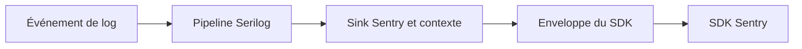

# Serilog.Sinks.SentrySDK : Adapter les événements de logs à Sentry

> Serilog.Sinks.SentrySDK relie un pipeline de journalisation .NET au SDK Sentry. L’application émet des événements structurés; le sink les adapte pour…

- Page HTML: https://antoineboucher.info/CV/blog/fr/projects/notes/serilog-sinks-sentrysdk/
- Langue: fr
- Traduction (en): https://antoineboucher.info/CV/blog/projects/notes/serilog-sinks-sentrysdk/index.md
- Publié: 2026-10-23
- Mis à jour: 2026-10-23
- Auteur: Antoine Boucher (https://antoineboucher.info/CV/index-en.html)

- Dépôt: https://github.com/antoinebou12/Serilog.Sinks.SentrySDK
- Licence: MIT
- Révision inspectée: d0b5c252b942f61f097feccef10ac2d2b43aad7b

## Résumé

Serilog.Sinks.SentrySDK relie un pipeline de journalisation .NET au SDK Sentry. Son sink convertit les événements structurés pour Sentry, ce qui permet aux points d’appel de conserver Serilog.

**Pourquoi il existe:** Sink Serilog .NET 6+ reliant la journalisation structurée à Sentry avec zéro allocation superflue.

**Cas d’usage:** Observabilité des erreurs et traçage distribué pour microservices d'entreprise .NET.

## Langages (octets GitHub Linguist)

| Langage | % |
| --- | ---: |
| C# | 98.04 |
| PowerShell | 1.96 |

## Démarrage (commandes du dépôt, non exécutées ici)

### README.md · Installation

```bash
dotnet add package Serilog.Sinks.SentrySDK
Install-Package Serilog.Sinks.SentrySDK
```

### README.md · Build, run tests, and coverage (local development)

```bash
dotnet restore src/Serilog.Sinks.SentrySDK/Serilog.Sinks.SentrySDK.csproj
dotnet build src/Serilog.Sinks.SentrySDK/Serilog.Sinks.SentrySDK.csproj -c Release
dotnet build src/Serilog.Sinks.SentrySDK.AspNetCore/Serilog.Sinks.SentrySDK.AspNetCore.csproj -c Release
dotnet test src/Serilog.Sinks.SentrySDK.Tests/Serilog.Sinks.SentrySDK.Tests.csproj
dotnet test src/Serilog.Sinks.SentrySDK.AspNetCore.Tests/Serilog.Sinks.SentrySDK.AspNetCore.Tests.csproj
```

### README.md · Build, run tests, and coverage (local development)

```bash
dotnet test /p:CollectCoverage=true /p:CoverletOutputFormat=cobertura /p:CoverletOutput=./reports/coverage src/Serilog.Sinks.SentrySDK.Tests/Serilog.Sinks.SentrySDK.Tests.csproj
```

### README.md · Code formatting (dotnet format)

```bash
dotnet restore src/Serilog.Sinks.SentrySDK.sln
dotnet format src/Serilog.Sinks.SentrySDK.sln
```

### README.md · Code formatting (dotnet format)

```bash
dotnet format src/Serilog.Sinks.SentrySDK.sln --verify-no-changes
```


## Fonctions et composants

- **Frontière entre sink et SDK** — SentrySink.cs définit une interface enveloppant le SDK, avec des méthodes de capture de messages, d’exceptions et de transactions. Son implémentation délègue à SentrySdk. Les tests peuvent remplacer ces appels externes.
- **Contexte applicatif** — L’arborescence distingue le paquet du sink, l’intégration ASP.NET Core et les tests. Des factories de requête et d’utilisateur adaptent le contexte HTTP. La configuration des logs et leur enrichissement ont donc des responsabilités différentes.

## Architecture

Composants et connexions vérifiés dans le dépôt.

- Événement de log → Pipeline Serilog
- Pipeline Serilog → Sink Sentry et contexte
- Sink Sentry et contexte → Enveloppe du SDK
- Enveloppe du SDK → SDK Sentry



**Un parcours dans le code:** Suivez un log contenant une exception et comparez-le à un simple message. L’enveloppe expose des opérations distinctes; un test utile vérifie l’opération choisie et ses données, au-delà de la présence d’un appel.

## Limites et points à vérifier

Le contexte HTTP peut contenir des données personnelles. Vérifiez l’enrichissement et le filtrage avant transmission; la présence du paquet ne constitue pas une politique de confidentialité.

## Fichiers à lire

- [src/Serilog.Sinks.SentrySDK/SentrySink.cs](https://github.com/antoinebou12/Serilog.Sinks.SentrySDK/blob/main/src/Serilog.Sinks.SentrySDK/SentrySink.cs)
- [src/Serilog.Sinks.SentrySDK/AspNetCoreSentryRequestFactory.cs](https://github.com/antoinebou12/Serilog.Sinks.SentrySDK/blob/main/src/Serilog.Sinks.SentrySDK/AspNetCoreSentryRequestFactory.cs)
- [src/Serilog.Sinks.SentrySDK/SentrySinkExtensions.cs](https://github.com/antoinebou12/Serilog.Sinks.SentrySDK/blob/main/src/Serilog.Sinks.SentrySDK/SentrySinkExtensions.cs)


