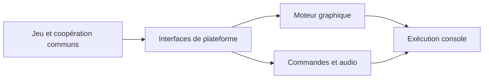

# sm64coopdx-switch-N3DS : Isoler un port derrière les interfaces de plateforme

> Ce fork explore les cibles Switch et New 3DS de sm64coopdx. Le code commun du jeu et de la coopération repose sur des couches graphiques, audio et…

- Page HTML: https://antoineboucher.info/CV/blog/fr/projects/notes/sm64coopdx-switch-n3ds/
- Langue: fr
- Traduction (en): https://antoineboucher.info/CV/blog/projects/notes/sm64coopdx-switch-n3ds/index.md
- Publié: 2026-10-23
- Mis à jour: 2026-10-23
- Auteur: Antoine Boucher (https://antoineboucher.info/CV/index-en.html)

- Dépôt: https://github.com/antoinebou12/sm64coopdx-switch-N3DS
- Révision inspectée: 567fd71a962d44e006461f3085a3a7ca3a063eb4

## Résumé

Ce fork explore les cibles Switch et New 3DS de sm64coopdx. Le code commun du jeu et de la coopération repose sur des couches graphiques, audio et d’entrée propres aux plateformes. La sonde de plateforme a un périmètre plus étroit que le jeu complet.

**Pourquoi il existe:** Portage système en C bas niveau optimisant le réseau multithread et la mémoire pour consoles portables.

**Cas d’usage:** Jeu multijoueur coopératif portable sur consoles Switch et New 3DS.

## Cas d’utilisation

Portage homebrew non officiel de sm64coopdx (coop en ligne) pour Switch, avec une cible New 3DS en chantier ; ROM non fournie.

- **Installer avec sa propre ROM** (Joueur Switch): docs/SWITCH_INSTALL.md : extraire le ZIP à la racine de la carte SD, ajouter une ROM US sous switch/sm64coopdx/baserom.us.z64 conforme à sm64.us.sha1, puis lancer sm64coopdx.nro en mode application complète.
- **Rejoindre un salon CoopNet** (Joueur Switch, Salons CoopNet): La version Switch envoie l’empreinte réelle du NRO et liste les salons de l’espace sm64coop-android, comme l’explique docs/switch.md ; le client se trouve sous src/pc/network/coopnet.
- **Jouer en sans-fil local** (Joueur Switch): src/pc/network/socket/socket_ldn.c ajoute un transport sans fil local et src/pc/djui/djui_panel_ldn_browser.c liste les sessions à proximité.
- **Saisir un mot de passe** (Joueur Switch, Salons CoopNet): Les mots de passe des salons privés passent par le clavier intégré au jeu (src/pc/djui/djui_panel_switch_text_entry.c) plutôt que par le clavier natif de la Switch.
- **Compiler et empaqueter le NRO** (Développeur du portage): Dans l’image Docker devkitpro/devkita64, make -f Makefile.switch-sdmc SWITCH_COOPNET=1 switch-nro compile le NRO et switch-dist vérifie l’en-tête et les empreintes puis écrit le ZIP ; build-switch-game.yml exécute en CI des contrôles sans ROM.
- **Compiler la cible New 3DS** (Développeur du portage): Makefile.new3ds compile une coquille de plateforme et Makefile.new3ds-game le moteur complet avec rendu Citro3D et audio NDSP ; docs/new3ds-port.md précise que le jeu n’est pas encore vérifié sur console.

### Scénario : Jouer en coop en ligne depuis une Switch

1. Extraire le ZIP Switch de sm64coopdx à la racine de la carte SD, ce qui crée switch/sm64coopdx/.
2. Copier votre propre ROM US dans switch/sm64coopdx/baserom.us.z64.
3. Maintenir R en lançant un jeu pour ouvrir le menu homebrew en mode application complète, puis lancer SM64CoopDX.
4. Ouvrir le menu de connexion, choisir un salon CoopNet public et taper son mot de passe sur le clavier du jeu s’il est privé.
5. En cas d’échec, lire startup.log, coopnet.log et exception.log sous switch/sm64coopdx/logs/.

## Langages (octets GitHub Linguist)

| Langage | % |
| --- | ---: |
| C | 82.89 |
| C++ | 10.86 |
| Lua | 4 |
| Python | 1.44 |
| Assembly | 0.49 |
| Shell | 0.13 |
| Pawn | 0.11 |
| Go Template | 0.04 |
| Makefile | 0.03 |
| Dockerfile | 0 |
| Linker Script | 0 |
| PHP | 0 |
| BitBake | 0 |

## Fonctions et composants

- **Exécution commune et moteurs** — src/pc sépare les commandes, l’audio, le rendu, le réseau et la plateforme. Le port peut remplacer un moteur en conservant le comportement commun. Les options de compilation et makefiles déterminent les implémentations liées.
- **La sonde de plateforme** — Makefile.switch-platform compile une sonde avec le cycle de vie Switch, les commandes et les journaux de crash, puis produit un NRO avec devkitPro. Sa liste de sources est plus petite que celle du jeu complet.

## Architecture

Composants et connexions vérifiés dans le dépôt.

- Jeu et coopération communs → Interfaces de plateforme
- Interfaces de plateforme → Moteur graphique
- Interfaces de plateforme → Commandes et audio
- Moteur graphique → Exécution console
- Commandes et audio → Exécution console

**Un parcours dans le code:** Lisez SOURCES dans le makefile de la sonde avant d’interpréter une compilation réussie. Elle exerce certains modules, sans prouver que tous les sous-systèmes, le rendu et la coopération fonctionnent sur console.

## Limites et points à vérifier

Les essais du jeu complet nécessitent des ressources de jeu obtenues légalement par l’utilisateur et une validation matérielle. Le fork conserve le crédit du projet d’origine.

## Fichiers à lire

- [Makefile.switch-platform](https://github.com/antoinebou12/sm64coopdx-switch-N3DS/blob/main/Makefile.switch-platform)
- [src/pc/platform/switch/switch_platform.c](https://github.com/antoinebou12/sm64coopdx-switch-N3DS/blob/main/src/pc/platform/switch/switch_platform.c)
- [Makefile.new3ds](https://github.com/antoinebou12/sm64coopdx-switch-N3DS/blob/main/Makefile.new3ds)

