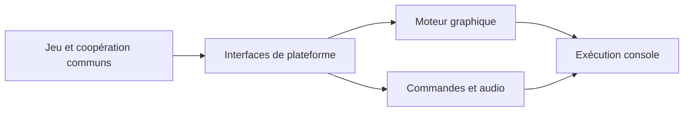

# sm64coopdx-switch-N3DS : Isoler un port derrière les interfaces de plateforme

> Ce fork explore les cibles Switch et New 3DS de sm64coopdx. Le code commun du jeu et de la coopération repose sur des couches graphiques, audio et…

- Page HTML: https://antoineboucher.info/CV/blog/fr/projects/notes/sm64coopdx-switch-n3ds/
- Langue: fr
- Traduction (en): https://antoineboucher.info/CV/blog/projects/notes/sm64coopdx-switch-n3ds/index.md
- Publié: 2026-10-23
- Mis à jour: 2026-10-23
- Auteur: Antoine Boucher (https://antoineboucher.info/CV/index-en.html)

- Dépôt: https://github.com/antoinebou12/sm64coopdx-switch-N3DS
- Révision inspectée: 567fd71a962d44e006461f3085a3a7ca3a063eb4

## Résumé

Ce fork explore les cibles Switch et New 3DS de sm64coopdx. Le code commun du jeu et de la coopération repose sur des couches graphiques, audio et d’entrée propres aux plateformes. La sonde de plateforme a un périmètre plus étroit que le jeu complet.

**Pourquoi il existe:** Portage système en C bas niveau optimisant le réseau multithread et la mémoire pour consoles portables.

**Cas d’usage:** Jeu multijoueur coopératif portable sur consoles Switch et New 3DS.

## Langages (octets GitHub Linguist)

| Langage | % |
| --- | ---: |
| C | 82.89 |
| C++ | 10.86 |
| Lua | 4 |
| Python | 1.44 |
| Assembly | 0.49 |
| Shell | 0.13 |
| Pawn | 0.11 |
| Go Template | 0.04 |
| Makefile | 0.03 |
| Dockerfile | 0 |
| Linker Script | 0 |
| PHP | 0 |
| BitBake | 0 |

## Fonctions et composants

- **Exécution commune et moteurs** — src/pc sépare les commandes, l’audio, le rendu, le réseau et la plateforme. Le port peut remplacer un moteur en conservant le comportement commun. Les options de compilation et makefiles déterminent les implémentations liées.
- **La sonde de plateforme** — Makefile.switch-platform compile une sonde avec le cycle de vie Switch, les commandes et les journaux de crash, puis produit un NRO avec devkitPro. Sa liste de sources est plus petite que celle du jeu complet.

## Architecture

Composants et connexions vérifiés dans le dépôt.

- Jeu et coopération communs → Interfaces de plateforme
- Interfaces de plateforme → Moteur graphique
- Interfaces de plateforme → Commandes et audio
- Moteur graphique → Exécution console
- Commandes et audio → Exécution console

**Un parcours dans le code:** Lisez SOURCES dans le makefile de la sonde avant d’interpréter une compilation réussie. Elle exerce certains modules, sans prouver que tous les sous-systèmes, le rendu et la coopération fonctionnent sur console.

## Limites et points à vérifier

Les essais du jeu complet nécessitent des ressources de jeu obtenues légalement par l’utilisateur et une validation matérielle. Le fork conserve le crédit du projet d’origine.

## Fichiers à lire

- [Makefile.switch-platform](https://github.com/antoinebou12/sm64coopdx-switch-N3DS/blob/main/Makefile.switch-platform)
- [src/pc/platform/switch/switch_platform.c](https://github.com/antoinebou12/sm64coopdx-switch-N3DS/blob/main/src/pc/platform/switch/switch_platform.c)
- [Makefile.new3ds](https://github.com/antoinebou12/sm64coopdx-switch-N3DS/blob/main/Makefile.new3ds)

