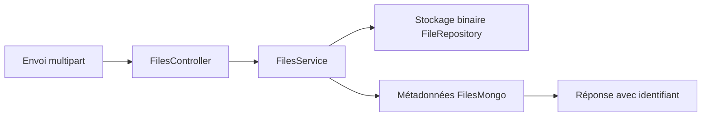

# SpringBootFilesUploader : Séparer les octets et les métadonnées

> SpringBootFilesUploader est un backend Kotlin et Spring qui sépare stockage binaire et métadonnées. L’identifiant retourné au client relie ces deux…

- Page HTML: https://antoineboucher.info/CV/blog/fr/projects/notes/springbootfilesuploader/
- Langue: fr
- Traduction (en): https://antoineboucher.info/CV/blog/projects/notes/springbootfilesuploader/index.md
- Publié: 2026-10-23
- Mis à jour: 2026-10-23
- Auteur: Antoine Boucher (https://antoineboucher.info/CV/index-en.html)

- Dépôt: https://github.com/antoinebou12/SpringBootFilesUploader
- Licence: MIT
- Révision inspectée: 3be3bbc6d828edf840ab6edaffee661db671d7db

## Résumé

SpringBootFilesUploader est un backend Kotlin et Spring qui sépare stockage binaire et métadonnées. L’identifiant retourné au client relie ces deux représentations lors du téléchargement.

**Pourquoi il existe:** Microservice Spring Boot en Kotlin avec téléversement multipart en flux et validation d'intégrité.

**Cas d’usage:** Backend ingestion de fichiers à haut débit.

## Cas d’utilisation

API Spring Boot en Kotlin qui range les fichiers téléversés dans MinIO/S3 derrière des rôles JWT, avec des routes Docker et SSH.

- **S'inscrire et obtenir un JWT** (Utilisateur de l'API, MinIO S3 et MongoDB): POST /auth/signup enregistre l'utilisateur dans MongoDB avec son mot de passe haché et ses rôles ; POST /auth/signin renvoie un JwtResponse avec le jeton et les rôles (AuthController.kt, JwtUtils.kt).
- **Téléverser un document** (Modérateur ou admin, MinIO S3 et MongoDB): POST /files/documents (modérateur ou admin) valide l'extension avec DOC_FILE_EXTENSION_REGEX, écrit le fichier dans le bucket S3 sous files/<uuid>/<nom> et note ses métadonnées dans MongoDB.
- **Télécharger un fichier stocké** (Utilisateur de l'API, MinIO S3 et MongoDB): GET /files/{id} retrouve la fiche du fichier dans MongoDB, lit l'objet dans S3 et le renvoie en pièce jointe avec son type et sa taille.
- **Gérer des conteneurs Docker** (Modérateur ou admin): Les routes /containers listent, créent, démarrent, arrêtent, redémarrent et renomment des conteneurs avec docker-java, sur l'hôte Docker défini dans application.yml (tcp://127.0.0.1:2375).
- **Lancer une commande SSH** (Modérateur ou admin): POST /ssh/cli (admin seulement) ouvre une session Apache SSHD avec l'hôte, le port et les identifiants reçus, puis renvoie la sortie de la commande.

### Scénario : Déposer un PDF puis le récupérer

1. Démarrer MongoDB sur localhost:27017 et MinIO sur localhost:9000, comme le prévoit application.yml, puis lancer ./gradlew bootRun.
2. Envoyer POST /auth/signup avec un nom d'utilisateur, un courriel, un mot de passe et le rôle « mod ».
3. Appeler POST /auth/signin et copier le JWT de la réponse.
4. Envoyer le PDF à POST /files/documents dans le champ multipart « document » avec le jeton Bearer ; la réponse donne fileId et fileName.
5. Appeler GET /files/{fileId} pour télécharger le PDF, ou parcourir les routes dans Swagger UI à /api-docs.

## Langages (octets GitHub Linguist)

| Langage | % |
| --- | ---: |
| Kotlin | 99.52 |
| Java | 0.31 |
| Dockerfile | 0.17 |

## Fonctions et composants

- **Validation HTTP** — FilesController reçoit un document multipart, vérifie l’extension et déclare des rôles modérateur/admin pour l’envoi. Le contrôle de taille est commenté. Le téléchargement utilise un identifiant, le type et la taille conservés.
- **Coordination du stockage** — FilesService crée un chemin fondé sur un UUID et envoie les octets à FileRepository. Il conserve ensuite FileModel par FilesMongo. La lecture cherche d’abord les métadonnées, puis utilise le chemin pour récupérer les octets.

## Architecture

Composants et connexions vérifiés dans le dépôt.

- Envoi multipart → FilesController
- FilesController → FilesService
- FilesService → Stockage binaire FileRepository
- FilesService → Métadonnées FilesMongo
- Métadonnées FilesMongo → Réponse avec identifiant

**Un parcours dans le code:** Suivez addDocument dans FilesService: les octets sont écrits avant les métadonnées. Si la seconde écriture échoue, la première peut laisser un fichier orphelin. Une version de production nécessite un nettoyage ou une stratégie de cohérence explicite.

## Limites et points à vérifier

Les annotations de rôles nécessitent la configuration de sécurité correspondante. L’extension ne valide pas le contenu et document.bytes charge le fichier en mémoire.

## Fichiers à lire

- [src/main/kotlin/com/api/project/controller/FilesController.kt](https://github.com/antoinebou12/SpringBootFilesUploader/blob/main/src/main/kotlin/com/api/project/controller/FilesController.kt)
- [src/main/kotlin/com/api/project/service/FilesService.kt](https://github.com/antoinebou12/SpringBootFilesUploader/blob/main/src/main/kotlin/com/api/project/service/FilesService.kt)
- [build.gradle.kts](https://github.com/antoinebou12/SpringBootFilesUploader/blob/main/build.gradle.kts)

