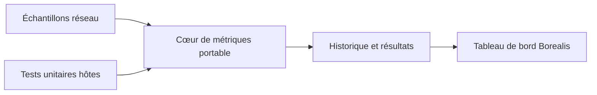

# switch-wifi : Séparer les mesures réseau de l’interface

> switch-wifi est un tableau de bord réseau pour Switch avec une interface Borealis. Il sépare les calculs portables de l’application console pour…

- Page HTML: https://antoineboucher.info/CV/blog/fr/projects/notes/switch-wifi/
- Langue: fr
- Traduction (en): https://antoineboucher.info/CV/blog/projects/notes/switch-wifi/index.md
- Publié: 2026-10-23
- Mis à jour: 2026-10-23
- Auteur: Antoine Boucher (https://antoineboucher.info/CV/index-en.html)
- Dépôt: https://github.com/antoinebou12/switch-wifi
- Licence: MIT
- Révision inspectée: 8ff883f6925c37b14b9683f8b933a9403654d08d

## Résumé

switch-wifi est un tableau de bord réseau pour Switch avec une interface Borealis. Il sépare les calculs portables de l’application console pour permettre de tester le cœur sans la chaîne de compilation Switch.

**Pourquoi il existe:** Utilitaire C++ natif communiquant directement avec les services wlan de l'OS Switch.

**Cas d’usage:** Configuration réseau rapide pour console Switch sans interface complexe.

## Langages (octets GitHub Linguist)

| Langage | % |
| --- | ---: |
| C++ | 86.58 |
| CMake | 8.31 |
| Python | 5.11 |

## Démarrage (commandes du dépôt, non exécutées ici)

### README.md · Recommended: official devkitPro container

```bash
git clone --recursive https://github.com/antoinebou12/switch-wifi.git
cd switch-wifi
```

### README.md · Recommended: official devkitPro container

```bash
docker run --rm \
  -v "$PWD:/work" -w /work \
  devkitpro/devkita64:latest \
  bash -lc 'cmake -S . -B build-switch \
    -DPLATFORM_SWITCH=ON \
    -DUSE_GLFW=ON \
    -DCMAKE_BUILD_TYPE=Release && \
    cmake --build build-switch --target switch-wifi.nro --parallel'
```

### README.md · Recommended: official devkitPro container

```bash
python3 scripts/verify_nro.py build-switch/switch-wifi.nro
```

### README.md · Native devkitPro installation

```bash
cmake -S . -B build-switch -DPLATFORM_SWITCH=ON -DUSE_GLFW=ON -DCMAKE_BUILD_TYPE=Release
cmake --build build-switch --target switch-wifi.nro --parallel
```


## Fonctions et composants

- **Cœur de calcul portable** — CMake construit switch_wifi_core depuis src/core/metrics.cpp. Les tests hôtes utilisent cette bibliothèque indépendamment de Borealis. Ils couvrent les métriques, l’historique et les benchmarks, avec des sanitizers optionnels.
- **Intégration console** — La cible applicative rassemble les modules src et lie Borealis, les bibliothèques libnx et libcurl. Le réseau et l’interface dépendent donc de la plateforme, tandis que le cœur numérique peut rester indépendant.

## Architecture

Composants et connexions vérifiés dans le dépôt.

- Échantillons réseau → Cœur de métriques portable
- Cœur de métriques portable → Historique et résultats
- Historique et résultats → Tableau de bord Borealis
- Tests unitaires hôtes → Cœur de métriques portable



**Un parcours dans le code:** Partez de la bibliothèque et de ses tests, puis examinez le module réseau qui fournit les mesures. Un débit HTTPS dépend du serveur et du trajet réseau; ce n’est pas une lecture directe de la capacité radio Wi-Fi.

## Limites et points à vérifier

Une valeur radio inaccessible doit rester indisponible, sans devenir zéro. La configuration de compilation ne prouve pas la compatibilité ou la précision sur chaque firmware.

## Fichiers à lire

- [CMakeLists.txt](https://github.com/antoinebou12/switch-wifi/blob/main/CMakeLists.txt)
- [src/core/metrics.cpp](https://github.com/antoinebou12/switch-wifi/blob/main/src/core/metrics.cpp)
- [src/main.cpp](https://github.com/antoinebou12/switch-wifi/blob/main/src/main.cpp)

