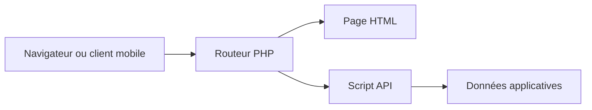

# TCH099 : Un routeur PHP pour les pages et l’API

> TCH099 est un projet pédagogique qui combine pages frontend statiques et API PHP. Les routes exposent la frontière: certains chemins retournent du HTML,…

- Page HTML: https://antoineboucher.info/CV/blog/fr/projects/notes/tch099/
- Langue: fr
- Traduction (en): https://antoineboucher.info/CV/blog/projects/notes/tch099/index.md
- Publié: 2026-10-23
- Mis à jour: 2026-10-23
- Auteur: Antoine Boucher (https://antoineboucher.info/CV/index-en.html)
- Dépôt: https://github.com/antoinebou12/TCH099
- Licence: MIT
- Révision inspectée: a7323c88b2ae6c12d89ef685c6a4cf4325218afc

## Résumé

TCH099 est un projet pédagogique qui combine pages frontend statiques et API PHP. Les routes exposent la frontière: certains chemins retournent du HTML, tandis que d’autres appellent des scripts serveur.

**Pourquoi il existe:** Environnement multi-conteneurs isolé avec réseau bridge, persistance MariaDB et interface web.

**Cas d’usage:** Référence d'architecture conteneurisée pour application et base de données.

## Langages (octets GitHub Linguist)

| Langage | % |
| --- | ---: |
| HTML | 30.29 |
| PHP | 24.43 |
| Java | 24.06 |
| Jupyter Notebook | 9.1 |
| Shell | 7.27 |
| Python | 3.99 |
| Dockerfile | 0.7 |
| CSS | 0.15 |

## Technologies vérifiées

- Docker Compose — docker-compose.yml
- MariaDB — Service image mariadb:latest in docker-compose.yml
- Azure — README and .github/workflows/README.md describe Azure deployment
- REST API — routes.php API routes

## Démarrage (commandes du dépôt, non exécutées ici)

### README.md · Utilisation de Docker

```bash
docker-compose up -d --build
```

### README.md · Initialisation de la base de données

```bash
cd db
python3 -m pip install mysql-connector-python python-dotenv
python3 db.py
```

### scripts/README.md · Ubuntu/Debian

```bash
sudo usermod -aG docker $USER
newgrp docker  # or log out and back in
```

### scripts/README.md · Installing Docker Compose

```bash
sudo curl -L "https://github.com/docker/compose/releases/download/v2.20.3/docker-compose-$(uname -s)-$(uname -m)" -o /usr/local/bin/docker-compose && \
sudo chmod +x /usr/local/bin/docker-compose
```

### scripts/README.md · Verifying Installation

```bash
docker --version
docker run hello-world
docker-compose --version
```

### scripts/README.md · Automated Installation

```bash
curl -fsSL https://raw.githubusercontent.com/yourusername/docker-install/main/install-docker.sh -o install-docker.sh
chmod +x install-docker.sh
sudo ./install-docker.sh
```


## Fonctions et composants

- **Routes des pages** — routes.php charge router.php, associe accueil et connexion aux fichiers frontend et définit les pages 403 et 404. Le callback /admin vérifie explicitement isAdmin avant de choisir la réponse.
- **Scripts API** — Connexion, inscription, déconnexion et user_details ont leurs scripts API. Des routes de démonstration incluent une langue et une image aléatoire. Les scripts traitent les requêtes; le routeur choisit leur destination.

## Architecture

Composants et connexions vérifiés dans le dépôt.

- Navigateur ou client mobile → Routeur PHP
- Routeur PHP → Page HTML
- Routeur PHP → Script API
- Script API → Données applicatives



**Un parcours dans le code:** Comparez GET /login et POST /api/login. Le premier choisit une page; le second lance l’authentification. Les contrôles doivent protéger les opérations API autant que la page administrative.

## Services Compose

| Service | Runtime | Ports | Dépend de |
| --- | --- | --- | --- |
| web | Build from Dockerfile | 8001:80 | db, startup order only |
| db | mariadb:latest | 3306:3306 |  |
| phpmyadmin | phpmyadmin/phpmyadmin | 8060:80 | db, startup order only |

## API


- `POST /api/login`
- `POST /api/signup`
- `POST /api/logout`
- `GET /api/user_details`
- `GET /api/clients`
- `GET /admin`
- `GET, POST /api/hello-world/$langue`
- `GET, POST /api/random-image`

## Limites et points à vérifier

Une démonstration de routes ne constitue pas une revue de sécurité. Sessions, requêtes et secrets de déploiement demandent une inspection distincte avant hébergement public.

## Fichiers à lire

- [routes.php](https://github.com/antoinebou12/TCH099/blob/main/routes.php)
- [router.php](https://github.com/antoinebou12/TCH099/blob/main/router.php)
- [README.md](https://github.com/antoinebou12/TCH099/blob/main/README.md)

