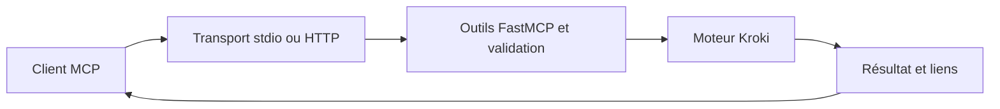

# uml-mcp : D’un appel MCP à un diagramme

> uml-mcp expose des outils de diagrammes aux clients MCP. Le client fournit une source et des options; le serveur valide la demande, l’oriente vers les…

- Page HTML: https://antoineboucher.info/CV/blog/fr/projects/notes/uml-mcp/
- Langue: fr
- Traduction (en): https://antoineboucher.info/CV/blog/projects/notes/uml-mcp/index.md
- Publié: 2026-10-23
- Mis à jour: 2026-10-23
- Auteur: Antoine Boucher (https://antoineboucher.info/CV/index-en.html)

- Dépôt: https://github.com/antoinebou12/uml-mcp
- Licence: MIT
- Révision inspectée: ebaeac6eb6737639cd1fd5e92967408309a9a64d

## Résumé

uml-mcp expose des outils de diagrammes aux clients MCP. Le client fournit une source et des options; le serveur valide la demande, l’oriente vers les services de rendu et retourne les résultats avec des liens d’édition.

**Pourquoi il existe:** Serveur phare Model Context Protocol (MCP) générant PlantUML, Mermaid et Kroki directement depuis des LLMs (Claude, Cursor, ChatGPT) sans dépendance locale.

**Cas d’usage:** Génération interactive de diagrammes d'architecture pour le pair programming avec IA et la documentation.

## Langages (octets GitHub Linguist)

| Langage | % |
| --- | ---: |
| Python | 90.9 |
| TypeScript | 7.99 |
| Shell | 0.31 |
| CSS | 0.26 |
| Go Template | 0.23 |
| Makefile | 0.14 |
| Dockerfile | 0.11 |
| JavaScript | 0.03 |
| HTML | 0.02 |

## Démarrage (commandes du dépôt, non exécutées ici)

### README.md · Quick start

```bash
git clone https://github.com/antoinebou12/uml-mcp.git
cd uml-mcp
uv sync
uv run python server.py
```

### README.md · Quick start

```bash
git remote add origin https://github.com/antoinebou12/uml-mcp.git
```

### tests/mcp-rig/README.md · Running

```bash
make mcp-rig
```

### tests/mcp-rig/README.md · Running

```bash
uvx mcp-rig@0.1.0 run tests/mcp-rig/
uvx mcp-rig@0.1.0 run tests/mcp-rig/ --tag smoke
uvx mcp-rig@0.1.0 run tests/mcp-rig/generate.yaml --case "batch*"
uvx mcp-rig@0.1.0 run tests/mcp-rig/ --server-logs   # show server stderr when debugging
```


## Fonctions et composants

- **Un point d’entrée sans sortie parasite** — server.py délègue le démarrage à mcp_core.core.server. L’objet mcp est résolu à la demande par __getattr__, ce qui évite de construire le serveur ou d’écrire sur stdout lors d’un simple import. C’est important quand stdout transporte le protocole stdio.
- **Transport et rendu** — Le serveur propose des parcours stdio et HTTP. Le cœur regroupe l’enregistrement des outils, la configuration et l’intégration Kroki. Le rendu reste une opération en aval: la couche MCP décrit les outils et transporte leurs entrées et résultats.

## Architecture

Composants et connexions vérifiés dans le dépôt.

- Client MCP → Transport stdio ou HTTP
- Transport stdio ou HTTP → Outils FastMCP et validation
- Outils FastMCP et validation → Moteur Kroki
- Moteur Kroki → Résultat et liens
- Résultat et liens → Client MCP



**Un parcours dans le code:** Partez de server.py, suivez main dans mcp_core, puis examinez l’outil de diagramme avant son moteur. Un appel fournit des arguments structurés, sans rendre automatiquement un texte quelconque valide en Mermaid ou PlantUML.

## API


## Limites et points à vérifier

Le rendu distant transmet la source du diagramme. Vérifiez le service utilisé et sa politique de données avant d’envoyer une architecture interne ou d’autres informations confidentielles.

## Fichiers à lire

- [server.py](https://github.com/antoinebou12/uml-mcp/blob/main/server.py)
- [mcp_core/core/server.py](https://github.com/antoinebou12/uml-mcp/blob/main/mcp_core/core/server.py)
- [README.md](https://github.com/antoinebou12/uml-mcp/blob/main/README.md)


